# Asset Foundry walkthrough

This guide covers every screen in Asset Foundry, one by one. For each screen it shows every button and what pressing it does. Part 1 follows the back-office sidebar from top to bottom. Part 2 is the HAPPY DAFFY arcade, and that part is written in the game's own voice.

If you just want to get through a normal day, start with [Your day](#your-day). It walks you through make, review and sell, and links to the chapter for each screen along the way.

All the pictures come from a throwaway test copy of the app filled with sample data, so every product title starts with "Sample". None of it is your real work. Your own screens will show your own products and numbers.

New to the app? Read [Getting started](../GETTING_STARTED.md) first. It covers installing, starting the app and getting your keys. This guide picks up from there.

## Contents

- [Your day](#your-day)
- [Things every screen shares](#things-every-screen-shares)
- **Part 1: The back office**
  1. [HAPPY DAFFY arcade (menu link)](#1-happy-daffy-arcade-menu-link)
  2. [Dashboard](#2-dashboard)
  3. [Production calendar](#3-production-calendar)
  4. [Research digest](#4-research-digest)
  5. [Research & opportunities](#5-research--opportunities)
  6. [Product library](#6-product-library) (with New product, Build a pack and the product page)
  7. [Imports](#7-imports)
  8. [Factory floor](#8-factory-floor)
  9. [Templates](#9-templates)
  10. [Production jobs](#10-production-jobs)
  11. [QA results](#11-qa-results)
  12. [Batch approval](#12-batch-approval) (with the batch review page)
  13. [Rework](#13-rework)
  14. [Notes for the AI](#14-notes-for-the-ai)
  15. [Marketplace listings](#15-marketplace-listings)
  16. [Publishing status](#16-publishing-status)
  17. [Analytics](#17-analytics)
  18. [Settings & integrations](#18-settings--integrations)
  19. [Student product types](#19-student-product-types)
- **Part 2: [HAPPY DAFFY, the arcade](#part-2-happy-daffy)**
- [Things this guide found that need your call](#things-this-guide-found-that-need-your-call)

---

## Your day

This is the same routine as in Getting started, with a link to the full chapter at each step.

### Morning: see what happened overnight

1. Open the [Dashboard](#2-dashboard). Read any coloured banner at the top first, because each one names a problem and links to its fix.
2. Look at **Awaiting review** and **Failed or QA-failed**. Click either number to go straight to that list.
3. If a production plan ran, the **Schedule** card shows what it made. The [Production calendar](#3-production-calendar) has the full history.

### Make: get new products started

Pick whichever fits the day:

- **From an idea.** Open [Research & opportunities](#5-research--opportunities), click an idea and press **Produce now**. You can also mark good ideas **Approve for production** so your daily plan picks them up.
- **From scratch.** Go to [Product library](#6-product-library), press **New product** and work through the steps.
- **From outside images.** Drop them on [Imports](#7-imports), pick them in order and press **Make coloring product from N selected**.
- **On autopilot.** Set up a plan once in the [Production calendar](#3-production-calendar). It runs by itself while the app is open.

While products are being made you can watch them on [Production jobs](#10-production-jobs), but you don't need to.

### Evening: review

1. Open [Batch approval](#12-batch-approval) and work through every batch. Approve, send back, regenerate or reject each item. Write real notes when you send something back or reject it, because the AI learns from them.
2. Open [Rework](#13-rework) and clear what you can. Press **Mark fixed** on anything you've dealt with.
3. Every so often, look at [Notes for the AI](#14-notes-for-the-ai) and tidy the repeat-problems list.

### Sell: packs, listings and publishing

1. Check the [Factory floor](#8-factory-floor). The products you approved get sorted onto carts by themselves. Press **Pack it** on a full cart if packing isn't automatic, then review the new pack in Batch approval like any other product.
2. Fix any listing marked invalid in [Marketplace listings](#15-marketplace-listings).
3. On [Publishing status](#16-publishing-status), press **Export package** for each approved listing, upload it to the marketplace, then press **Record publication** and paste the live link.

### Weekly

- Read the [Research digest](#4-research-digest) email and press **Save to Research** on the ideas you like.
- Enter or import sales on [Analytics](#17-analytics), then press **Refresh recommendations**.
- Make a backup: **Settings & integrations → Backups → Back up now** ([chapter 18](#backups)).

---

## Things every screen shares

You'll see these on almost every screen, so they're explained once here.

- **The sidebar.** It's grouped into **Make**, **Sell** and **System**. A green number next to an item is a count of things waiting there, for example items awaiting review. Hover over an item to see a one-line description.
- **The AI line under "Asset Foundry".** It says either which AI model is writing the text or "AI not configured".
- **Compact lists.** Long lists sit in a box with a fixed height. The header shows the true total ("Showing 50 of 212 products"). Press **Load more (N more)** at the bottom of the box to see more rows.
- **Preview / Hide preview.** Pictures only load when you press **Preview** on a row, one row at a time, so pages stay quick. The button is greyed out when there's nothing to show yet.
- **"Show done" boxes.** Finished, closed or fixed work is hidden until you tick the box ("Show finished jobs", "Show closed batches", "Show items already marked fixed").
- **Pills.** The small rounded labels show status. Green means fine or done, yellow means waiting or a warning, red means failed, and blue or grey means information.
- **Toasts.** After most buttons, a short message pops up to say what happened ("Plan saved", "Production started").
- **Buttons that ask first.** Anything that deletes, empties or archives opens a "Are you sure?" box before it does anything.
- **Pop-up windows.** Forms such as New product open in a window. **Cancel** or the **×** closes it without saving.

---

# Part 1: The back office

## 1. HAPPY DAFFY arcade (menu link)

The first item in the sidebar opens the arcade cabinet at `/arcade`. It runs on the same factory as the back office, so it uses the same products, keys and data. Everything about it is in [Part 2](#part-2-happy-daffy). To come back, press **BACK OFFICE** at the top of the cabinet.

Right under it, **Missions** opens the same mission list as the arcade's MISSIONS tab, in back-office style: Instructions (the guide chapter in a pop-up), Go, and Mark done or Undo. Progress is shared, so a mission cleared on one side shows as done on the other. See [MISSIONS](#missions) in Part 2.

Every back-office screen also has a round **? Instructions** button in the bottom-right corner. It opens that screen's chapter of this guide in a pop-up, so you can check how something works without leaving the page. Product and batch-review pages show the Product library and Batch approval chapters.

---

## 2. Dashboard

**What it's for:** a summary of what the factory is doing right now. It refreshes itself every few seconds.

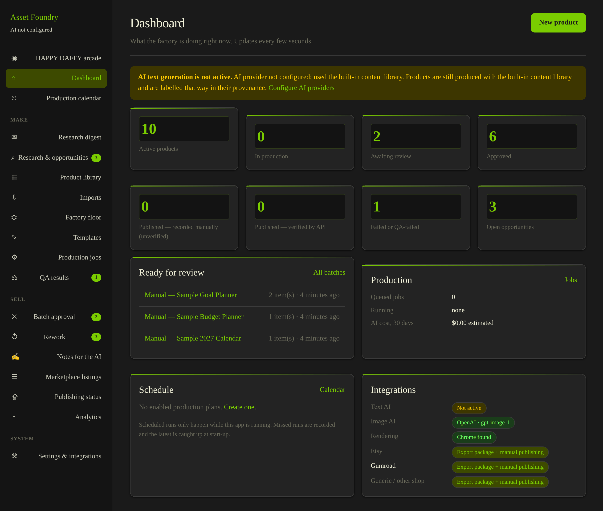

**Top right**
- **New product** opens the New product window on the Product library ([chapter 6](#making-a-new-product)).

**Banners** (each one only shows when it applies)
- **AI text generation is not active.** No text AI key is working, so products are being written from the built-in content library and are labelled that way. The **Configure AI providers** link opens Settings → AI providers.
- **Google Chrome was not found.** PDFs can't be made until Chrome is installed or its path is set. The link opens Settings → Rendering.
- **N listing(s) need reconciliation.** A publish attempt came back with an unknown result. The link opens Publishing status, where you tell the app what happened.

**The eight number tiles.** Each one is a link:

| Tile | Opens |
| --- | --- |
| Active products | Product library |
| In production | Production jobs |
| Awaiting review | Batch approval |
| Approved | Product library, filtered to approved |
| Published (recorded manually, unverified) | Publishing status |
| Published (verified by API) | Publishing status |
| Failed or QA-failed | QA results |
| Open opportunities | Research & opportunities |

**Cards**
- **Ready for review** lists the batches waiting for you. Click a batch name to review it, or click **All batches** to open the full list.
- **Production** shows queued jobs, what's running now and the estimated AI cost over the last 30 days. Recent failures are listed underneath with their error. **Jobs** opens Production jobs.
- **Schedule** shows the next planned run and the latest runs. **Calendar** opens the Production calendar. If there are no plans it says so, with a **Create one** link. Runs only happen while the app is open.
- **Integrations** shows whether text AI, image AI and Chrome are ready. The text and image rows name the provider that will answer next and its model, such as "NVIDIA NIM · (model)". If your first choice has no key and a backup will answer instead, the row says so, for example "Google Gemini · (model) (backup for NVIDIA NIM)". The card also shows, and for each marketplace whether it can post directly or uses an export package that you upload yourself.

---

## 3. Production calendar

**What it's for:** daily production plans, what ran, what was missed and what's coming up.

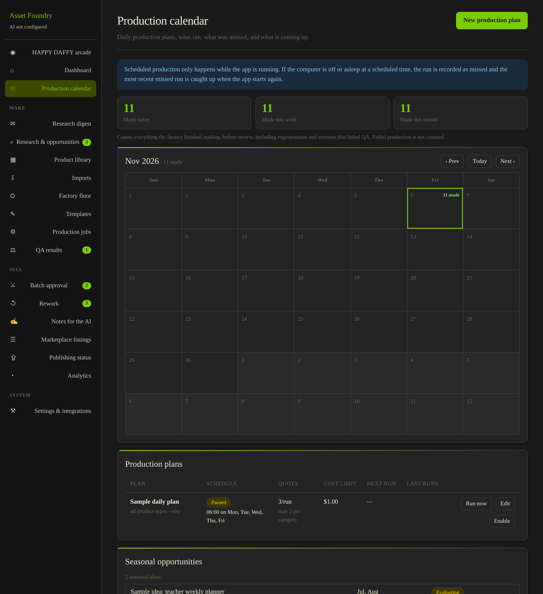

**The blue banner** is a reminder that plans only run while the app is open. If the computer is off or asleep at the set time, the run is recorded as missed, and the most recent missed run is caught up when the app starts again.

**Made today / this week / this month.** These count everything the factory finished making, before review. That includes regenerations and versions that failed QA. Production that failed outright isn't counted. Weeks start on Sunday.

**The month grid**
- **‹ Prev** and **Next ›** move a month at a time. **Today** jumps back to this month. The header shows how many things were made in the month on screen.
- Each day shows how many things were made ("3 made") and up to four events. Green is a finished run, yellow a missed run, red a failed run, blue a run in progress and grey a run that's coming up. Click a run to open its batch. "+N more" means there are more events that day, and hovering over it lists them.

**Production plans card**

Each row shows the plan's name, product types and marketplaces, whether it's enabled, its time and days, its quota, its cost limit, the next run and the last three runs (with a **batch** link for each).
- **Run now** starts a run straight away, whatever the schedule says.
- **Edit** opens the plan editor.
- **Pause** / **Enable** switches the plan off or on without deleting it.

**New production plan** (top right, or **Create a plan** when the list is empty) opens the plan editor:

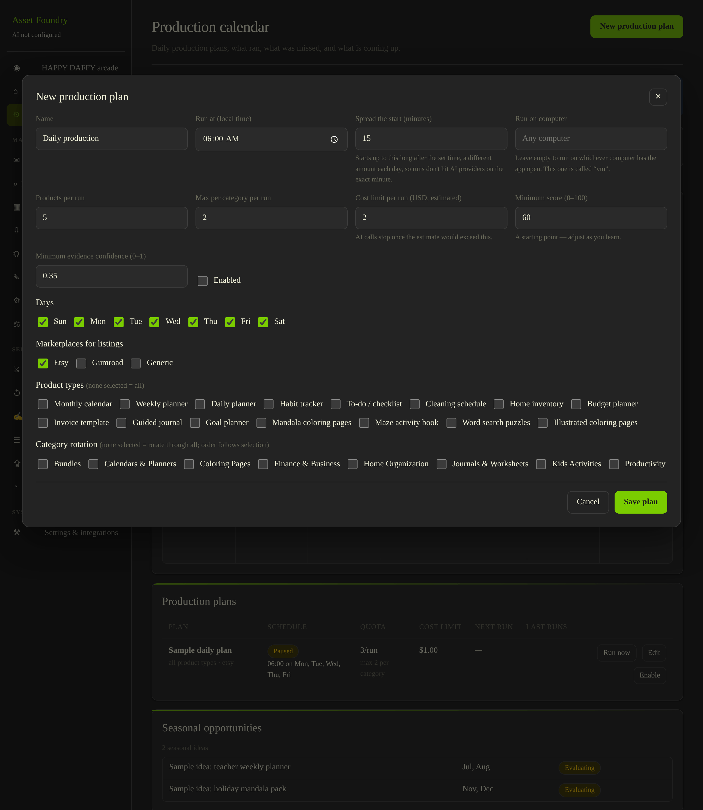

| Field | What it does |
| --- | --- |
| Name | Your label for the plan. |
| Run at (local time) | The start time. |
| Spread the start (minutes) | Starts up to this many minutes late, a different amount each day, so runs don't hit the AI providers on the exact minute. |
| Run on computer | Leave it empty to run on whichever computer has the app open, or type a computer's name to tie the plan to it. The window tells you this computer's name. |
| Products per run | How many products one run makes. |
| Max per category per run | Stops one category from taking the whole run. |
| Cost limit per run (USD, estimated) | AI calls stop once the estimate would go over this. |
| Minimum score (0–100) and Minimum evidence confidence (0–1) | An idea has to clear both to be picked, unless you marked it **Approve for production**, which always counts. |
| Enabled | Ticked means it runs on schedule. |
| Days | Which weekdays it runs. |
| Marketplaces for listings | Which marketplaces get listings drafted. |
| Product types | Tick some to limit the plan. Leave all unticked for every type. |
| Category rotation | Tick categories to take turns through them in the order you tick them. Leave all unticked to rotate through every category. |

At the bottom: **Save plan**, **Cancel**, and on an existing plan **Delete**. Delete asks first, and the plan's past runs only stay in the history while the plan exists.

**How a run picks what to make.** It looks at open ideas in Research (new, evaluating or approved). It skips anything that was already produced in the last 30 days, and anything blocked by the trademark list. It keeps ideas you approved and ideas that clear the score and confidence minimums. Then it takes the best-scoring ones, rotating through categories, until it hits the quota. Everything it makes lands in one new batch in Batch approval.

**Seasonal opportunities** (only shown when you have ideas with peak months) lists those ideas with their months and status.

---

## 4. Research digest

**What it's for:** every few days the app searches the web for what's selling, checks the competitor shops you list, comes up with new ideas, puts them through three rounds of critique and emails you the result.

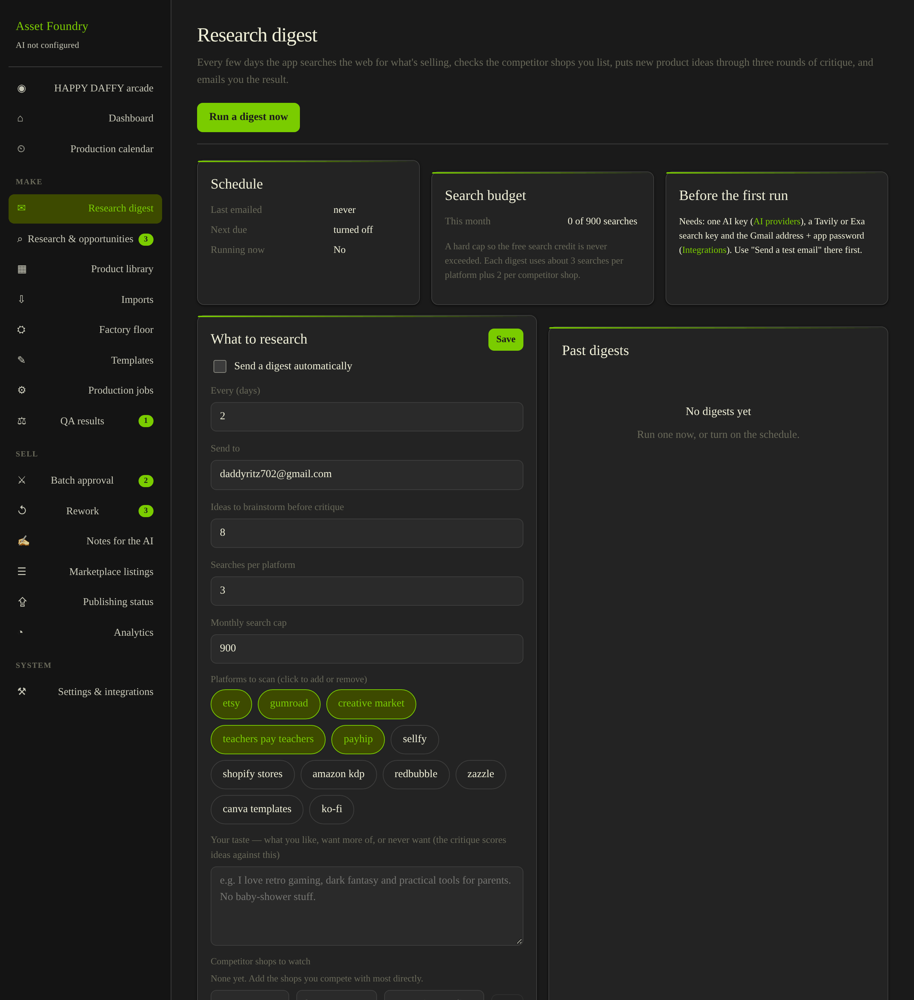

**Before the first run** it needs three things: an AI key (Settings → AI providers), a Tavily or Exa search key, and the Gmail address and app password (both in Settings → Integrations). Press **Send a test email** there first.

**Top right**
- **Run a digest now** starts one straight away. It takes a few minutes. The **Running now** line on the Schedule card changes to Yes while it works.

**Schedule card:** when the last digest was emailed, when the next one is due ("turned off" if the schedule is off) and whether one is running.

**Search budget card:** how many searches this month out of your cap. Each digest uses about 3 searches per platform plus 2 per competitor shop. The cap is a hard stop, so the free search credit is never overspent.

**What to research card.** Change anything here, then press **Save** in the card's corner.
- **Send a digest automatically.** Turns the schedule on or off.
- **Every (days).** How often it runs.
- **Send to.** The address the digest goes to.
- **Ideas to brainstorm before critique.** How many rough ideas the AI starts with.
- **Searches per platform** and **Monthly search cap.** These control how much search it uses.
- **Platforms to scan.** Click a chip to add or remove it. Up to 15 can be on.
- **Your taste.** Write what you like, want more of or never want. The critique scores ideas against this.
- **Competitor shops to watch.** Type the platform, the shop's web address (it has to start with http) and an optional name, then press **Add**. **Remove** takes a shop off the list. Adding and removing save straight away.

**Past digests card.** One row per digest, with its date, what started it, how many searches it used and its status (sent, failed or running). **Open** shows the digest and **Hide** folds it away again. An opened digest has:
1. **What's selling:** findings per platform. Each finding is marked "number checked", "cited" or "AI inference", and has source links where there are any. Gaps are listed underneath.
2. **Competitors:** each shop's strengths (+) and gaps (−).
3. **Ideas:** how many were brainstormed, how many survived critique and how many are proposed. Each proposed idea shows its buyer, money, prices, what to make first, risks and evidence. **Save to Research** copies the idea into Research & opportunities. **All candidates and the critique** opens the full critique of every idea.

---

## 5. Research & opportunities

**What it's for:** ideas worth making, the evidence behind them and a score that shows its working. Nothing here is invented, and missing data stays "unknown".

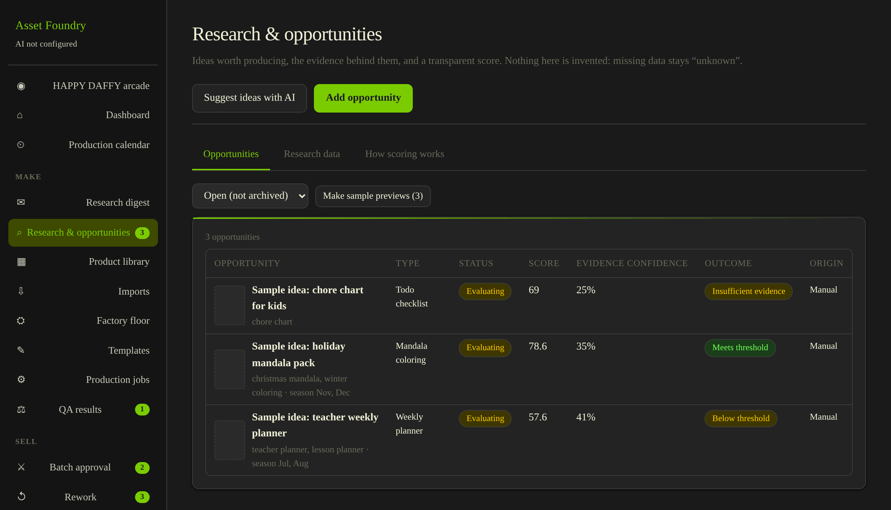

**Top right**
- **Suggest ideas with AI** opens a small window. Set **How many** (1 to 10) and an optional **Focus**, then press **Suggest**. The new ideas are labelled "AI idea". They carry no demand data, because the AI is told not to invent search volumes or sales, so add real research before you rely on them.
- **Add opportunity** opens the idea form: Title, Product type, Audience, Theme, Search keywords (comma separated), Description, "What would make it different?" and the **Peak season months** (leave them unticked if the idea is evergreen). Press **Save**, and the new idea opens.

**Tabs:** Opportunities, Research data, How scoring works.

### Opportunities tab

- The **status filter** shows open ideas by default. Pick New, Evaluating, Approved, Produced, Rejected or Archived to see those instead.
- **Make sample previews (N)** draws a free sample page for every idea in the list that has no preview or an out-of-date one. The button only shows when there's something to draw.
- Each row shows a small SAMPLE picture (if one has been made), the title, keywords and season, then the type, status, score, evidence confidence, outcome and where the idea came from. **Click a row to open the idea.**

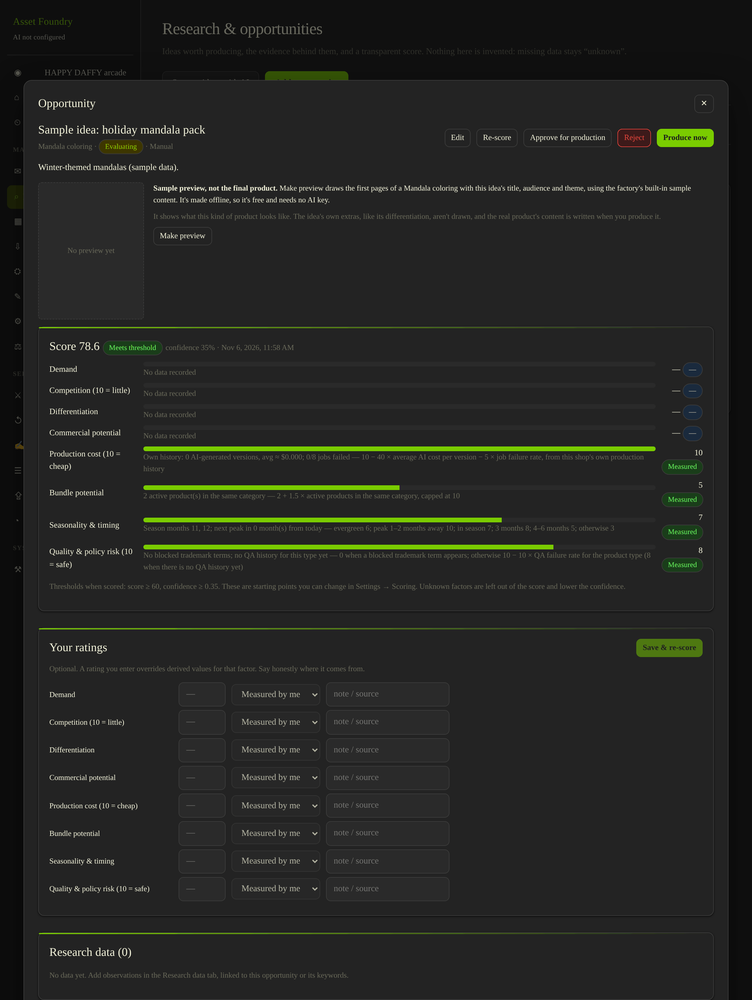

**Inside an idea**
- **Edit** opens the same form as Add opportunity.
- **Re-score** works the score out again from the current evidence.
- **Approve for production** marks the idea so production plans always pick it, whatever its score.
- **Reject** marks it rejected, so plans skip it.
- **Produce now** starts making a product from it straight away and opens that product's page.
- **Sample preview.** **Make preview** (or **Remake preview**) draws the first pages of this product type with the idea's title, audience and theme. It's made offline, so it's free and needs no AI key. It's always labelled SAMPLE because it isn't the final product, and it doesn't draw the idea's own extras. If you edit the title, type, audience or theme, it's marked out of date. Illustrated coloring ideas can't get a free sample, because their pages need an image AI.
- **The score card** lists each factor with its value, where it came from and its evidence kind. Factors with no data show "—". They're left out of the score and lower the confidence instead.
- **Your ratings.** Type your own 0–10 value for any factor, choose where it came from (Measured by me, External estimate or AI hypothesis) and add a note or source. Then press **Save & re-score**. Your rating overrides the worked-out value for that factor.
- **Research data** lists the observations linked to this idea or its keywords.
- **Products made from this** links to every product made from the idea.

### Research data tab

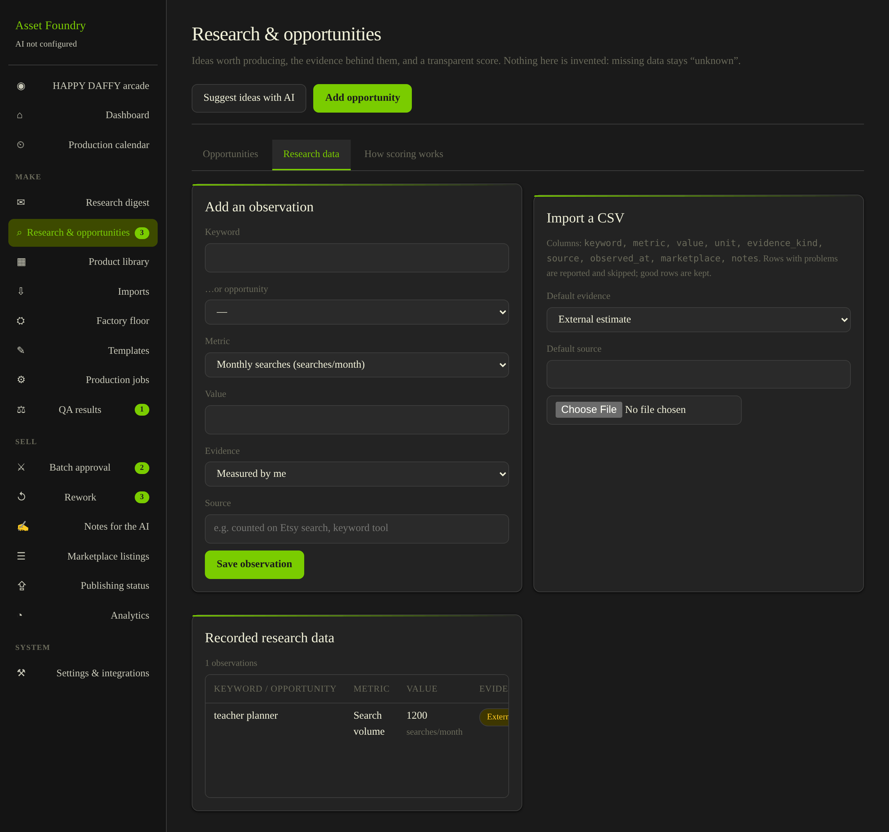

- **Add an observation.** Enter a keyword or pick an idea, then the metric, value, evidence kind (Measured by me, External tool estimate or AI hypothesis) and source. Press **Save observation**.
- **Import a CSV.** Pick the default evidence kind and source, then choose a file. The columns are listed on the card. Rows with problems are reported by row number and skipped, and the good rows are kept.
- **Recorded research data** lists everything recorded so far.

### How scoring works tab

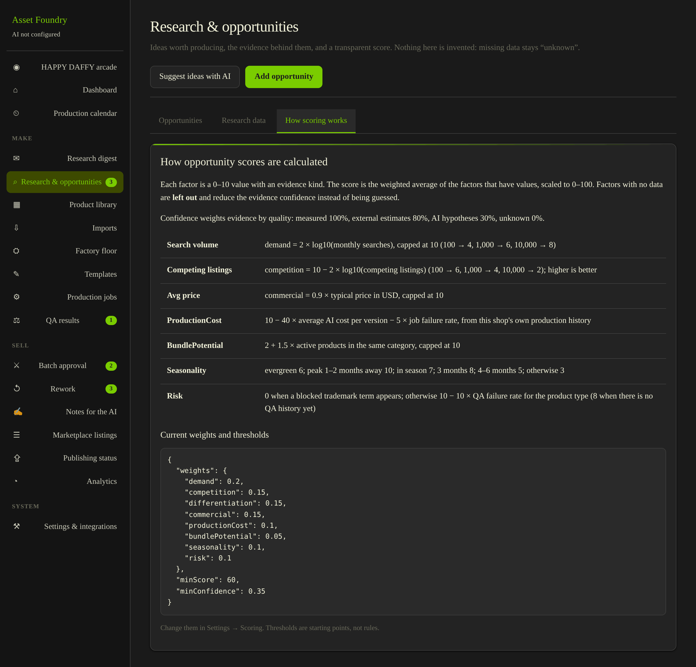

This tab explains the maths. Each factor is a 0–10 value. The score is the weighted average of the factors that have values, scaled to 0–100. Confidence weights each piece of evidence by quality: measured 100%, external estimates 80%, AI hypotheses 30% and unknown 0%. The current weights and thresholds are shown underneath, and you change them in Settings → Scoring.

---

## 6. Product library

**What it's for:** every product you have, its current version and where it is in production.

### Gallery and List

**Gallery** (the default) shows your newest approved work: the last 5 product types you made, up to 4 approved items of each. Click a card to open that product.

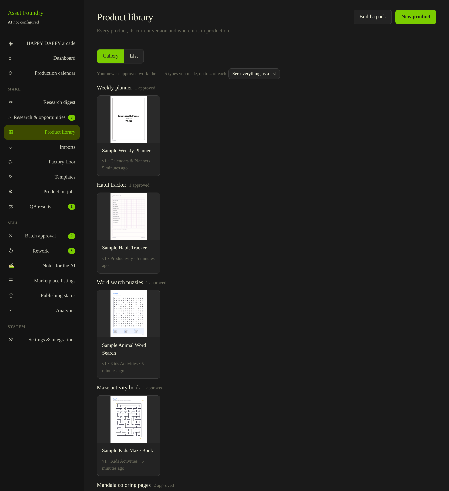

**List** shows everything. Links from the Dashboard open the List with a filter already set.

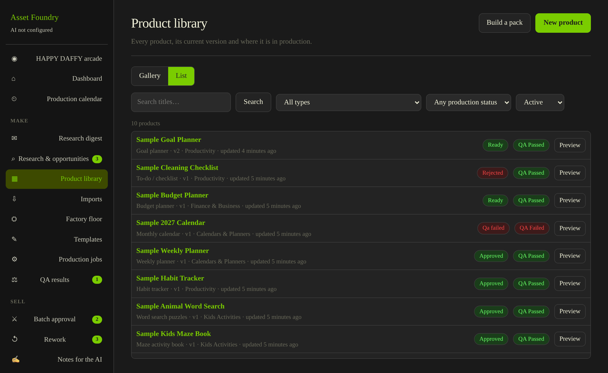

- **Search titles…** then **Search** finds products by title.
- The **type** dropdown narrows the list to one product type.
- The **production status** dropdown: In progress, Ready, Approved, QA failed, Failed or Rejected.
- The **product status** dropdown: Active (the default), Archived, Retired or All.
- Each row shows the title (click it to open the product), type, version number, category, when it was last updated and status pills. **Preview** shows the cover.

**Top right:** **Build a pack** and **New product**, both explained below.

### Making a new product

**New product** opens a step-by-step window. Each step appears once you've answered the one before.

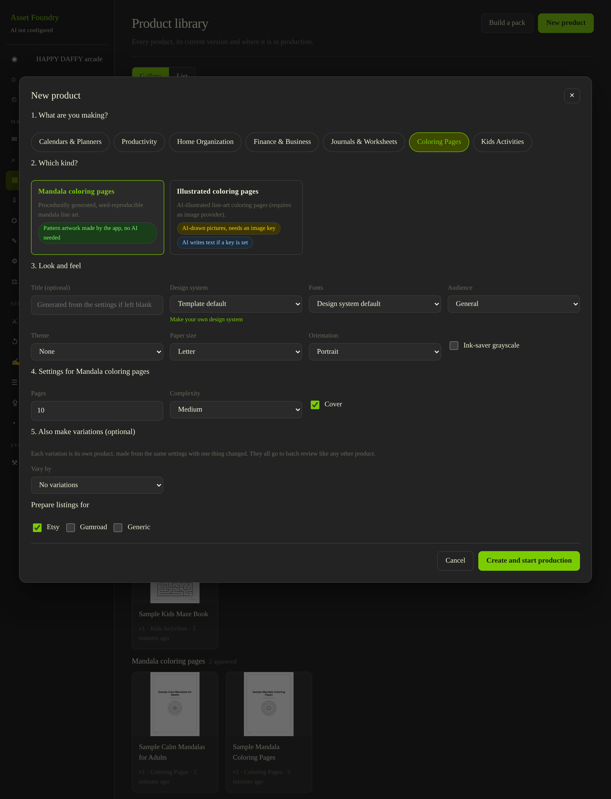

1. **What are you making?** Click a category chip. The categories and the kinds in each:

   | Category | Kinds |
   | --- | --- |
   | Calendars & Planners | Monthly calendar, Weekly planner |
   | Productivity | Daily planner, Habit tracker, To-do / checklist, Goal planner |
   | Home Organization | Cleaning schedule, Home inventory |
   | Finance & Business | Budget planner, Invoice template |
   | Journals & Worksheets | Guided journal |
   | Coloring Pages | Mandala coloring pages, Illustrated coloring pages |
   | Kids Activities | Maze activity book, Word search puzzles |
   | School & Study | Assignment tracker, Class timetable, Reading log. See [Student product types](#19-student-product-types) |
   | Geometric Patterns | Geometric pattern art: pick a **Family** (tessellate, girih, op art, Truchet, guilloche, fractal, lace or herringbone) and a **Mode**: coloring for black line art to color in, or print for wall art in the design system's colors |

   Imported coloring pages are made from the [Imports](#7-imports) screen instead, and packs from **Build a pack**.
2. **Which kind?** Click a product type. Each card says whether its pictures are drawn by the app (no AI needed), drawn by an image AI (needs an image key), or come from your imports, and whether the AI writes its text when a key is set. If you pick a type that needs an image key and none is saved, a yellow banner warns you that production will fail.
3. **Look and feel.**
   - **Title** is optional. If you leave it blank, one is made from the settings.
   - **Design system** sets colours, fonts and layout. The **Make your own design system** link opens Templates.
   - **Fonts.** Leave it on the design system's default, pick a pairing (grouped into everyday, bold display, hollow outline and decorative), or choose **Pick fonts myself…** to set the heading, body and accent fonts one by one. A sample underneath shows the fonts in use.
   - **Audience**, **Theme**, **Paper size**, **Orientation** and **Ink-saver grayscale**.
4. **Settings for (type).** These fields change with the type: pages, cover, week start and so on. Mandala coloring pages, for example, have **Detail** (simple, medium, detailed or intricate: 3, 5, 7 or 10 rings), **Symmetry** (how many times the design repeats around its centre; Auto lets each page choose) and **Motif set** (classic, botanical, geometric or celestial shapes).
5. **Also make variations (optional).** Pick something to **Vary by** (design system, font pairing, audience, theme, paper size, new random artwork, or one of the type's own settings), then tick the values you want, up to 12. Each variation becomes its own product, the same as the first in every way except that one thing.
6. **Prepare listings for.** Tick Etsy, Gumroad and/or Generic.

Press **Create and start production**. If you added variations, the button says **Create N products** instead. Production starts and the product's page opens. When it's ready it shows up in Batch approval.

### Building a pack by hand

**Build a pack** opens the pack builder. (The [Factory floor](#8-factory-floor) does the same thing automatically.)

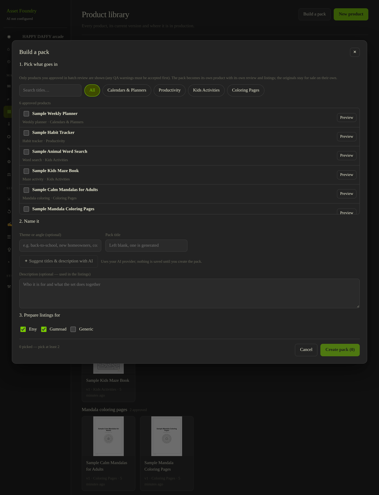

1. **Pick what goes in.** Only products you've approved in batch review are listed, and any QA warnings on them have to be accepted first. Search by title or click a category chip to narrow the list. Tick between 2 and 20 products. **Preview** shows each one's cover.
2. **Name it.** **Theme or angle** is optional. **Pack title** is made for you if you leave it blank. **✦ Suggest titles & description with AI** offers a few titles (click a chip to use one) and writes a description. Nothing is saved until you create the pack. You can also type the **Description** yourself.
3. **Prepare listings for.** Tick Etsy, Gumroad and/or Generic.

Press **Create pack (N)**. The pack becomes its own product, with its own review and listings, and the products inside it stay for sale on their own too.

### The product page

Click any product title anywhere in the app to open its page.

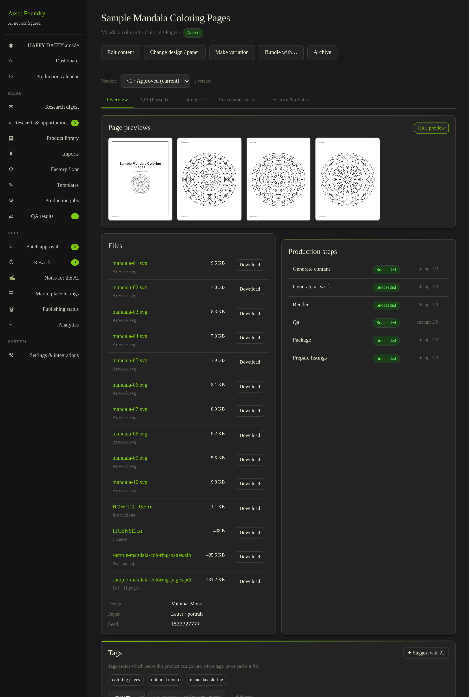

**The line under the title** shows the type, category, audience, theme and status. If the product came from an idea, a link to that idea sits underneath.

**Buttons along the top**
- **Edit content** opens the product's content as raw JSON text that you can change. **Save as new version** makes a new version, draws it again and re-runs QA. Any approval of the current version is withdrawn. You can add a change note.
- **Change design / paper** lets you pick a different design system, paper size, orientation or grayscale and see a preview. **Re-render as new version** keeps the content and changes only the look.
- **Make variation** makes a separate product linked to this one. It has to differ in design, audience, theme, paper or settings, because a new title alone isn't a variation. Press **Create variation**.
- **Bundle with…** opens Build a pack with this product already ticked. It's hidden on packs.
- **Archive** hides the product under Archived in the library (it asks first). On an archived product the button says **Restore** instead.

**Version dropdown.** It lists every version and its status. Picking an older one shows a blue banner that says so.

**Banners**
- A blue "In production" banner shows the current stage, and the page updates by itself.
- A red "Production failed" banner has a **Retry failed step** button.
- A red "QA failed" banner tells you to fix the problem with Edit content or Change design, or to regenerate from batch review.

**Tabs**
- **Overview.** Press **Show N page previews** to load the pages, and click one to open it full size. The **Files** card lists each file with **Download**, plus the design, paper and seed. **Production steps** shows each job and its attempts. **Tags** is explained below. **Listing images** load when you press their button.
- **QA.** Every check from each QA run, with failures and warnings marked.

  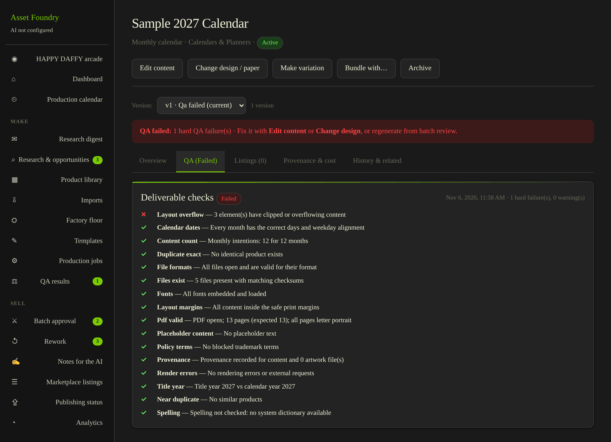

- **Listings.** One card per marketplace with its title, price, tags and who wrote the copy. **Edit listing** opens the listing editor ([chapter 15](#15-marketplace-listings)).
- **Provenance & cost.** Who or what wrote the content, every AI call with its tokens and estimated cost, and where each file came from. Cost is estimated from the price table in Settings, not from an invoice.
- **History & related.** Every version with its notes, related products, very similar products ("consider merging"), products in the same category and the review batches the product has been in.

**Tags card** (on Overview). Tags decide which packs a product can join, so more tags means more packs it fits.
- Tags that come from the product itself are fixed. Tags you or the AI added have an **×** to remove them.
- To add one, pick a kind (theme, audience, season, style or custom), type the tag and press **Add tag**.
- **✦ Suggest with AI** offers tags. Click one to add it. This needs an AI key.

---

## 7. Imports

**What it's for:** bringing in things you made with other tools. Images become coloring-page products. Text you like becomes style examples for the AI. Exact duplicates are skipped automatically.

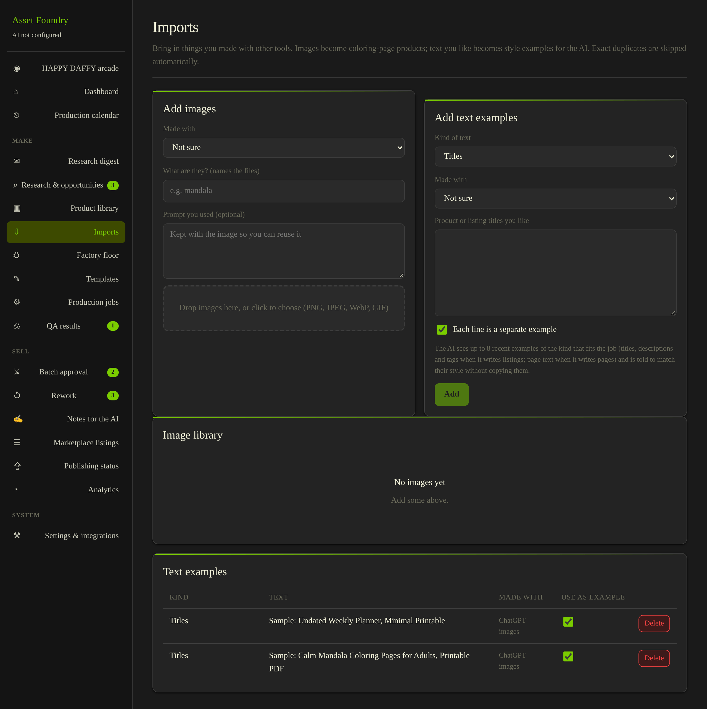

**Add images card**
1. **Made with.** Pick the tool (Grok Imagine, ChatGPT images, Gemini, Midjourney, Canva and so on). Choose **Something else…** to type a name, or **Not sure**.
2. **What are they?** A word such as "mandala". It's used to name the files.
3. **Sort into (tags).** Type a tag such as "fonts" and press Enter, or click one under **Used before**. Every picture you drop gets these tags. A picture can have several tags, so a font sheet can be both **fonts** and **art** and shows up under either. Click × on a tag to take it off. Pictures dropped with no tags, or dropped anywhere else in the app, wait under **To sort**.
4. **Prompt you used** is optional. It's kept with the image so you can reuse it.
5. Drag images onto the drop box, or click it to choose files (PNG, JPEG, WebP or GIF). While they import it counts "Importing 2 of 9…". Afterwards each file shows as imported, duplicate (with which file it matches) or not imported (with why). If you drop a picture that's already in the library, it isn't copied again, but the tags you typed are added to the one that's there. That's a quick way to sort pictures you imported before tags existed.

**Add text examples card**
1. **Kind of text.** Titles, Descriptions, Tags, Page text or Other.
2. **Made with**, as above.
3. Paste the text. Leave **Each line is a separate example** ticked to split it into one example per line.
4. **Sort into (tags)** is optional and works the same as for images. Tags are shared, so **fonts** is the same group for pictures and text.
5. Press **Add**. A message says how many were added and how many duplicates were skipped.

When the AI writes, it sees up to 8 recent examples of the kind that fits the job (titles, descriptions and tags when it writes listings, page text when it writes pages). It's told to match their style without copying them.

**Image library card**
- **Groups row** at the top: **All**, **To sort** (pictures with no tags yet) and one button per tag with how many pictures it holds, e.g. **fonts (12)**. Click one to show only that group; click it again for All.
- Click images to pick them, in the order you want the pages. Each picked image gets a number. **Tick all N shown** picks everything in the group you're looking at; **Untick all** clears the picks.
- With pictures ticked, a **Tags for the N ticked** box appears. Type or click tags, then press **Add tags** or **Remove tags** to change them all at once. Each picture holds up to 12 tags; any already full are skipped, and the message says how many.
- Under each image: its file name, the tool, its size and date, its tags, and which products use it.
- **Edit** changes the tool, prompt and tags. Press **Save** or **Cancel** when you're done.
- **Delete** removes the file (it asks first). It's greyed out while a product uses the image.
- Once you've picked at least one image, a **Product title** box and a **Make coloring product from N selected** button appear in the card's corner. Pressing it starts the product and opens its page. It shows up in Batch approval when it's ready.

**Text examples card.** Every example, with its kind, tool and tags, and the same groups row as the image library. **Edit** beside the tags changes them. Untick **Use as example** to keep an example but stop the AI seeing it. **Delete** removes it (it asks first).

---

## 8. Factory floor

**What it's for:** turning approved products into packs automatically. Every product you approve goes onto a cart with other products that share its tags. When a cart is full it becomes a pack, which goes to review like any other product. Anything that doesn't fit a cart waits in the backlog until the next break.

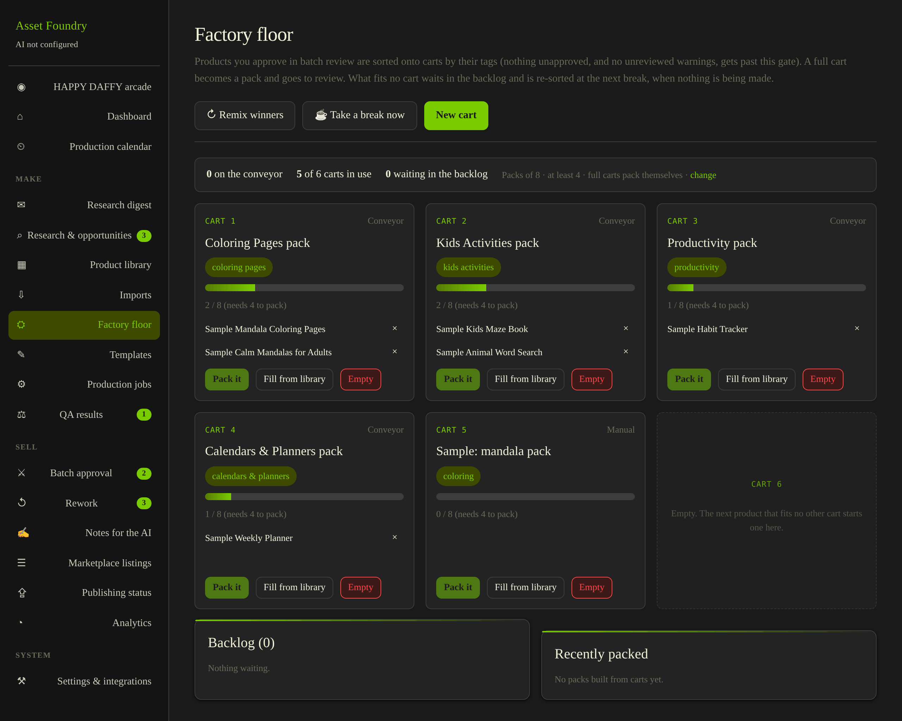

**The gate.** Only products you approved in batch review get onto the floor, and only once any QA warnings have been accepted. Nothing unapproved gets past.

**Status strip:** how many products are on the conveyor (still being made), how many carts are in use out of how many slots, how many products are waiting in the backlog, and the pack size settings. **change** opens Settings → Packing.

**Top right**
- **↻ Remix winners** opens a cart around a tag that your best sellers share but haven't been packed under yet.
- **☕ Take a break now** re-sorts the backlog now, even while products are still being made. Normally this only happens when nothing is being made. A message says how many products were re-sorted, how many packs were made and how many are still waiting.
- **New cart** opens a window where you name the cart (optional, made from the tags if left blank) and click up to 6 tag chips. You can also pick a kind and type a tag, then press **Add**. Press **Open cart**. A cart with no tags takes anything you add by hand.

**Each cart** shows its slot number, where it came from, its name, its tags, a fill bar and "items / target", with a note if it needs more to pack.
- Each product in the cart links to its page. The **×** next to it takes it out.
- **Pack it** turns the cart into a pack now. It needs at least 2 products, and at least the cart's minimum. The new pack starts being made straight away.
- **Fill from library** pulls matching finished products from the whole library into the cart.
- **Empty** sends the cart's products back to the backlog and frees the slot (it asks first).
- An empty slot reads "Empty. The next product that fits no other cart starts one here."

**Backlog card.** Products waiting for a cart, newest first, with why they're waiting and how many times they've been tried. **Preview** shows the cover. **Put in cart…** moves a product into a cart you pick.

**Recently packed card.** Carts that became packs, with a link to each pack's page, plus carts that were emptied.

**At a break,** carts that have sat too long are packed if they have enough products, or emptied if they don't. Then the backlog is re-sorted, best sellers first and then oldest first. The pack size, how long a cart can sit, whether full carts pack themselves and more are all in Settings → Packing.

---

## 9. Templates

**What it's for:** the reusable parts that products are made from. The tabs are Product types, Design systems, Audiences, Themes and Categories.

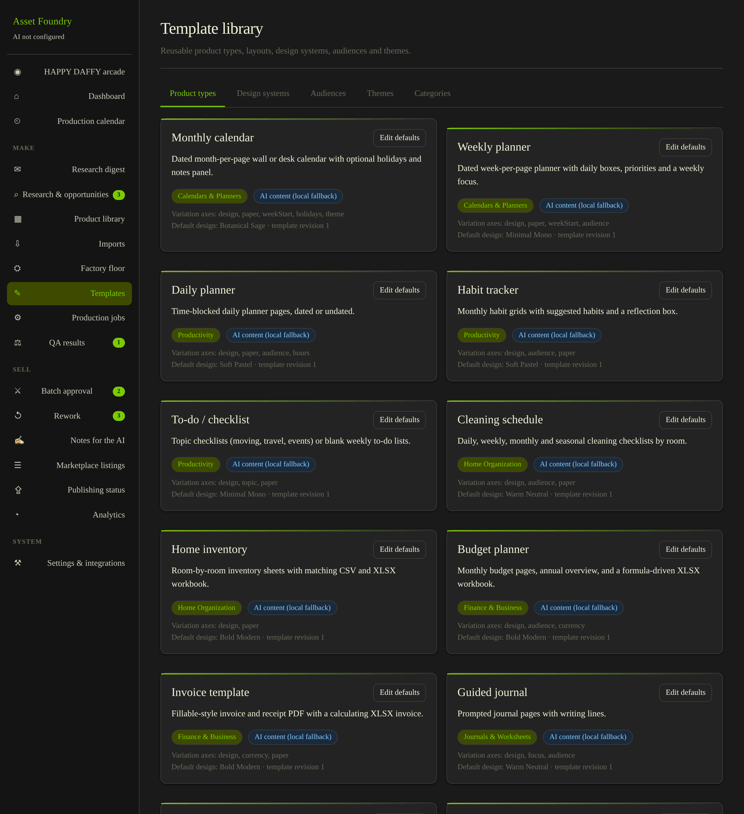

**Product types tab.** One card per type, with its description, category, whether the AI writes its content, how its pictures are made and what it can vary by.
- **Edit defaults** opens a window where you set the type's default design system and default settings. Press **Save**. New products of that type start from these.

**Design systems tab.** One card per design system, with a page preview, its colours, whether it's built-in or custom, and how many product versions use it.

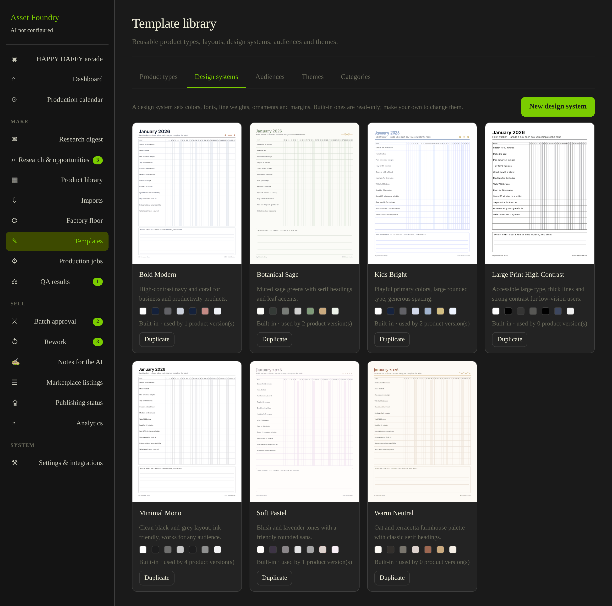

- **New design system** opens the editor, starting from a copy of the first one. You can pick a different starting point under **Start from**.
- **Duplicate** asks for a name, then makes a copy.
- **Edit** is only on custom ones, because built-in ones can't be changed. The editor has:
  - Name and Description.
  - **Colors:** a colour picker for each colour.
  - **Type:** heading, body and accent fonts (each shown in its own face), base size and heading scale.
  - **Layout:** line weight, corner radius, ornament (none, dots, leaf, stars, waves or geometric), density (airy, balanced or compact) and the four margins in mm.

  Press **Create** or **Save**.
- **Delete** only appears on custom design systems that no product uses (it asks first).

**Audiences tab.** The list on the left. To add an audience on the right, fill in name, description, tone, reading level, text size multiplier, density and notes for content, then press **Add audience**.

**Themes tab.** The list on the left. To add a theme on the right, fill in name, description, keywords (comma separated) and season months as numbers (for example `11,12`), then press **Add theme**.

**Categories tab.** A read-only list with how many products each category has.

---

## 10. Production jobs

**What it's for:** every background step the factory runs, with its attempts and errors. Most of the time you won't need it. It's where you look when something seems stuck.

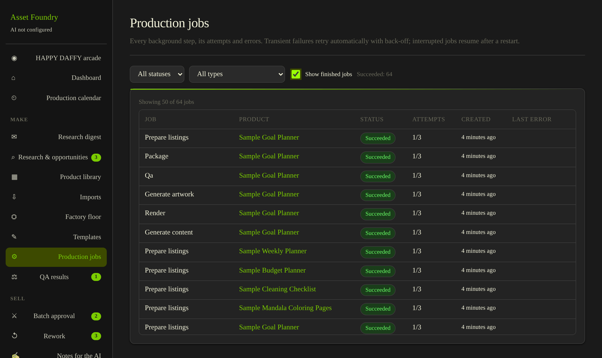

- By default it shows only jobs that are queued, running or failed. Tick **Show finished jobs** to see everything.
- The **status** and **type** filters narrow the list. The job types are generate content, generate artwork, render, QA, package, prepare listings, run production plan and refresh recommendations.
- Counts per status sit next to the filters.
- Each row shows the job, its product (a link), status, attempts, when it was made and the last error. A queued job that's waiting to retry says when.
- **Retry** (on failed or cancelled jobs) runs it again.
- **Cancel** (on queued jobs) stops it before it runs.
- **Click a row** to open Job details: its type, status, error class and times, every attempt with its duration and error, and the result.

Jobs that fail for a passing reason retry by themselves, waiting a little longer each time. Jobs that were interrupted pick up again after a restart.

---

## 11. QA results

**What it's for:** the automatic checks on every version. A failed hard check blocks approval and publishing. Warnings are shown to you at review.

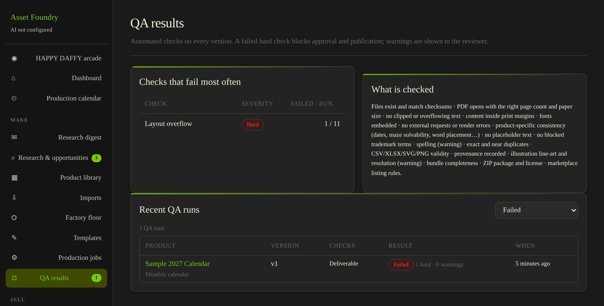

- **Checks that fail most often** lists the checks with failures, whether each is Hard or a Warning, and failed / run.
- **What is checked** is the full list: files and checksums, PDF page count and paper size, clipped or overflowing text, print margins, embedded fonts, no outside requests, product-specific checks (dates, mazes that can be solved, word placement), placeholder text, blocked trademark terms, spelling (a warning), duplicates, file validity, provenance, line art and resolution (a warning), bundle completeness, the ZIP and license, and marketplace listing rules.
- **Recent QA runs** shows failed runs by default. The dropdown in the corner switches to Passed with warnings, Passed or All. Each row shows the product, version, kind of check (Deliverable or Release), result and counts. **Click a row** to open every check and its message, and click again to close it.

---

## 12. Batch approval

**What it's for:** reviewing finished products. Nothing is exported or published without an approval recorded here, for that exact version and that marketplace listing.

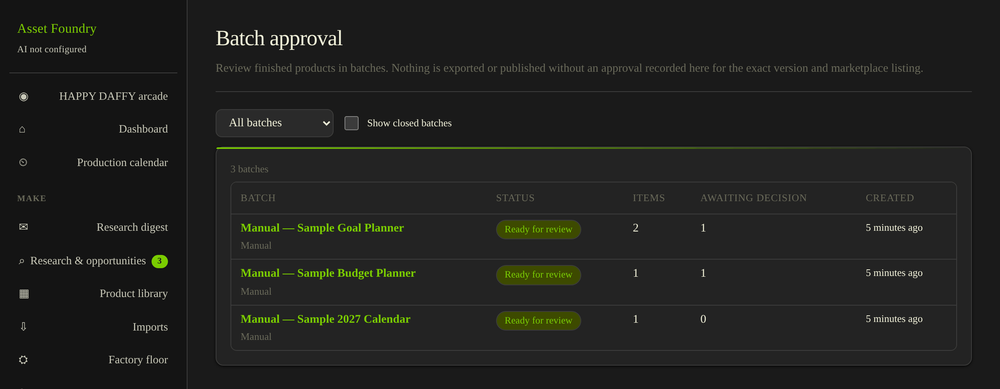

**The list**
- By default it shows batches that still need you. Tick **Show closed batches** to see all of them, or pick a status (Ready for review, Still producing or Closed).
- Each production-plan run makes one batch. Each product you make by hand gets its own batch named "Manual — (title)".
- Click a batch name to review it.

**"N approved items with warnings you haven't accepted"** only appears if some products were approved before the warning gate existed and still have yellow flags. They stay approved, but they can't be packed or published until you accept the warnings. **Review** opens that item.

### Reviewing a batch

Each item is one slim line with its version, type, any decision so far, and status pills. Press **Review** to open the item (one at a time) and **Close** to fold it away. If some items are still being made, a banner says so, and you can review the finished ones in the meantime.

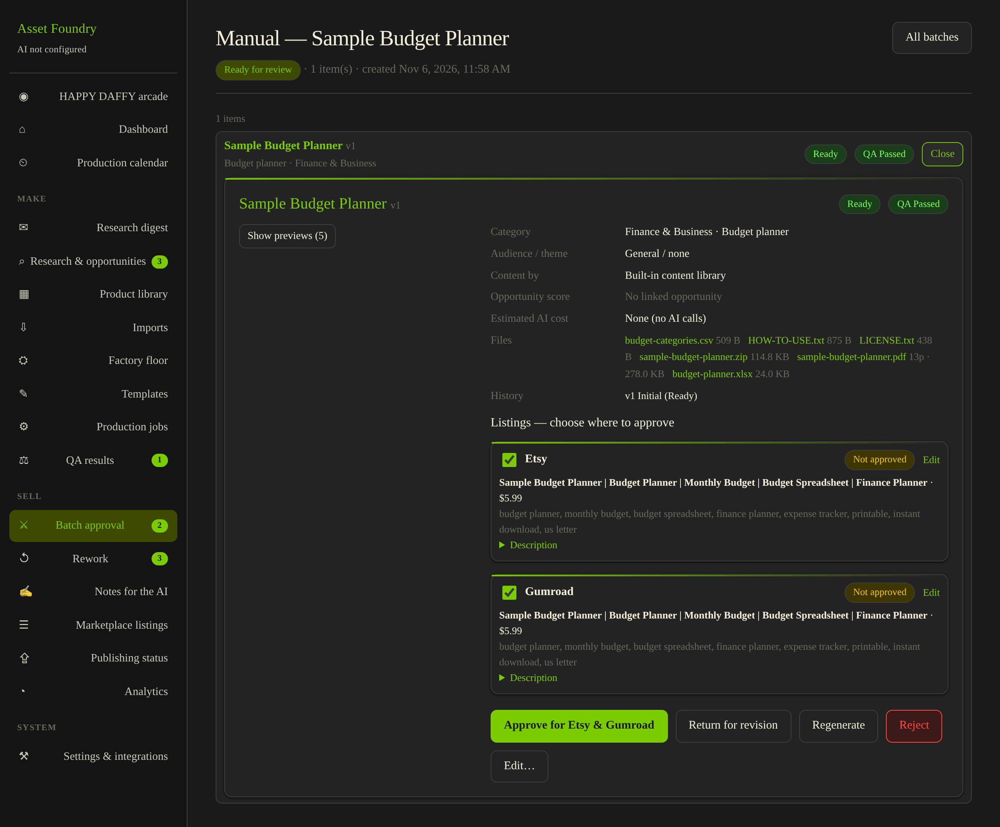

**What an open item shows**
- **Show previews (N)** loads up to 4 page previews and the main listing image.
- Category, audience and theme, what wrote the content, the opportunity score, the estimated AI cost, the files (each one downloads when you click it), what's inside if it's a pack, and the version history.
- **QA failures,** if any, opened up.
- **Warnings to review,** if any (see below).
- **Listings — choose where to approve.** One card per marketplace with the title, price, tags and a **Description** you can open. Tick the marketplaces you're approving for. A listing with problems is shown in red and its box can't be ticked until you fix it. **Edit** opens it in Marketplace listings.

**The buttons**
- **Approve for (marketplaces)** records your approval for this version and the ticked listings. It's greyed out if QA failed, if no marketplace is ticked, or if there are warnings you haven't accepted. Hover over it to see why. After you approve, the product goes onto the Factory floor (if that's switched on), and if you turned on "Post automatically when I approve" for Gumroad, it gets posted.
- **Return for revision** opens a box: "What should change?" Your notes go to the generator for the next version. Press **Send back with notes**.
- **Regenerate** opens a box for optional notes. A fresh version is made with new random artwork. Press **Regenerate**.
- **Reject** opens a box for your reason (it has to say which part is wrong and what is wrong with it). The version is marked rejected and can never be published. Press **Reject version**.
- **Edit…** opens the product page.

**Draw a box on a page.** The Reject, Return for revision and Regenerate boxes all have a **Draw a box on a page** button. It shows the page previews (pick one with the **Page** buttons) and you drag across the part that is wrong. You can draw up to 6 boxes, on any pages, and **Remove** takes one off.
- A box counts as saying *which part* is wrong, so your words only have to say *what* is wrong. "Too blurry" with a box around the blurry lines is fine. "Bad" with a box still isn't.
- The picture-reading AI (Settings → Generation → Vision) looks at each box and writes down what it sees, for example "the mandala lines in the box are broken". That goes to the next version's notes when you return it for revision, and into the notes the AI learns from.
- If the picture-reading AI isn't set up or can't be reached, the box is still saved with its page and place, and the AI tries again every minute.
- Afterwards, **Show the box you drew** under the decision shows the cut-out and what the AI saw. Click the cut-out to open the whole page with the box drawn in red.

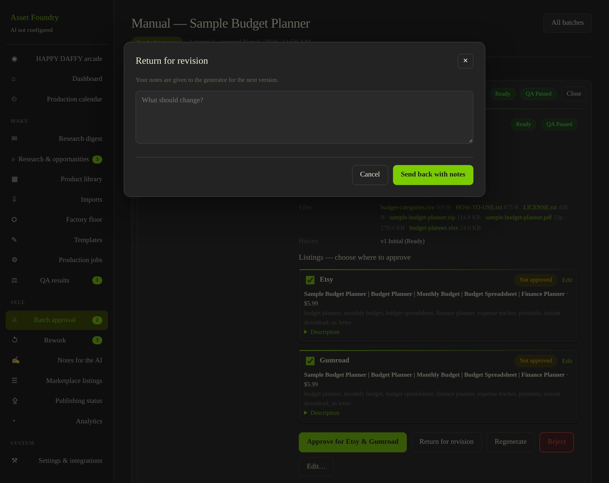

Every note you write here is kept on [Notes for the AI](#14-notes-for-the-ai), and the AI reads them for repeat problems, so specific notes pay off.

**When QA failed.** The item says "This version failed a hard QA check, so it cannot be approved." Fix it from the product page, or press Regenerate.

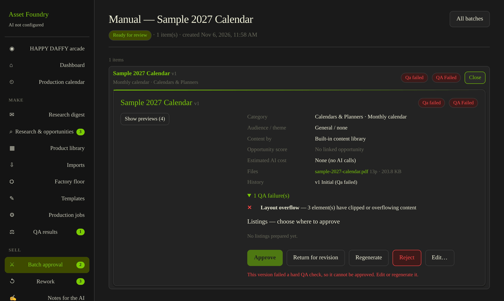

**When there are warnings (yellow flags).** A box lists each warning.
- **Help me with this** asks the AI what the warning means, how to fix it and when it's fine to accept. It's only a suggestion, and nothing gets changed. It needs an AI key.
- Fix the problem (Edit, Return for revision or Regenerate), or tick **I accept these warnings**. An optional note box appears where you can say why it's fine or what you'll do about it.
- **Approve** unlocks once the box is ticked.
- If you're looking at an item that was approved before the gate, tick the box and press Approve again.

**Other things you might see**
- "A newer version exists — review that one instead." This version has been replaced.
- "Decision: …" shows who decided what and when, with the note.
- "Earlier approvals were withdrawn: …" means an edit cancelled an earlier approval, and says why.

---

## 13. Rework

**What it's for:** everything that was rejected or failed, in one place to work through. An item stays here until you press **Mark fixed**. Nothing is deleted.

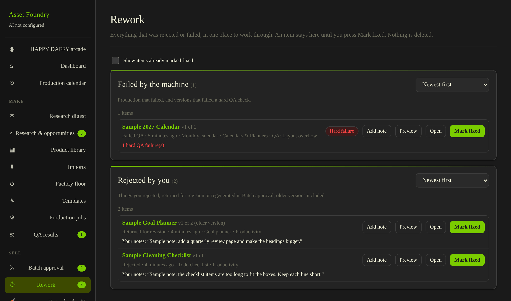

There are two sections, and each has its own **sort** dropdown: Newest first, Product type, Category, Marketplace, QA check flagged, Failure before warning, Most versions or Has your notes.
- **Failed by the machine:** production that failed, and versions that failed a hard QA check.
- **Rejected by you:** anything you rejected, returned for revision or regenerated in batch review, older versions included.

Each row shows the title, which version out of how many, why it's here, when, type, category, marketplaces and the QA checks involved. Under that it shows your notes or the error, and **Show the box you drew** if you drew boxes on the pages.
- **Add note** opens a box for a note to the AI about this item. Press **Save note**. Press **Cancel note** to close the box without saving. The note goes into Notes for the AI.
- **Preview** shows the cover.
- **Open** opens the product page.
- **Mark fixed** takes the item off the list.
- Tick **Show items already marked fixed** to see them again. They have a **Put back** button that returns them to the list.

---

## 14. Notes for the AI

**What it's for:** every note you've written in review, and a short list of repeat problems that the AI works out from them. That list goes into every AI prompt.

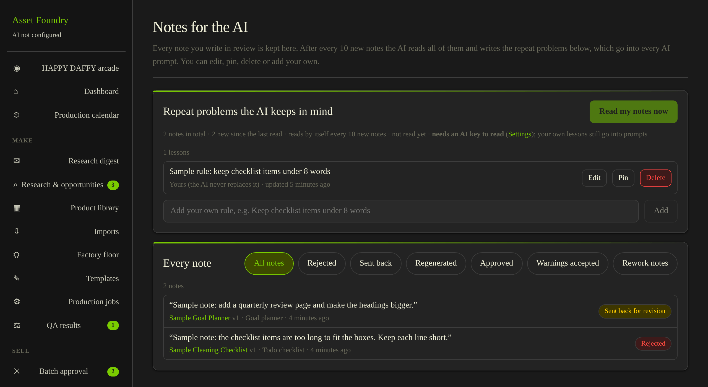

**Repeat problems the AI keeps in mind**
- The status line shows how many notes there are, how many are new since the last read, that the AI reads them by itself every 10 new notes, and when it last read them. It also tells you if it needs an AI key or if the last try failed.
- **Read my notes now** makes the AI read every note now and update the list. It's greyed out with no AI key, while a read is running, or when there are no notes yet.
- Each lesson shows whether the AI wrote it (and how many times it's come up) or you did. Lessons you write are never replaced by the AI.
  - **Edit**, then **Save** or **Cancel**, changes the wording.
  - **Pin** (📌) keeps an AI lesson when the AI re-reads. **Unpin** undoes it.
  - **Delete** removes the lesson (it asks first). The AI may write it again if your notes keep saying it.
- **Add your own rule.** Type a rule (for example "Keep checklist items under 8 words") and press **Add**. Your own rules go into prompts even without an AI key.

**Every note.** Click a chip to filter: All notes, Rejected, Sent back, Regenerated, Approved, Warnings accepted or Rework notes. Each note shows the product (a link), version, type, when, and any warnings involved.

---

## 15. Marketplace listings

**What it's for:** the listing drafts for each product version and marketplace, checked against each marketplace's rules.

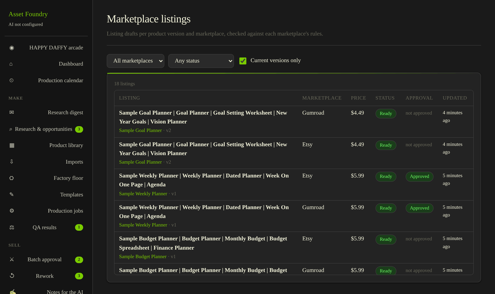

- Filters: **marketplace**, **status** (Ready, Invalid, Export prepared, Published manually, Published verified, Needs reconciliation or Retired), and **Current versions only** (ticked by default).
- Each row shows the title, product (a link), version, marketplace, price, status (with an issue count if there are problems), approval and when it was updated. **Click a row** to open the listing editor.

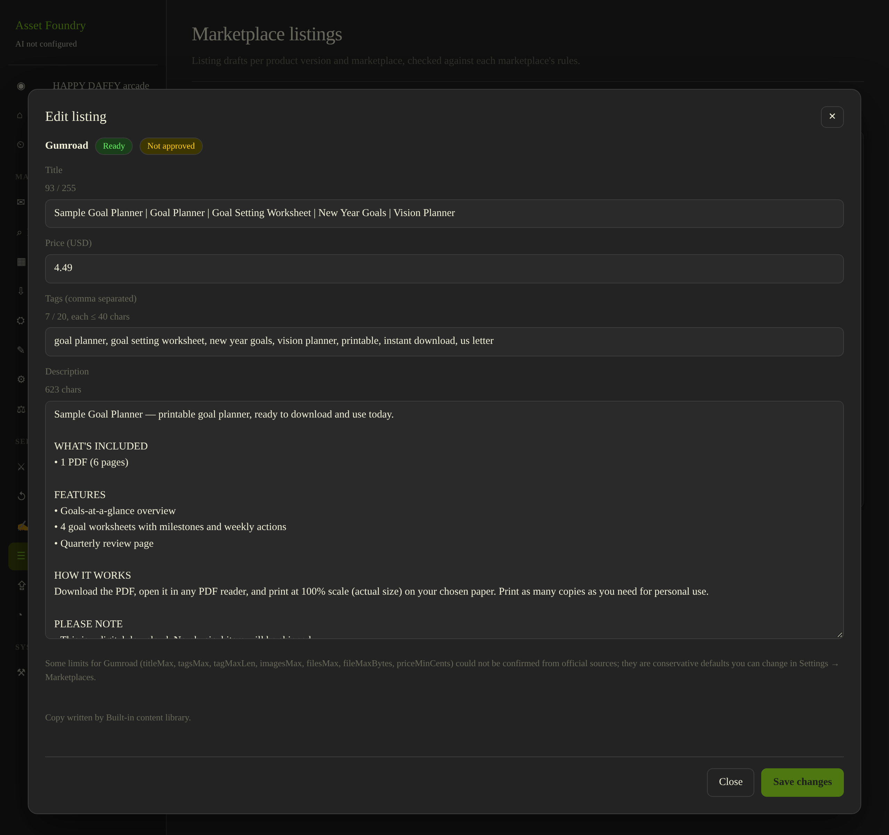

**The listing editor**
- At the top: the marketplace, the status, and whether it's approved. If it's approved, it warns that saving changes withdraws the approval.
- **Title,** with a counter against the marketplace's maximum (it turns red when you're over).
- **Price.**
- **Tags,** comma separated, with a counter. Any tag that's too long is named in red.
- **Description,** with a character count.
- Any rule problems are listed in red. Limits that couldn't be confirmed from the marketplace's own pages are mentioned, and you can change them in Settings → Marketplaces.
- Who wrote the copy, and when it was last edited.
- **Save changes** saves (it's greyed out until you change something). **Close** closes without saving.

Listings are drafted automatically once a product is packaged.

---

## 16. Publishing status

**What it's for:** export packages, publications you've recorded, and sorting out publish attempts with an unknown result. Every action here needs an approval for that exact version and listing.

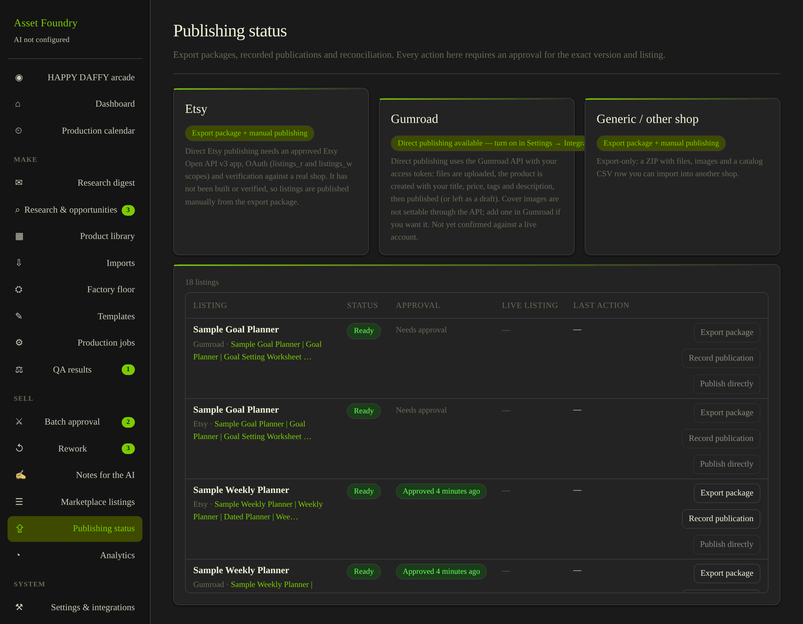

**Marketplace cards** at the top show each marketplace's mode:
- "Direct publishing verified."
- "Direct publishing on — not yet live-confirmed."
- "Direct publishing available — turn on in Settings → Integrations."
- "Export package + manual publishing."

**The list.** Each row shows the product, the marketplace and listing title (click it to open the editor), the status, the approval, the live link if one is recorded (marked "Verified by API" or "Recorded manually — not verified by the app") and the last action.
- **Export package** builds the upload package for this approval and downloads it. If one already exists for this approval, it's reused.
- **Download** downloads the package again.
- **Record publication** is for after you've put the listing up yourself. Paste the live listing's address and press **Record**. The app records it as "published manually" and doesn't check that it's live. The address has to be on that marketplace's site.
- **Publish directly** posts the listing through the marketplace's API. It only works where direct posting is built and turned on, which today means Gumroad. Hover over it to see why it's greyed out.
- **Reconcile** appears when a publish request was sent but the result couldn't be confirmed. Check the marketplace, then either paste the live address and press **It IS live**, or press **It was NOT published**. The app won't retry until you answer, so it can never create a duplicate listing.

---

## 17. Analytics

**What it's for:** evidence about production and sales. Sales from different sources are reported separately and never added together.

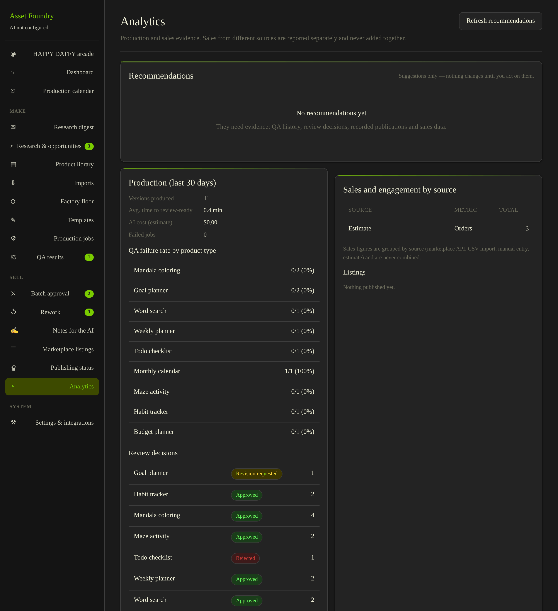

- **Refresh recommendations** (top right) looks for new suggestions in your QA history, review decisions, recorded publications and sales.
- **Recommendations card.** Each one shows its kind, title, reasoning, evidence and confidence. **Accept** or **Dismiss** records your choice. They're suggestions only, and nothing changes until you act on them yourself.
- **Production (last 30 days):** versions produced, average time until ready for review, estimated AI cost, failed jobs, the QA failure rate by product type, and review decisions by type.
- **Sales and engagement by source:** totals per source (marketplace API, CSV import, entered manually or estimate) and metric. Below that: published listings per marketplace, verified or recorded manually.
- **By product** (once there are sales): orders, revenue and views per product and source.
- **Import sales CSV.** Pick the marketplace, then choose the file. It needs a date column and a column that identifies the listing (listing ID, address or title). Quantity, revenue, views and favourites are read when they're there. Rows are matched to listings you've recorded as published. Problem rows are listed by row number.
- **Enter numbers manually.** Pick the listing, the metric (views, favourites, orders, units, revenue in cents or refunds), the value, the dates, and whether the number is real (copied from your shop stats) or an estimate. Press **Save**.

---

## 18. Settings & integrations

**What it's for:** keys, connections and every option. Everything is stored on your computer. API keys go into the Mac's Keychain (or are encrypted for your Windows account) and are never shown again once saved.

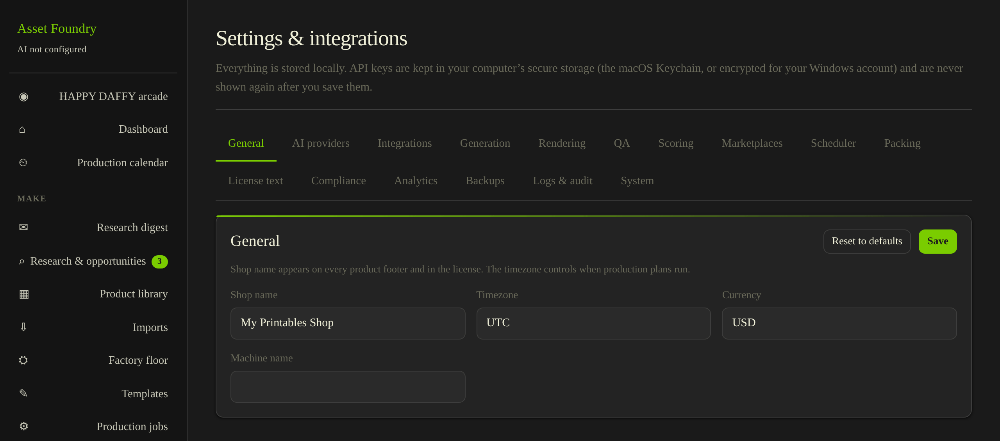

Each tab is explained below.

### Tabs that are a plain form

General, Generation, Rendering, QA, Scoring, Marketplaces, Scheduler, Packing, License text, Compliance and Analytics all work the same way. The form is built from the settings themselves, so each field is labelled with the setting's own name. Each one has:
- a one-line explanation at the top,
- **Save** to keep your changes,
- **Reset to defaults** to put that tab back the way it shipped (it asks first).

Ticked boxes are on/off settings. A box marked "one per line" takes a list. Boxes marked "(JSON)" take structured text, and they say "not valid JSON yet" until what you've typed is complete.

| Tab | What's in it |
| --- | --- |
| **General** | Shop name (printed on every product footer and in the license), timezone (when plans run), currency and this computer's name. |
| **Generation** | The first-choice text and image providers, the backup order for each, whether a paid backup is allowed, pacing limits per provider, what to do when no AI key works ("deterministic" uses the built-in content library, "fail" stops the job), and each provider's model and backup models. The AI price table is under **Advanced**. It's only used to estimate cost and enforce budget limits. |
| **Rendering** | Chrome's path, how many pages render at once, preview resolution and pages, and the page timeout. Changing these restarts the renderer. |
| **QA** | Near-duplicate thresholds, spelling on or off, the spelling allowlist (one word per line), minimum image DPI, the line-art limit and the margin tolerance. |
| **Scoring** | The weight of each score factor, plus the minimum score and confidence. |
| **Marketplaces** | Each marketplace on or off, its listing rules (title, description and tag limits, images, files and minimum price), Gumroad's posting options, and the default price per product type in cents. |
| **Scheduler** | How often it checks plans, the catch-up window for missed runs, retries, how many jobs run at once, and the weekly clean-up of old test copies. |
| **Packing** | Automatic feeding, how many carts can be open at once, target and minimum pack size, how closely tags must match (and the looser match used for the backlog), how many carts and packs one product can be in, the cooldown, how long a cart can sit before a break deals with it, whether full carts pack themselves, and the marketplaces packs get listings for. |

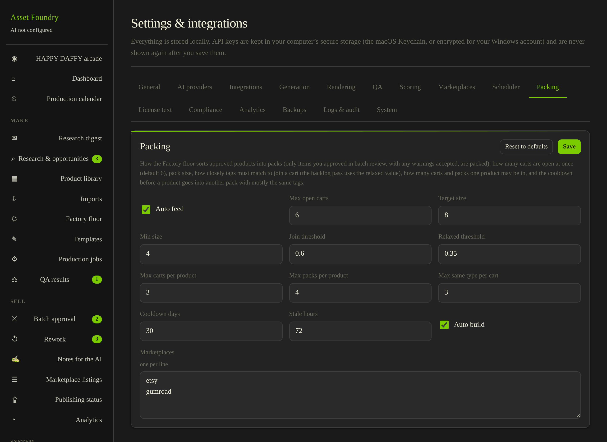

| Tab | What's in it |
| --- | --- |
| **License text** | The license that goes in every download. `{{shopName}}` and `{{year}}` are filled in for you. |
| **Compliance** | Terms that block a product or listing in QA (trademarks, licensed characters, brands), one per line. |
| **Analytics** | How much evidence is needed before a recommendation is made, plus the alert levels. |

### AI providers

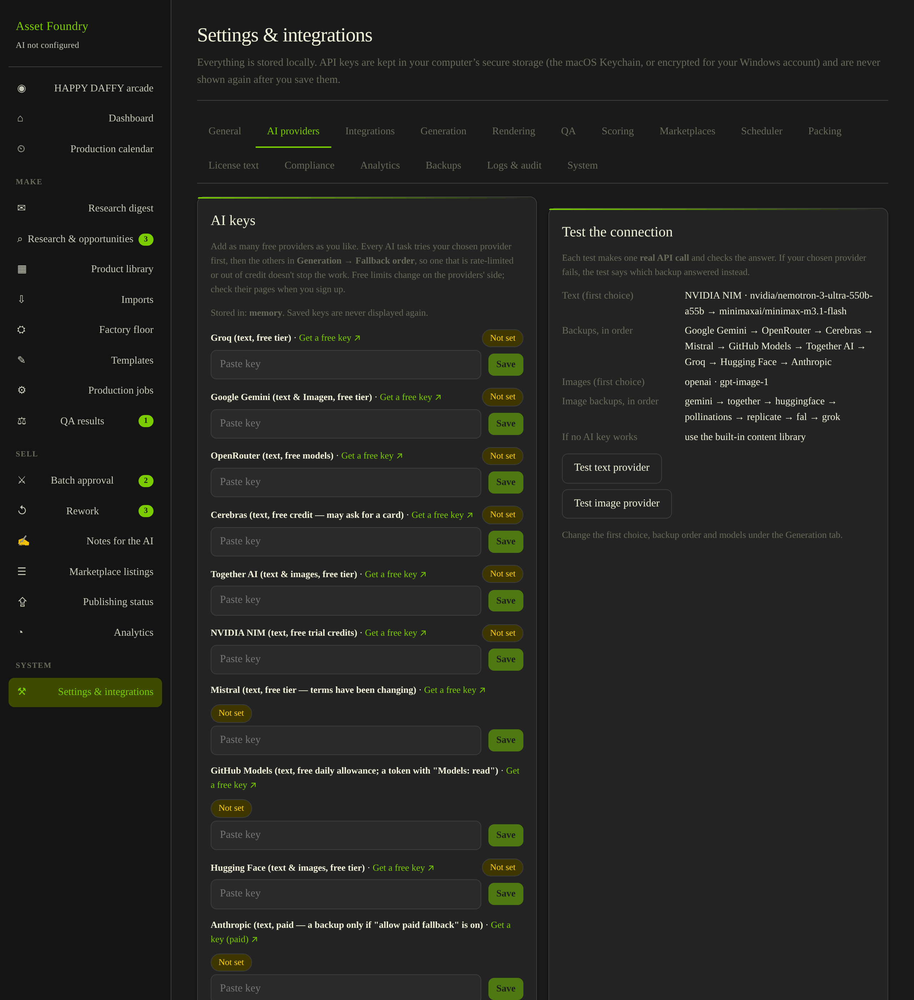

- **AI keys card.** One row per provider, saying whether it's free or paid, with a **Get a free key** or **Get a key (paid)** link and a Saved or Not set pill. Paste a key and press **Save**. **Remove** deletes a key from the Keychain (it asks first). Saved keys are never shown again. Typing a new key replaces the old one.
- **Test the connection card.** It shows the current first choice and the backup order for text and images, and what happens if no key works. **Test text provider**, **Test image provider** and **Test picture-reading AI** each make one real API call and report whether it worked, which model answered and how long it took. If your first choice fails, it says which backup answered instead. The picture-reading test sends a small picture of a red square and passes only if the model says "red". To change the order, use the Generation tab.

### Integrations

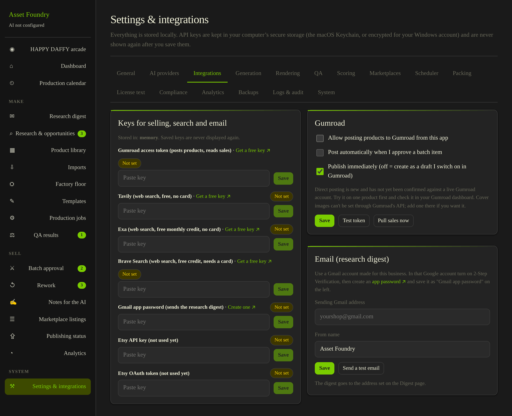

- **Keys for selling, search and email:** Gumroad token, Tavily, Exa, Brave Search, the Gmail app password, and two Etsy keys that aren't used yet. They work the same way as the AI keys.
- **Gumroad card**
  - **Allow posting products to Gumroad from this app.**
  - **Post automatically when I approve a batch item** (only available when the box above is ticked).
  - **Publish immediately.** If this is off, products are created as drafts that you switch on in Gumroad.
  - **Save**, **Test token**, and **Pull sales now** (which imports new Gumroad sales).

  Direct posting hasn't been confirmed against a live Gumroad account yet, so try it on one product first. Cover images can't be set through Gumroad's API.
- **Email (research digest) card.** The sending Gmail address and the From name. **Save**, then **Send a test email**. The digest goes to the address set on the Research digest page.

### Arcade

- **HAPPY DAFFY test credits card.** While the arcade can't count how many AI calls your providers have left today, its credit meter shows this test number, marked **TEST**. The card says what the meter shows right now and whether the test number is in use.
- Type a whole number from 0 to 99 and press **Save**.
- **Set to 0 (lock)** locks PRESS START, which is how you try the zero-credit lock. **Reset to 3** puts it back to the number a fresh copy starts with.
- The arcade's other settings aren't here: the stats ticker is picked with **EDIT TICKER** on the Hub.

### Backups

- **Back up now** makes a consistent copy of the database plus every generated file. API keys aren't included, because they stay in the Keychain.
- The list shows each backup's name, date, product count, file count and size.
- **To restore,** quit the app and run `npm run restore -- <backup-name>` in Terminal. Your current data is moved aside, not deleted.

### Logs & audit

- **Application log.** Pick Debug, Info, Warnings or Errors. It refreshes by itself. Secrets are removed from every entry before it's written.
- **Audit trail.** Every recorded action: who did it, what and when.

### System

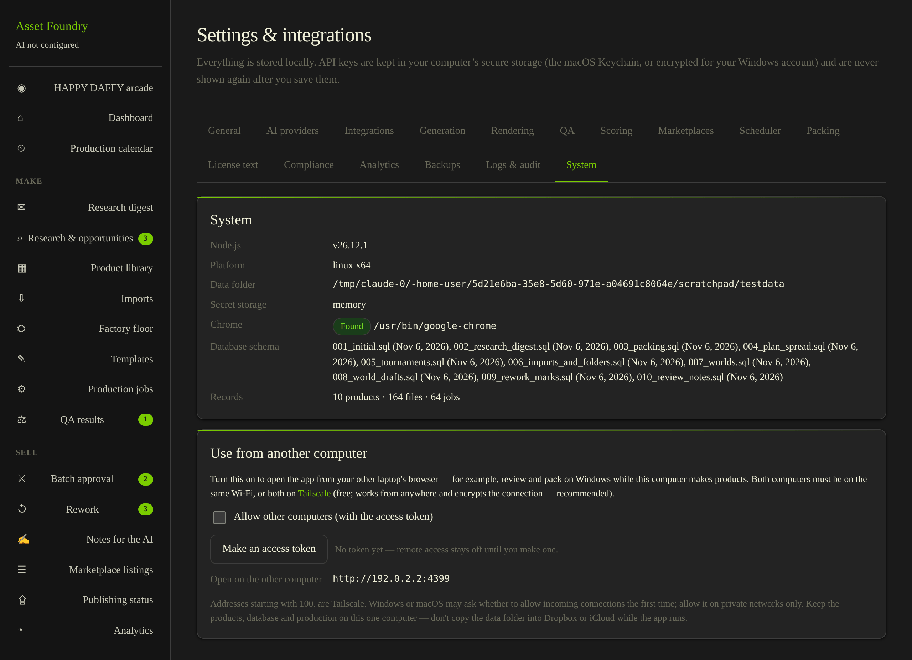

- **System card:** Node version, platform, data folder, where secrets are kept, whether Chrome was found, the database schema and record counts.
- **Use from another computer.** This lets you open the app from your other laptop's browser.
  1. Tick **Allow other computers (with the access token)**, then quit and restart the app.
  2. Press **Make an access token**. Copy it straight away, because it isn't shown again. **Make a new access token** replaces the old one, and other computers then have to sign in again.
  3. On the other computer, open one of the addresses listed. Addresses starting with 100. are Tailscale.

  Both computers need to be on the same Wi-Fi or both on Tailscale (recommended). Keep the products and database on this one computer, and don't put the data folder in Dropbox or iCloud while the app is running.

---

## 19. Student product types

**What it's for:** three kinds of product for students, made in the [Product library](#6-product-library) like any other. They're in the **School & Study** category under **New product**. The AI writes their words when a key is set; without one, they use the built-in content library, so they always work offline. Layouts, times and page counts are always worked out by the app.

**Presets.** Under **New product**, the **Students** presets fill in the whole form in one click: Student assignment tracker (page per subject), Class timetable (Mon-Fri, 6 periods), Two-week (A/B) class timetable, Student reading log and Kids reading log. Change anything before you press Create.

**Assignment tracker.** A **My subjects** page (subject, teacher, room, notes, plus tips), then the log pages: subject, assignment, the date it was set, the due date, a done box and a grade.
- **Layout:** *Combined* is one running list for every subject. *Per subject* gives each subject its own page.
- **Pages** (combined only) and **Rows per page.** If the rows you ask for would be too small to write in on your paper, fewer are printed, and QA warns you.
- **Show grade** adds the grade column. **Subjects** (optional) sets the list yourself; QA warns if the printed list differs from yours.

**Class timetable.** A week grid with a row for each period, a lunch row, and a subjects key with teacher and room, plus a notes box.
- **Days** (5, 6 or 7) and **Week start** (Sunday or Monday).
- **Periods**, **Start time** (24-hour, like 08:30), **Period minutes**, **Break minutes** (the gap between periods), **Lunch after** (which period lunch follows; 0 for none) and **Lunch minutes.** The app works out every period's times from these. QA checks the times are in order, don't overlap and end before midnight.
- **Weeks:** *Single* for one page, *AB* for a Week A and a Week B page. **Show times** prints each period's times.
- If the day has too many rows for the key to fit underneath, the key and notes get a page of their own. If even that is too tight, QA fails it and says to use bigger paper, fewer periods or no times.

**Reading log.** A numbered book list with title, author, genre, done and stars; a reading challenge (one book of each kind); reading-minutes pages (one per month, with the month written in); and book review pages.
- **Books** sets how many numbered rows the list has. **Goal** (optional) prints a reading goal; QA warns if the goal is bigger than the list.
- **Challenge**, **Minutes months** and **Review pages** turn those pages on or set how many. Kids audiences get kids' kinds of book and simpler review questions.

**The mission.** The HAPPY DAFFY mission for this chapter is earned: clear the **Product library** and **Templates** missions first.

---

# Part 2: HAPPY DAFFY

*(Read this part in your best arcade-announcer voice.)*

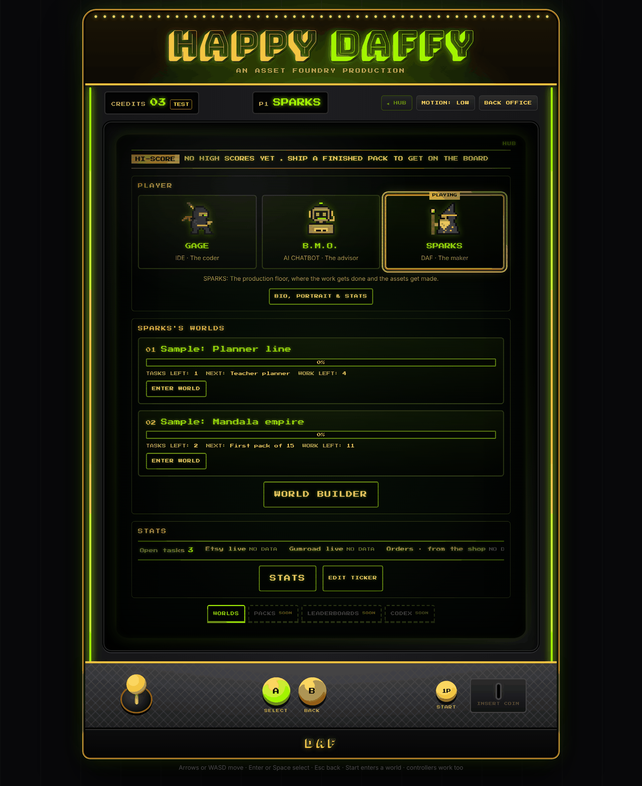

## WELCOME TO THE CABINET, PLAYER 1

HAPPY DAFFY is the arcade front of Asset Foundry. Same factory, same products, same keys, just a lot more neon. Get here with **HAPPY DAFFY arcade** at the top of the back-office sidebar. Get out with **BACK OFFICE** at the top of the cabinet. The cabinet is always dark. Them's the rules.

## THE TOP OF THE CABINET

- **CREDITS.** Your credits meter. When none of your providers has a daily limit set, it shows a **TEST** number, which you change in **Settings & integrations → Arcade**. When it shows `--` and **UNAVAILABLE**, the cabinet lost its link to the factory.
- **P1.** Whoever's playing. **NO PLAYER** means nobody's picked yet.
- **◀ HUB** zips you back to the hub from anywhere.
- **MOTION: FULL / LOW** turns the CRT flicker, the scrolling and the wobble down or back up. The cabinet remembers your choice on this computer.
- **BACK OFFICE** takes you to the back-office Dashboard.

## THE CONTROLS

| Do this | Keyboard | Controller | Cabinet |
| --- | --- | --- | --- |
| Move between buttons | Arrows or WASD | D-pad or left stick (hold to repeat) | Joystick (it wiggles along with you) |
| Press the highlighted button | Enter or Space | A | **A · SELECT** |
| Go back a screen | Esc | B | **B · BACK** |
| Enter a world | (Start) | Start | **1P · START** |
| Insert a coin | | Select | **INSERT COIN** |

**INSERT COIN** goes *CLINK!* and that's all it does. It never changes your credits. It's there for the vibes.

When you're typing in a box, the keys type, they don't steer. Hit Esc to step out of the box.

## THE HUB

The hub is your home base. Everything starts here.

### HI-SCORE

The banner across the top. It reads NO HIGH SCORES YET until you ship a finished pack to get on the board.

### PLAYER: PICK YOUR FIGHTER

| Fighter | Class | What they do |
| --- | --- | --- |
| **GAGE** the ninja | IDE · The coder | Coding projects, code-built assets and tool-building tasks |
| **B.M.O.** the desk robot | AI CHATBOT · The advisor | Ideas, advice, direction and suggestions |
| **SPARKS** the wizard | DAF · The maker | The production floor, where the assets get made |

- Click a card (or move to it and press A). It lights up **PLAYING**, and the cabinet remembers who you picked on this computer.
- The line under the cards says what the highlighted fighter covers.
- **BIO, PORTRAIT & STATS** opens up their story, their portrait buttons and their stat panel. **HIDE BIO & PORTRAIT** closes it again.
  - **CUSTOM PORTRAIT** swaps the pixel art for your own picture (PNG, JPEG, WebP or GIF). After that the button says **CHANGE PORTRAIT**.
  - **USE PIXEL ART** brings back the original sprite.
  - **EYE, CRAFT, TASTE, PATIENCE** all show `--`. They stay blank until the XP rules are decided. No made-up numbers in this arcade.

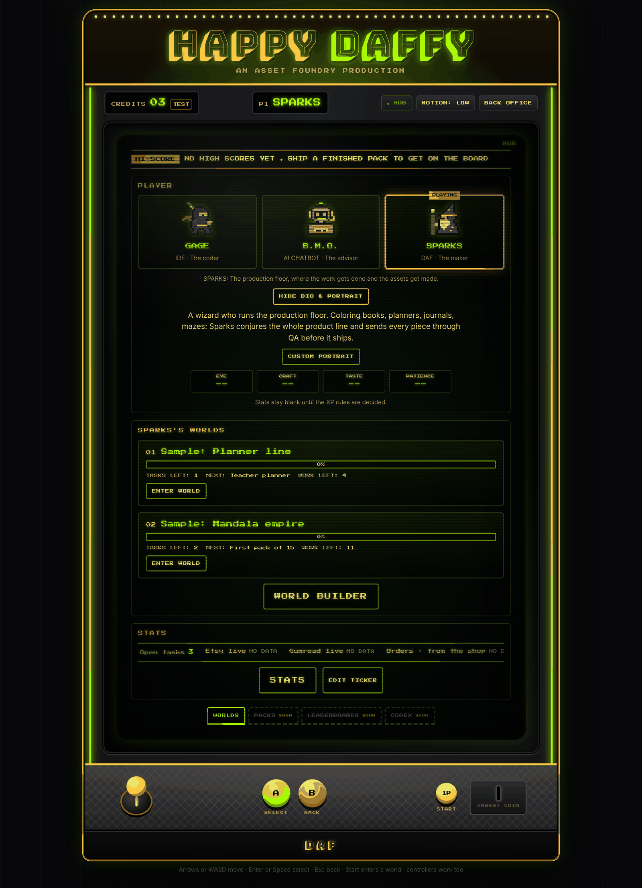

### (PLAYER)'S WORLDS

Your fighter's worlds, the ones closest to their next milestone first. A world only shows up for a fighter who has an open task in it.

Each world card shows its rank, a progress bar towards the next milestone, **TASKS LEFT**, **NEXT** (the milestone) and **WORK LEFT** (effort points left in the next milestone).
- **ENTER WORLD** takes you in. So does **1P · START**, which enters whichever world you've highlighted, or the top one.
- **OUT OF CREDITS?** At 0 credits, ENTER WORLD stays locked and the hub tells you **ENTER LOCKED: NO AVAILABLE CREDITS**. Picking a fighter, the World Builder and STATS all keep working.
- **NO OPEN WORLDS** means your fighter has nothing to do yet. Head to the World Builder and give them a task.
- **WORLD BUILDER** opens the builder (see below).

### STATS

- **The ticker** scrolls your chosen stats across the screen. **NO DATA** means nothing's been recorded yet. The factory never fills in a number. Anything marked **TEST** is a test number.
- **STATS** opens the back-office Analytics page. An arcade stats screen comes later.
- **EDIT TICKER** opens the editor:
  - **ON THE TICKER, IN ORDER** lists what's on now, up to 16 stats. **▲** and **▼** move a stat, and **✕** takes it off.
  - **EVERY STAT** lists everything the factory can report, grouped into Arcade, Sales, Listings, Production and AI. Click one to add it or take it off. Sales from different sources are separate stats and never get added together.
  - **SAVE TICKER** locks it in. **CANCEL** walks away.

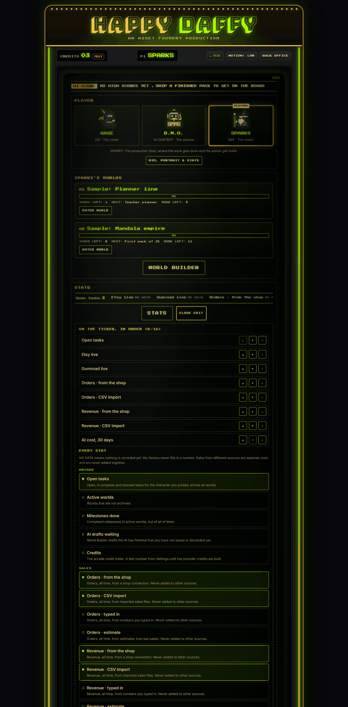

### THE TABS AT THE BOTTOM

**WORLDS** is where you are. **MISSIONS** opens your mission list (see below). **PACKS** shows your packs and the pack pool, **LEADERBOARDS** your FINISHED, REJECTED WELL, per-type and LAST 3 SHIPPED boards, and **CODEX** your player's XP and what they've learned. Next to WORLD BUILDER, **ASK B.M.O.** opens your advisor and **BIN** holds what you deleted to the bin. When B.M.O. suggests something, press **YES, DO IT**, **NO**, or **SAVE FOR LATER**. Saved ones wait under **SAVED IDEAS** at the top of B.M.O.'s screen, even after a restart, with **DO IT** and **DISCARD**.

## MISSIONS

Want to learn the whole Foundry? Here's your quest log. There's one mission for every chapter of this guide, from the arcade menu link down to Student product types, plus one for the arcade itself. The bar up top shows how many you've cleared.
- **INSTRUCTIONS** pops up that chapter of this guide as plain text, right there in the cabinet, so you can read up on a screen without loading it. Arrow keys scroll it. **CLOSE**, Esc or B shuts it.
- **GO** opens the screen the mission is about.
- **MARK DONE** clears a mission and puts a **✓ DONE** beside it. **UNDO** takes it back.
- **■ LOCKED** missions are either for things that aren't built yet, whose INSTRUCTIONS say what's coming and where it sits on the build list (`TASKS.md`), or ones that have to be earned: **NEEDS** lists the missions to clear first. Student product types, for one, needs Product library and Templates cleared. A locked mission can't be cleared until it unlocks.
- Missions don't earn XP yet. That waits until the XP rules are decided.
- **BACK TO HUB** (or B) heads home.
- Same list, same progress on the back-office side: **Missions** in the sidebar.

## WORLD DETAIL

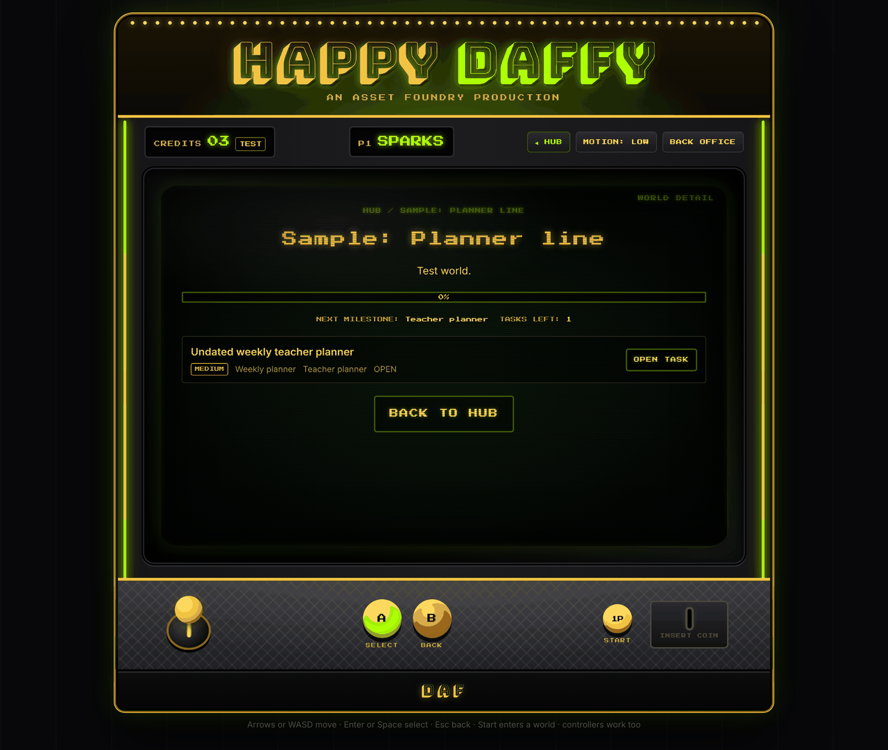

You're in. The breadcrumb up top says **HUB / (WORLD)**. You get the world's name, what it's for, the progress bar, **NEXT MILESTONE** and **TASKS LEFT**.

Below that are your fighter's open tasks, each tagged with its difficulty (LOW, MEDIUM or HIGH), task type, milestone and status.
- **OPEN TASK** opens the **Task Workspace**. For a product task, fill in a title, a design and a note for the AI if you like, and press **MAKE IT**: the factory makes the whole thing (pages, QA checks, listings). It shows up under **ASSETS FOR THIS TASK** and says what stage it's at. When it says READY FOR QA REVIEW, press **SUBMIT FOR QA / REVIEW**. A custom task has nothing to make, so you just mark it IN PROGRESS, BLOCKED or DONE.
- **QA Review** shows the pages, the factory's QA checklist and the task. **APPROVE** (with an optional WHAT I LIKED note) finishes the task. **REJECT** needs at least two sentences saying which part is wrong and what's wrong with it; the AI checks it's specific. Every 5 good rejections earn a credit. **DELETE** asks where to: the **BIN** (you can restore it later) or **DELETE FOREVER** after you type DELETE. Deleting never counts as a rejection.
- **BACK TO HUB** (or B) takes you home.

## THE WORLD BUILDER

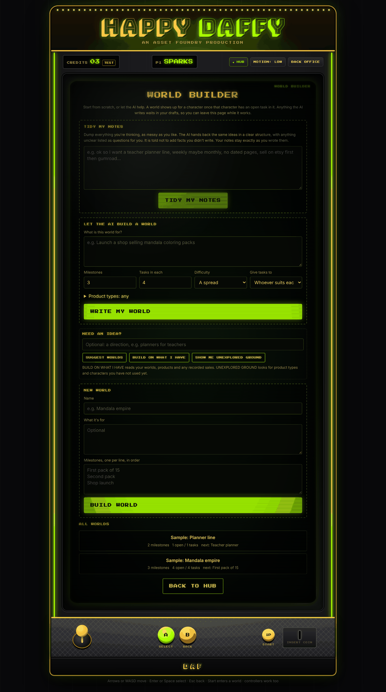

This is where worlds get made. Start from scratch, or let the AI help. Anything the AI writes waits in your drafts, so you can walk away from the cabinet while it works.

### TIDY MY NOTES

Got a brain full of half-ideas? Dump them in the box, as messy as you like, and press **TIDY MY NOTES**. The AI hands back the same ideas in a clean structure: a title and goal, **SCOPE**, **MILESTONES** with tasks, **MUST AND MUST-NOT** and **DONE WHEN**. Anything it couldn't work out gets listed as **QUESTIONS FOR YOU**. It's told not to add facts you didn't write, and your original notes stay exactly as you typed them, side by side with the tidy version.
- Edit the text under **Use as the world goal** (answer its questions there if you want them used).
- **USE FOR LET THE AI BUILD A WORLD** drops that text into the world writer below.
- **CLOSE** folds the result away. **DISCARD DRAFT** throws it out.

### LET THE AI BUILD A WORLD

1. **What is this world for?** Type your goal.
2. **Milestones** (1 to 8) and **Tasks in each** (1 to 10).
3. **Difficulty:** Mostly easy, A spread or Mostly hard.
4. **Give tasks to:** whoever suits each task, or one fighter only.
5. **Effort budget (pts):** optional. Put in a total, say 40, and the AI aims for tasks whose effort points add up to about that. With a budget, Milestones and Tasks in each turn into the most it can use, so a small budget can come back with fewer tasks. Leave it empty and you get exactly the counts you asked for.
6. **Base effort guesses on how I sized my finished tasks:** ticked by default. The AI is shown the effort numbers you gave tasks you've already finished (grouped by type and difficulty) and sizes new tasks on the same scale. It's your own numbers, not time spent, because the factory doesn't time tasks. With nothing finished yet it just guesses.
7. **Product types:** open the list and tick some to limit the AI to those types. Tick none to allow any type, plus Custom tasks.
8. Press **WRITE MY WORLD**. It can take a minute or two. You can leave, and the draft waits for you.

When it's ready you get **REVIEW THE AI'S WORLD**. **TOTAL EFFORT** adds up every task's points and, if you set a budget, says how far over or under it is. It updates as you delete things. The line under it says whether the guesses followed your finished tasks. Rename it, **REMOVE** a milestone or **DEL** a task you don't want, then press **SAVE WORLD**. Nothing becomes a real world until you press SAVE WORLD. **CLOSE** puts it back in your drafts, but any trimming you did isn't kept. **DISCARD DRAFT** throws it away.

### YOUR AI DRAFTS

Every draft from either AI box, marked **WRITING…**, **READY** or **FAILED** (with the reason). **REVIEW** opens a ready one. **CANCEL** stops one that's still writing, and **DISCARD** throws one away.

### NEED AN IDEA?

Type an optional direction, then pick a mode:
- **SUGGEST WORLDS:** fresh ideas.
- **BUILD ON WHAT I HAVE:** reads your worlds, products and any recorded sales, then suggests what comes next.
- **SHOW ME UNEXPLORED GROUND:** looks for product types and fighters you haven't used yet.

Click an idea and it fills in the NEW WORLD form for you. You can still change anything.

All the AI buttons need a working AI key. Without one, the cabinet says so straight away and doesn't fake it.

### NEW WORLD

**Name**, **What it's for** (optional) and **Milestones, one per line, in order**. Press **BUILD WORLD** and you land in that world's builder screen.

### ALL WORLDS

Every world, with its milestones, open and total tasks, and next milestone. Archived worlds are marked. Click one to edit it. **BACK TO HUB** heads home.

## BUILDING ONE WORLD

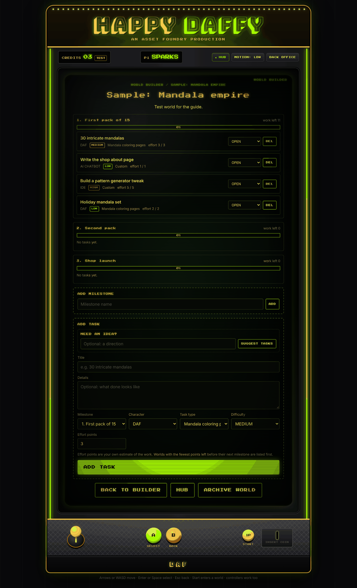

The breadcrumb says **WORLD BUILDER / (WORLD)**. Each milestone shows its number, its name (with a ✓ when it's complete), the work left and a progress bar, then its tasks.
- Every task shows its fighter, difficulty, type and effort (remaining / estimated).
- The **status dropdown** on each task moves it between **OPEN**, **IN PROGRESS**, **BLOCKED** and **DONE**. This is how you mark progress for now. A milestone completes by itself when all its tasks are done, and reopens if you reopen one.
- **DEL** deletes a task (it asks first).

**ADD MILESTONE:** type a name and press **ADD**. Every task needs a milestone, so add one first.

**ADD TASK**
- **NEED AN IDEA?** Type an optional direction and press **SUGGEST TASKS**. Click an idea to fill in the form. Its effort points are the AI's first guess, so change them.
- **Title**, **Details** (optional, what done looks like), **Milestone**, **Character**, **Task type** (any product type you can make, or Custom for anything else), **Difficulty** and **Effort points**.
- Effort points are your own estimate of the work. Worlds with the fewest points left before their next milestone go to the top of the hub.
- Press **ADD TASK**.

**Down at the bottom:** **BACK TO BUILDER**, **HUB**, and **ARCHIVE WORLD**, which hides the world without deleting it. On an archived world it says **RESTORE WORLD** instead.

**GAME OVER?** Never. Go make something. ★

---

## Things this guide found that need your call

While writing this guide I found four gaps and mismatches. Three were fixed on 2026-11-10, at your request:

1. ~~The arcade's test credits can't be changed from the app.~~ Fixed: **Settings & integrations → Arcade**.
2. ~~The Dashboard's Integrations card always says "Anthropic" and "OpenAI."~~ Fixed: it names the provider that will answer and its own model. The sidebar's "AI: (model)" line had the same fault and is fixed too.
3. ~~The Constitution's screen count is out of date.~~ Fixed: Article 3 now lists the 17 sidebar pages, with Product detail, Batch review and Missions beside them.

Still open:

4. **The two Etsy keys in Settings → Integrations are marked "not used yet."** Etsy is export-package only for now. Wiring them up waits on your go-ahead.
