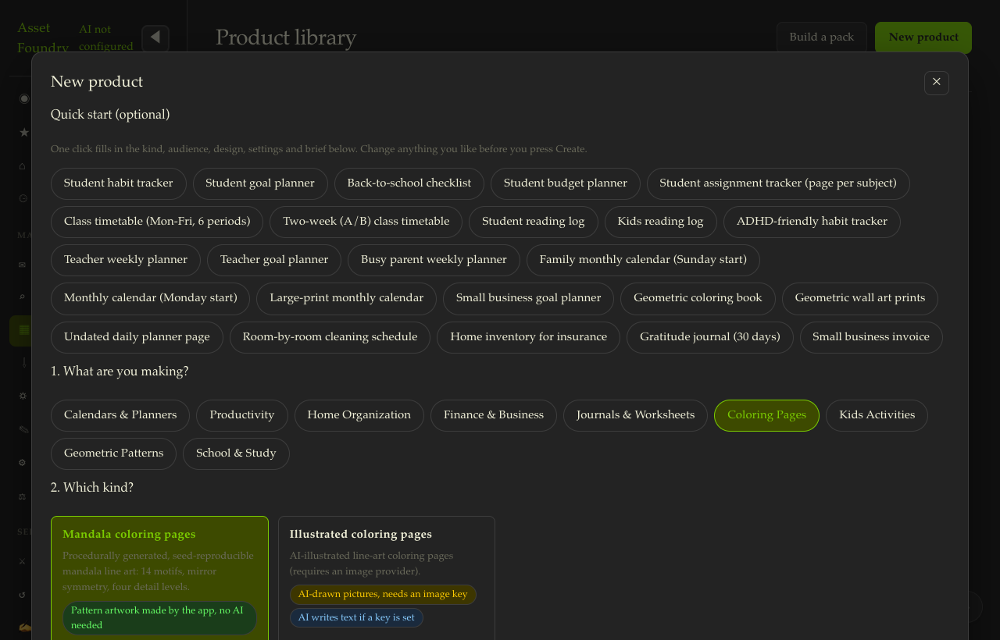

# 3. Your first product: a mandala coloring pack

**Goal:** make a six-design mandala coloring pack, check it, approve it and see where its files are.

**Why a mandala first:** mandalas are drawn by the app's own code. No AI key, no internet, no cost. The result is the same every time you use the same settings, so you can follow along and see what this chapter shows.

**Verification:** the product was created and run through the full pipeline in a throwaway copy of the app, and every result below (page counts, file names, QA lines) was read from that run: VERIFIED. The New product window was captured live. The creation call used the same API the window uses. The button-by-button clicking follows the screenshots and the [Walkthrough](../../guide/WALKTHROUGH.md): PARTIALLY VERIFIED.

**Time:** about a minute for Foundry to make it, five minutes for you to check it.

## Before you start

- The app is running ([chapter 2](02-first-run-and-navigation.md)).
- Nothing else is needed. This lesson spends no money and posts nothing.

## Step 1: open New product

Open **Product library** in the sidebar and press **New product** (top right). The Dashboard has the same button.

The window fills in step by step. At the top is **Quick start**: buttons that fill the whole form at once. There are no mandala presets, so skip them.

## Step 2: choose what you are making

1. Under **1. What are you making?**, click **Coloring Pages**.
2. Under **2. Which kind?**, click the **Mandala coloring pages** card. It carries a green label, "Pattern artwork made by the app, no AI needed". That label is your promise that this works with no key.

## Step 3: look and feel

- **Title:** leave it blank and one is made for you, or type `Sample Mandala Coloring Pages`.
- **Design system:** colours, fonts and layout. The default for mandalas is **Minimal Mono**. Leave it.
- **Audience, Theme:** leave them. For mandalas the theme only changes the default title and listing keywords. It does not change the drawings.
- **Paper size:** the default is US Letter, portrait. Change it only if you print on A4.
- **License:** leave **Personal use**.

## Step 4: the mandala settings

| Setting | What it controls | For this lesson |
| --- | --- | --- |
| **Pages** | How many designs (1 to 30) | 6 |
| **Detail** | Number of rings: simple 3, medium 5, detailed 7, intricate 10 | medium |
| **Symmetry** | How many times a design repeats around its centre. **Auto** lets each page choose | Auto |
| **Motif set** | The family of shapes: classic, botanical, geometric, celestial | celestial |
| **Cover** | Adds a title page | on |

Changing **Detail** changes the *whole page*, not only one corner: more rings means finer lines and more to color. Changing **Pages** changes how many drawings and the page count of the PDF.

## Step 5: try it first

Under the settings is a **SAMPLE** panel. For mandalas it draws the first six designs from the current settings and redraws when you change a setting. **Different designs** changes the random seed. When you press Create, the product keeps the seed you see, so you get exactly the designs you previewed. Nothing here is stored or costs anything.

## Step 6: choose listings, then create

Tick the marketplaces to **Prepare listings for**: Etsy, Gumroad, Generic. This only writes draft listings. Nothing is posted. Press **Create and start production**.

**What happens next:** the window closes and the **product page** opens. A blue **In production** banner shows the stage. The page updates by itself. On the test copy a mandala pack went from creation to finished in under a minute.

## Step 7: what finished looks like

On the product page the version dropdown reads **v1**, with status **Ready** and a green **QA Passed** pill. Under **Production steps** you should see six lines, each **Succeeded**:

1. Generate content
2. Generate artwork
3. Render
4. Qa
5. Package
6. Prepare listings

The **Files** card lists what was made. For six pages the test run produced:

| File | What it is |
| --- | --- |
| `mandala-01.svg` to `mandala-06.svg` | The six drawings, as SVG (a picture made of lines, so it prints sharp at any size) |
| `sample-mandala-coloring-pages.pdf` | **7 pages**: a cover plus six designs. This is what the customer prints |
| `HOW-TO-USE.txt`, `LICENSE.txt` | Printing tips and usage terms |
| `sample-mandala-coloring-pages.zip` | Everything above in one download. This is the file a customer gets |

Open the **QA** tab. You should see about 20 checks, all passed. The mandala-specific ones are worth knowing:

- `mandala_viewbox`: every line stays inside the drawing box.
- `mandala_min_stroke`: no line is thinner than 0.2 mm when printed. The test run's thinnest line was about 0.46 mm.
- `mandala_line_art`: pure black on white, no stray colours.
- `mandala_density`: a *warning* if a design is too packed to color.

## Step 8: inspect it yourself

QA proves the files are sound. It cannot tell you whether the pages are *good*. Press **Show 4 page previews** on the product page and click one. Then ask:

- Are there areas so fine you could not color them?
- Do the designs look different from each other, or all the same?
- Is the cover readable?

For a real product, open the PDF and page through it. [What to check before you approve](../../guide/CHECKING_PRODUCTS.md) lists what only eyes can catch for every kind of product.

## Step 9: review and approve

> **Consequence:** approving records your decision for this exact version and the listings you tick. It does not publish anything. Any later edit to the files or listing cancels the approval.

1. Open **Batch approval**. Your product is in a batch called **Manual — (title)**.
2. Click the batch name, then press **Review** on the item.
3. Look at **Listings — choose where to approve**. Each marketplace card shows the title, price, tags and a **What you keep after the marketplace's fees** line (for a $5.99 Etsy planner the test copy showed $5.17 per sale, 86 percent, plus $0.20 to list it).
4. Tick the marketplaces you want, then press **Approve for Etsy** (the button names what you ticked).

**What happens next:** the item shows your decision. The product pill on the library becomes **Approved**. The product appears on the **Factory floor**, where it joins a cart of similar products.

**If Approve is greyed out:** hover over it. Typical reasons are a failed QA, no marketplace ticked, or yellow warnings you have not accepted.

## Common mistakes

- Expecting the theme to change the artwork. For mandalas, use **Motif set** (classic, botanical, geometric, celestial).
- Skipping the visual check because QA is green.
- Ticking every marketplace by habit. Only tick the ones you will actually use.
- Forgetting that Etsy drops a listing tag longer than 20 characters (the QA line says "Dropped tag longer than 20 characters"). It is a note, not a failure.

## You are done when

- [ ] The product page shows **v1 Ready**, **QA Passed**, and six succeeded steps.
- [ ] You opened at least one page preview and the cover looks right.
- [ ] You approved it in Batch approval and the library shows **Approved**.
- [ ] You know where the ZIP is (Files card, `...zip`).

## What you learned

A product is a specification plus a pipeline. The app makes it, checks it, packs it and drafts the listings. You decide whether it is good. Everything else in this manual is a variation on that loop.

## Practice exercise: Celestial Geometry Mandala Collection

This is one of your twelve practice briefs. It does **not** exist as a product yet. See [the twelve practice briefs](../D-lessons/00-the-twelve-practice-briefs.md) for what Foundry can and cannot do for each.

---

**Previous:** [2. First run and navigation](02-first-run-and-navigation.md) · **Next:** [Part B: screen chapters](../B-screens/01-dashboard.md) · **Lessons:** [Lesson 1](../D-lessons/01-basic-mandala.md)
