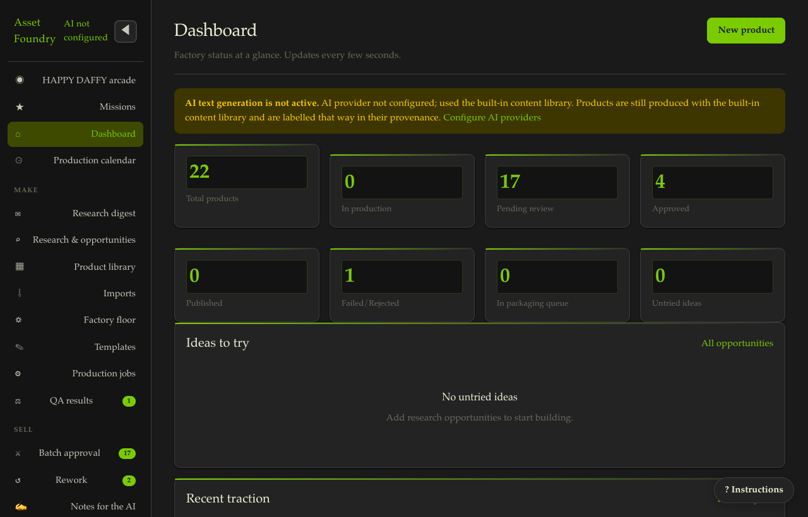

# Dashboard

**Route:** `/` · **Sidebar:** top group · **Verification:** screen captured live from a throwaway copy (VERIFIED). Banner behaviour read from the code (VERIFIED, code).

## 1. What this screen is
A summary of what the factory is doing right now. It refreshes itself every few seconds, so you can leave it open.

## 2. Why it exists
So you do not have to open eight screens to find out whether anything needs you. Each number is a doorway to the list behind it, and each coloured banner names a problem and links to its fix.

## 3. When to use it
Open it first each day. Use another screen when you need to *do* something: Batch approval to decide, Production jobs to find a stuck step, Product library to open a product.

## 4. Before you begin
Nothing. A brand-new copy shows zeros and a yellow banner. That is normal.

## 5. Understand the interface

**Top right:** **New product** opens the New product window on the Product library.

**Banners** (each shows only when it applies)

| Banner | Means | Fix |
| --- | --- | --- |
| **AI text generation is not active** | No text AI key works. Products are made from the built-in content library and are labelled that way in their provenance. | The link opens Settings → AI providers |
| **Google Chrome was not found** | PDFs cannot be made. | Install Chrome, or set its path in Settings → Rendering |
| **N listing(s) need reconciliation** | A publish attempt had an unknown result. | Opens Publishing status; see [Publishing status](16-publishing-status.md) |

**Eight number tiles** (each is a link to the matching list)

| Tile | Counts |
| --- | --- |
| Total products | Every product |
| In production | Products still being made |
| Pending review | Finished versions waiting for your decision |
| Approved | Versions you approved |
| Published | Listings recorded as published |
| Failed/Rejected | Failed or rejected versions |
| In packaging queue | Approved products waiting on the Factory floor backlog |
| Untried ideas | Research ideas not yet made into a product |

**Cards**

- **Ideas to try** and **Recent traction.** Empty until you have research ideas and sales numbers.
- **Ready for review.** The newest batches waiting for you. Click a name to review, **All batches** for the list.
- **Production.** Queued jobs, what is running, and the estimated AI cost over 30 days.
- **Schedule.** Next planned run. Says "No enabled production plans" until you make one. Plans only run while the app is open.
- **Integrations.** Whether text AI, image AI and Chrome are ready, and how each marketplace works (**Export package + manual publishing** for Etsy and Generic; Gumroad can post directly once enabled). The image row names the provider that will actually answer. With no key it showed **Pollinations · flux (backup for OpenAI)**, because the default first choice (OpenAI, paid) has no key and the keyless backup would answer.

## 6. Step-by-step: your morning check
1. Read any banner first.
2. Look at **Pending review** and **Failed/Rejected**. Click the number to go to that list.
3. Look at **Ready for review**. Click a batch name to start reviewing.
4. If you use production plans, read **Schedule** to see what ran.

## 7. Expected results
Tiles update within a few seconds of anything changing. After you make a product the **In production** tile rises, then **Pending review** does.

## 8. Practical example (sample data)
On the throwaway copy after making a set of samples: 22 total products, 17 pending review, 4 approved, 1 failed (a planner that failed QA, see [Lesson 7](../D-lessons/07-run-qa-and-fix-a-problem.md)).

## 9. Common mistakes
- Reading "Published 0" as "nothing is for sale". It counts listings *recorded* as published in Foundry. A listing you posted by hand but never recorded does not count.
- Treating the Image AI row as a promise that images are free. It only says which provider would answer next.

## 10. Troubleshooting
| Problem | Do this |
| --- | --- |
| All numbers frozen | The app server may have stopped. Check Terminal; restart with `npm start`. |
| Chrome banner | Install Chrome in /Applications, or Settings → Rendering → Chrome path. |
| Tiles say 0 but you have products | Check you are on the right copy of the app (port and data folder). |

## 11. What happens next
Review work in [Batch approval](12-batch-approval.md); open a product from the [Product library](05-product-library.md).

## 12. Completion checklist
- [ ] I read every banner.
- [ ] I know how many items are waiting for me.
- [ ] I know whether AI text and Chrome are ready.

---
**Next:** [Production calendar](02-production-calendar.md) · **Related:** [Settings](18-settings-and-integrations.md), [Production jobs](10-production-jobs.md)
