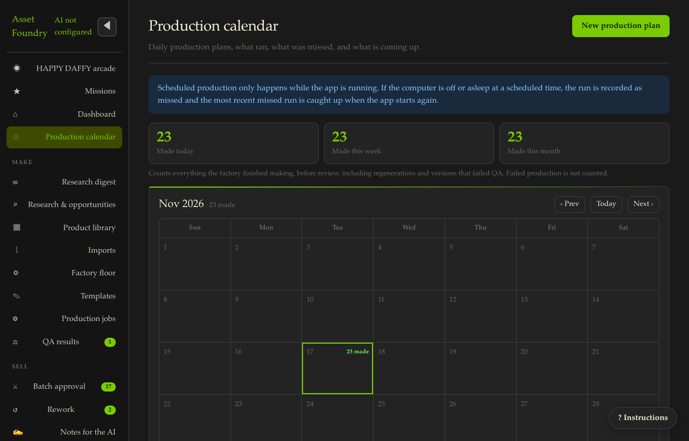
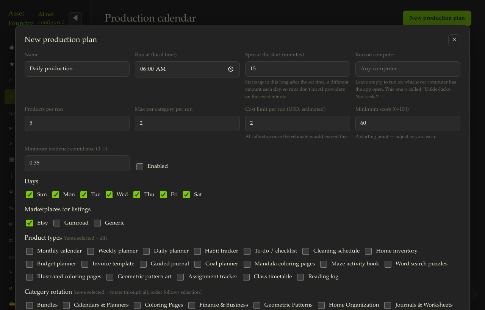

# Production calendar

**Route:** `/calendar` · **Sidebar:** top group · **Verification:** screen captured live (VERIFIED). Creating and running a plan was NOT exercised in this pass (NOT VERIFIED live); plan fields and rules come from the code and the Walkthrough.

## 1. What this screen is
Three things in one: **production plans** (automatic production on a schedule), a **month grid** of what was made, and a **Due for a new edition** card for dated products whose dates are ending.

## 2. Why it exists
To make products without you starting each one. A plan is a recipe: "every weekday at 9, make 3 products from my approved ideas." The calendar shows what ran, what was missed and what is coming.

## 3. When to use it
When you want regular output, or to see how much was made. For a single product, use New product instead.

## 4. Before you begin
A plan picks from **research ideas** (statuses New, Evaluating or Approved). **With no ideas, a plan makes nothing.** Add ideas first in [Research & opportunities](04-research-and-opportunities.md). The app must be open when the plan is due.

## 5. Understand the interface

- **Blue banner:** plans run only while the app is open. If the computer is off or asleep, the run is recorded as **missed**, and the most recent missed run is caught up when the app starts.
- **Made today / this week / this month:** everything the factory finished making *before review*, including regenerations and versions that failed QA. Production that failed outright is not counted. Weeks start on Sunday.
- **Month grid:** **‹ Prev**, **Today**, **Next ›**. Each day shows how many were made. Event colours: green finished run, yellow missed, red failed, blue running, grey upcoming.
- **Due for a new edition** (appears only when something is due): approved dated products (monthly calendar, weekly planner, dated daily planner) whose dates end within the window set in Settings → New editions (90 days to begin with), or already ended. **Make next edition** makes the same product with its dates moved on by exactly what it covered, in its own review batch, **once per product**. **Never expires** removes a product from the list. **Track its end date again** (on the product page) puts it back.
- **Production plans card:** one row per plan with schedule, quota, cost limit, next run and the last three runs. Buttons: **Run now**, **Edit**, **Pause/Enable**.
- **Seasonal opportunities:** ideas with peak months.

**Plan fields**

| Field | What it does |
| --- | --- |
| Name | Your label |
| Run at (local time) | Start time |
| Spread the start (minutes) | Starts up to this many minutes late, a different amount each day, so runs do not hit AI providers on the exact minute |
| Run on computer | Empty means any computer with the app open; a name pins it |
| Products per run | How many products one run makes |
| Max per category per run | Stops one category taking the whole run |
| Cost limit per run (USD, estimated) | AI calls stop once the estimate would go over |
| Minimum score (0 to 100), Minimum evidence confidence (0 to 1) | An idea must clear both, unless you marked it **Approve for production** |
| Enabled, Days | On/off and which weekdays |
| Marketplaces for listings | Which marketplaces get drafts |
| Product types / Category rotation | Limit or rotate what the plan makes |

**How a run picks:** open ideas, skipping any produced in the last 30 days or blocked by the trademark list, then the best scorers, rotating categories, until the quota. Everything lands in **one new batch** in Batch approval.

## 6. Step-by-step: set up a plan
1. Press **New production plan**.
2. Fill the fields above. Start small: 2 products per run, cost limit a few dollars.
3. Tick **Enabled** and the days. Press **Save plan**.
4. To test, press **Run now**. Open Batch approval to see the new batch.

> **Consequence:** a plan with an AI key spends AI credits each run. The cost limit is an *estimate* from your price table, not an invoice.

## 7. Expected results
A new batch named after the plan appears in Batch approval. The grid shows a green event.

## 8. Practical example (sample)
A plan "Weekday starter": 09:00 Mon to Fri, 2 per run, minimum score 60, marketplaces Etsy. It will not make anything until at least two ideas score above 60 or are marked Approve for production.

## 9. Common mistakes
- Creating a plan before adding any ideas, then wondering why nothing happens.
- Expecting runs while the Mac is asleep.
- Pressing **Make next edition** twice. It is once per product by design.

## 10. Troubleshooting
| Symptom | Cause and fix |
| --- | --- |
| Run shows "missed" | App was closed at the time. It catches up the latest one on start. |
| Run made 0 products | No eligible ideas. Add or approve some. |
| "reached its cost limit" | Raise the plan's cost limit or lower quota. |

## 11. What happens next
Review the batch in [Batch approval](12-batch-approval.md).

## 12. Completion checklist
- [ ] I know plans need ideas and an open app.
- [ ] I set a cost limit.
- [ ] I tested with Run now.

---
**Previous:** [Dashboard](01-dashboard.md) · **Next:** [Research digest](03-research-digest.md)
