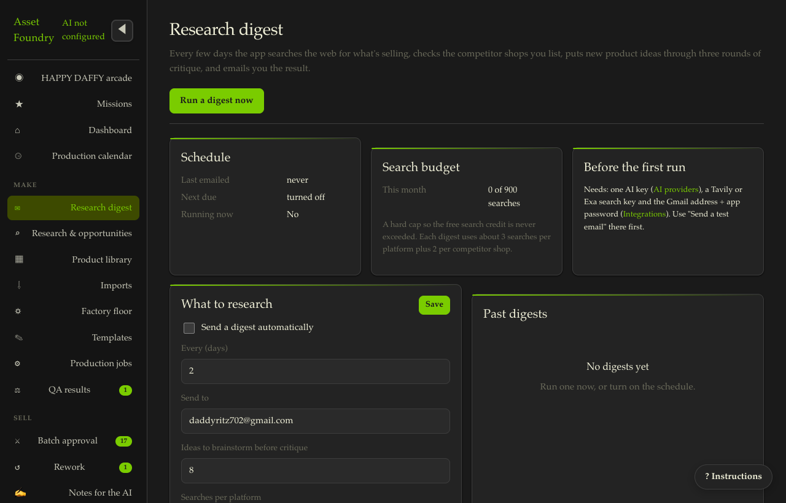

# Research digest

**Route:** `/digest` · **Sidebar:** Make · **Verification:** screen captured live (VERIFIED). A digest run needs real search and AI keys and was NOT run (NOT VERIFIED; the Constitution says the digest email has never had a live run).

## 1. What this screen is
Every few days the app searches the web for what is selling on the platforms you pick, studies competitor shops you list, brainstorms product ideas, puts them through three rounds of critique and emails you the result.

## 2. Why it exists
To feed Stage 1 (Research) with ideas backed by evidence, without you browsing marketplaces by hand.

## 3. When to use it
Weekly, to read the result and press **Save to Research** on ideas you like. Use [Research & opportunities](04-research-and-opportunities.md) for ideas you already have.

## 4. Before you begin
It needs three things, listed on the screen under **Before the first run**:
1. **One AI key** (Settings → AI providers).
2. **A Tavily or Exa search key** (Settings → Integrations). A *search key* lets the app run web searches through a search service.
3. **A Gmail address and app password** (Settings → Integrations). An *app password* is a 16-letter password Google creates for one app, so you never give an app your real password. Use a separate business Gmail, turn on 2-Step Verification, create the app password, then press **Send a test email**.

## 5. Understand the interface
- **Run a digest now** (top right). Takes a few minutes.
- **Schedule:** last emailed, next due ("turned off" until enabled), running now.
- **Search budget:** searches used this month against your cap (default cap 900). A digest uses about 3 searches per platform plus 2 per competitor shop. The cap is a hard stop so a free search credit is never overspent.
- **What to research** (press **Save** in the card corner): automatic sending on/off, every N days, send-to address, ideas to brainstorm, searches per platform, monthly cap, **Platforms to scan** (chips: etsy, gumroad, creative market, teachers pay teachers and others; up to 15), **Your taste** (what you like or never want; critique scores ideas against it), **Competitor shops** (platform, web address starting with http, optional name and **Family**, then **Add**).
- **Competitor families:** the aim is about 12 shops per family. A digest looks at 10 shops and moves on through the list next time.
- **Past digests:** each row has date, trigger, searches used and status (sent, failed, running). **Open** shows: what is selling per platform, competitor strengths and gaps, and proposed ideas with **Save to Research**.

**Honest numbers:** a number (sales, revenue) is shown only if it appears on a page the app found, with a link. Anything inferred is labelled "AI inference". Many platforms publish no seller sales, so some digests have few hard numbers. That is honest, not a bug.

## 6. Step-by-step
1. Add keys and send the test email (Settings).
2. Tick **Send a digest automatically**, set **Every (days)** and the send-to address.
3. Pick platforms. Write **Your taste**.
4. Add competitor shops.
5. Press **Save**, then **Run a digest now**.
6. When the status becomes **sent**, press **Open**, read it, and press **Save to Research** on ideas you like.

> **Consequence:** each run uses search credits and AI calls. Keep the monthly cap at or under your free allowance.

## 7. Expected results
An email arrives; a row appears under Past digests; saved ideas show in Research & opportunities as "AI idea".

## 8. Practical example (sample)
Platforms: etsy, teachers pay teachers. Taste: "Simple, calm printables for students. Never anything with brand names." Two competitor shops with family "Student planners".

## 9. Common mistakes
- Using the normal Gmail password instead of the app password.
- Turning on the schedule with no keys.
- Treating AI ideas as proven demand. They carry no demand data until you add research.

## 10. Troubleshooting
| Message | Fix |
| --- | --- |
| "Gmail refused the login" | Use the 16-letter app password and check the sending address |
| "monthly web-search budget is used up" | Wait for next month or raise the cap |
| Digest status "failed" | Check Settings → Logs & audit |

## 11. What happens next
Saved ideas become opportunities: [Research & opportunities](04-research-and-opportunities.md).

## 12. Completion checklist
- [ ] Keys saved and test email arrived.
- [ ] Platforms and taste set.
- [ ] One digest run and read.

---
**Previous:** [Production calendar](02-production-calendar.md) · **Next:** [Research & opportunities](04-research-and-opportunities.md)
