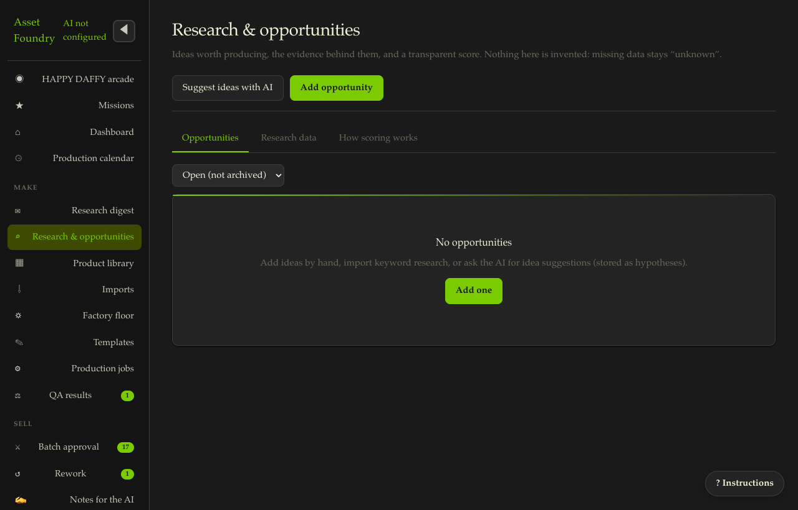
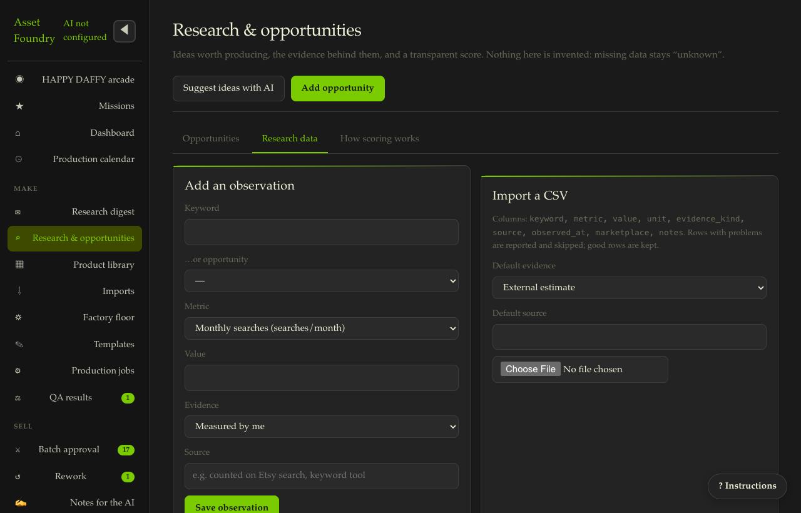
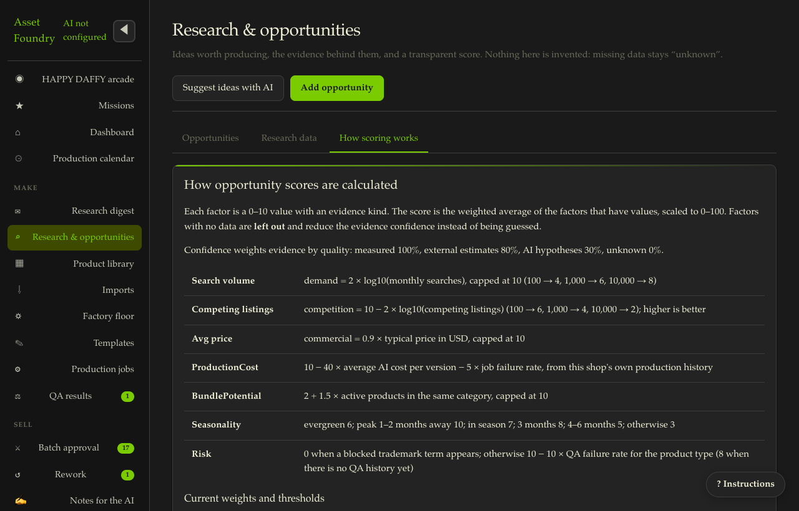

# Research & opportunities

**Route:** `/research` (three tabs) · **Sidebar:** Make · **Verification:** screen and tabs captured live (VERIFIED). Adding, scoring and producing from an idea was NOT exercised in this pass (code and Walkthrough only).

This chapter also covers the three things that are *not* separate screens: **Opportunity details** (a pop-up), **Research data** (a tab) and **Scoring** (a tab).

## 1. What this screen is
A list of product ideas ("opportunities") with the evidence behind each and a score that shows its working.

## 2. Why it exists
So "what should I make next?" has an answer based on evidence. Missing data stays "unknown", lowers the confidence and is never filled in with a guess (Constitution, Article 5.2).

## 3. When to use it
When you have an idea, or want to choose what to produce. Product plans pick from here. For a one-off product, New product is quicker.

## 4. Before you begin
Nothing. An empty list says "No opportunities".

## 5. Understand the interface

**Top right**
- **Suggest ideas with AI:** set **How many** (1 to 10) and an optional focus. Needs a text AI key. Ideas are labelled **AI idea** and carry *no demand numbers* (the AI is told not to invent any).
- **Add opportunity:** Title, Product type, Audience, Theme, Search keywords (comma separated), Description, "What would make it different?", and **Peak season months** (leave unticked for evergreen).

**Tabs:** Opportunities · Research data · How scoring works.

### Opportunities tab
- **Status filter:** open by default (New, Evaluating, Approved). Others: Produced, Rejected, Archived.
- **Make sample previews (N):** draws a free sample page for every idea lacking one. No AI.
- Columns: Opportunity, Type, Status, Score, Evidence confidence, Outcome, Origin. **Click a row** to open the details pop-up.

**Opportunity details (pop-up)**
- **Edit**, **Re-score**, **Approve for production** (plans always pick it, whatever its score), **Reject**, **Produce now** (starts a product and opens it).
- **Sample preview:** **Make preview** draws the cover and first inside page offline, labelled SAMPLE. Marked out of date if you change the title, type, audience or theme. Illustrated coloring ideas get no free sample.
- **Score card:** each factor's value, where it came from and its evidence kind. Factors with no data show a dash, are left out of the score and lower the confidence.
- **Your ratings:** type your own 0 to 10 value for any factor, say where it came from (Measured by me, External estimate, AI hypothesis), add a note, press **Save & re-score**. Your rating overrides.
- **Research data (N)** and **Products made from this**.

### Research data tab

- **Add an observation:** keyword or idea, metric, value, evidence kind, source.
- **Import a CSV:** pick default evidence kind and source, choose a file. Bad rows are reported by row number and skipped; good rows are kept.

### How scoring works tab

Each factor is a 0 to 10 value; the score is the weighted average of the factors that have values, scaled to 0 to 100. **Confidence** weights each piece of evidence by quality: measured 100 percent, external estimate 80, AI hypothesis 30, unknown 0. Weights and thresholds (default minimum score 60, minimum confidence 0.35) are set in Settings → Scoring.

## 6. Step-by-step: from idea to product
1. Press **Add opportunity**. Enter a title (for example "Ocean Explorer Word Search"), product type, audience, theme, keywords. **Save**.
2. Open it. Press **Make preview** to see a free sample.
3. Add evidence: on the Research data tab, record any real numbers you have (for example a keyword's monthly searches, evidence kind "External tool estimate").
4. Back in the idea, press **Re-score**.
5. Press **Approve for production** (so plans pick it) or **Produce now** (makes it immediately).

> **Consequence:** **Produce now** starts production straight away and, with an AI key, spends credits.

## 7. Expected results
The idea moves to Approved or Produced, and links to the product made.

## 8. Practical example (sample)
Idea "Ocean Explorer Word Search": type Word search, theme Ocean, audience Kids. A sample preview shows the cover and first puzzle drawn from the built-in ocean word list.

## 9. Common mistakes
- Trusting a high score built on AI hypotheses (weighted only 30 percent).
- Expecting a production plan to pick a rejected or archived idea.
- Editing the title after making a preview, which marks the preview out of date.

## 10. Troubleshooting
| Symptom | Fix |
| --- | --- |
| "Suggest ideas with AI" fails | Add an AI key (Settings → AI providers) |
| Score looks low | Add real research data; unknown factors cut confidence |
| CSV rows skipped | Read the row-numbered list and fix the columns |

## 11. What happens next
The product appears in [Product library](05-product-library.md) and, when finished, [Batch approval](12-batch-approval.md).

## 12. Completion checklist
- [ ] I added or opened an idea.
- [ ] I understand which numbers are measured and which are guesses.
- [ ] I approved or produced it.

---
**Previous:** [Research digest](03-research-digest.md) · **Next:** [Product library](05-product-library.md)
