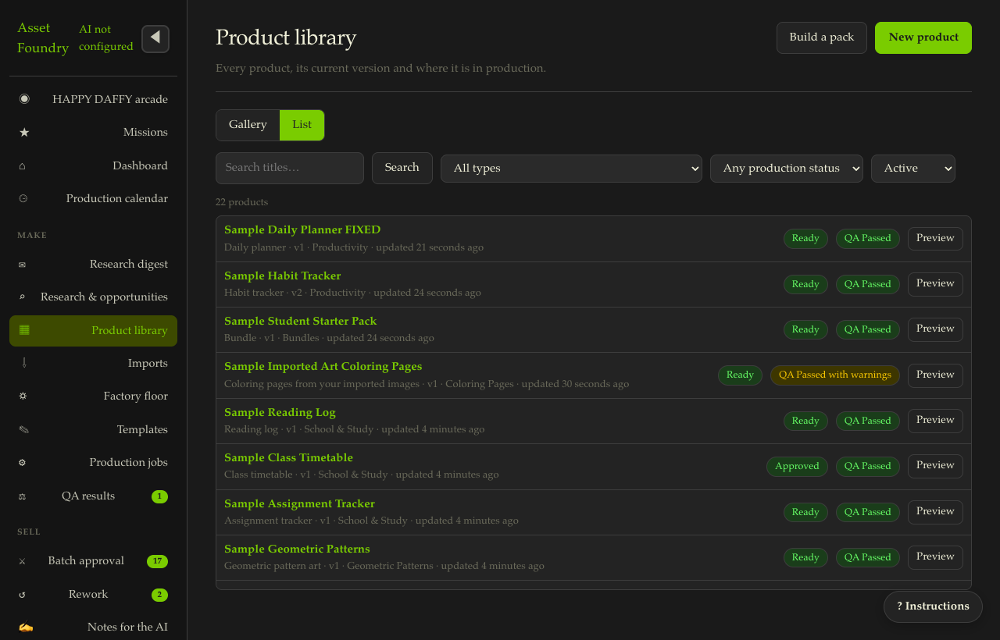
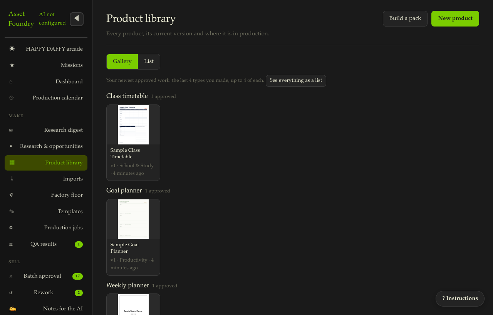
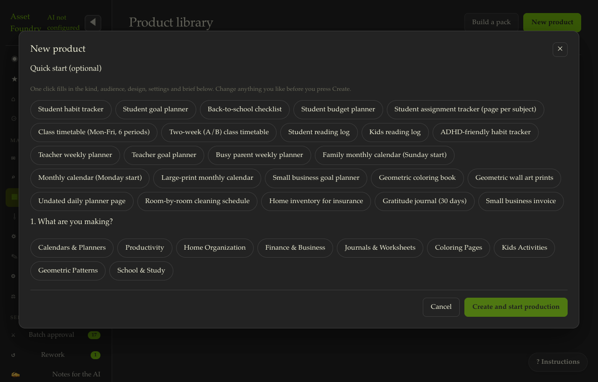
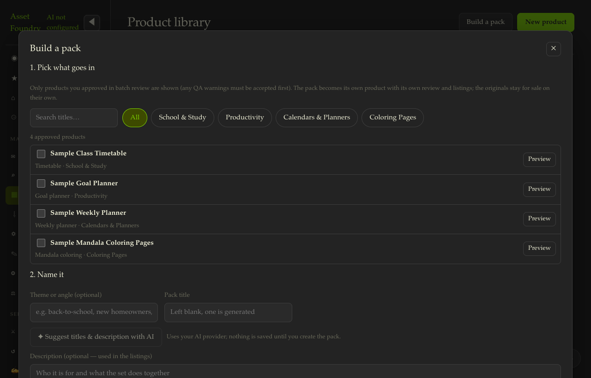

# Product library (with New product and Build a pack)

**Route:** `/library` · **Sidebar:** Make · **Verification:** screens and every form field below read from the live app (VERIFIED). Products were created through the same API the form uses (VERIFIED). Clicking through every form control by hand: PARTIALLY VERIFIED.

## 1. What this screen is
Every product you have, its current version and where it is in production. It is also where you start new products (**New product**) and packs (**Build a pack**).

## 2. Why it exists
It is the home base for the Make stage: one list, with filters, for everything the factory has produced.

## 3. When to use it
To find a product, check its status, start something new, or build a pack. To *decide* on a product use [Batch approval](12-batch-approval.md); to inspect one in depth open its [product page](06-product-page.md).

## 4. Before you begin
For New product, nothing. For a pack you need at least **two approved** products. With fewer, Build a pack says "Not enough approved products yet".

## 5. Understand the interface

**Top right:** **Build a pack**, **New product**.

**Gallery and List**
- **Gallery** (default): your newest approved work, the last 5 product types, up to 4 approved items each. Empty text: "Nothing approved yet".
- **List:** everything. Shows the true total ("22 products").
  - **Search** by title.
  - **Type** filter (all 21 types, including "Coloring pages from your imported images" and "Bundle").
  - **Production status:** In progress, Ready, Approved, QA failed, Failed, Rejected.
  - **Product status:** Active (default), Archived, Retired, All.
  - Each row: title (click to open), type, version number, category, last updated, status pills, **Preview** (the cover).

### The New product window

Each step appears once you answer the one before.

1. **Quick start (optional).** 24 preset buttons fill the whole form: the kind, audience, design, paper, the kind's own settings and a Brief. Groups: Students, Teachers, Home and family, Work, Everyone. They only fill boxes. Change anything before pressing Create.
2. **What are you making?** Categories: Calendars & Planners, Productivity, Home Organization, Finance & Business, Journals & Worksheets, Coloring Pages, Kids Activities, Geometric Patterns, School & Study.
3. **Which kind?** Cards that say how the pictures are made: *Pattern artwork made by the app, no AI needed*, *AI-drawn pictures, needs an image key*, and whether *AI writes text if a key is set*.
4. **Look and feel.** Title (optional; made for you if blank), **Design system** (colours, fonts, layout), **Fonts**, **Audience**, **Theme**, **Paper size**, **Orientation**, **Ink-saver grayscale**, **License** (Personal, Classroom or Commercial; the classroom and commercial texts are unreviewed drafts and QA warns until you edit them in Settings → License text).
5. **Brief fields.** *Who it is for*, *The problem it solves*, *What makes it different* (200 characters each) and the free **Brief for the AI** (600). They steer the AI's wording only. With no AI key they have no effect. See the [prompt library](../../guide/PROMPT_LIBRARY.md).
6. **Settings for (type).** Different for each type; see [Part C](../C-product-reference/00-overview.md).
7. **Try it first (SAMPLE).** Mandalas, patterns and mazes show their first six designs and redraw as you change settings. **Show the first pages** draws the cover and first inside page for any offline kind. Nothing is stored. Illustrated coloring gets no free sample.
8. **Also make variations (optional).** **Vary by** one thing (design system, font pairing, audience, theme, paper size, or a type setting), tick up to 12 values. Each becomes its own product.
9. **Prepare listings for:** Etsy, Gumroad, Generic. This only drafts listings.

Press **Create and start production** (or **Create N products** with variations).

> **Form gaps you must know about (VERIFIED live, 2026-11-17).** The form draws only settings that have a default value. These are **not** on the form for these types, so you cannot set them here:
>
> | Type | Missing from the form |
> | --- | --- |
> | Daily planner | **Start date** (the **Dated** box is there, but without a start date the product fails QA with `dated_requires_start`) |
> | Assignment tracker | **Subjects** |
> | Reading log | **Goal** |
> | Word search | **Topic** (use **Theme** instead; the built-in lists match a theme name) |
> | Cleaning schedule | **Rooms** (the form says "This product type has no settings") |
> | Home inventory | **Rooms** (only **Rows per room** appears) |
>
> Some presets carry a value for these (for example the Student reading log preset sets a goal). Otherwise leave **Dated** unticked for daily planners, and use Weekly planner or Monthly calendar when you need real dates.

### Build a pack

Only products you approved appear, and any QA warnings on them must have been accepted. Tick **2 to 20** products (search or filter by category; **Preview** shows covers). Optional **Theme or angle**, **Pack title** (made for you if blank), **Description**. **Suggest titles & description with AI** needs a key. Choose marketplaces and press **Create pack (N)**. The pack is its own product with its own review; the products inside stay for sale on their own too. Packs cannot be nested.

## 6. Step-by-step
**Make a product:** [Your first product](../A-start-here/03-your-first-product.md).
**Find a product:** type part of the title in Search, press Search, click the title.
**Build a pack by hand:** approve two or more products, open Build a pack, tick them, name it, Create. Review the pack in Batch approval like any product ([Lesson 9](../D-lessons/09-build-a-bundle.md)).

## 7. Expected results
After Create, the product page opens with an **In production** banner. The product appears in the list with a **Ready** pill and a **QA Passed** pill when finished (QA Passed with warnings is a yellow pill).

## 8. Practical example (sample)
Make a **Habit tracker** with Year 2027, **Months** 6 and **Rows** 10. The test copy made exactly this and it passed QA.

## 9. Common mistakes
- Ticking **Dated** on a daily planner (see the gap table).
- Choosing a theme for a mandala or maze and expecting different drawings (theme does not change them).
- Creating many variations at once with an AI key and not noticing the AI cost.

## 10. Troubleshooting
| Problem | Do this |
| --- | --- |
| Yellow banner: needs an image key | Illustrated coloring needs an image provider. See [Providers](../E-reference/04-providers-and-keys.md) |
| Product stuck "In production" | Check [Production jobs](10-production-jobs.md) |
| Product shows QA failed | Open its product page, QA tab |
| Pack list empty | Approve products first |

## 11. What happens next
Finished products go to [Batch approval](12-batch-approval.md).

## 12. Completion checklist
- [ ] I can find any product with Search and filters.
- [ ] I know the six form gaps.
- [ ] I made a product with a preset and with a manual setup.

---
**Previous:** [Research & opportunities](04-research-and-opportunities.md) · **Next:** [Product page](06-product-page.md) · **Related:** [Templates](09-templates.md)
