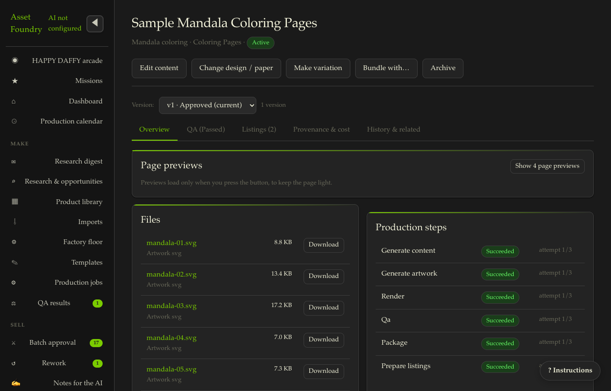
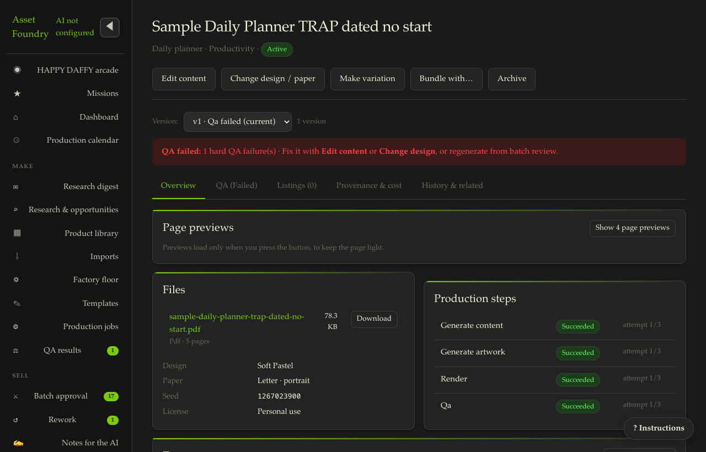
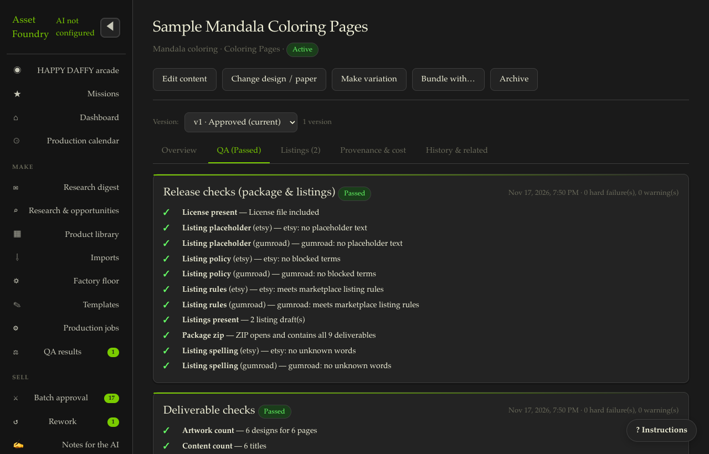
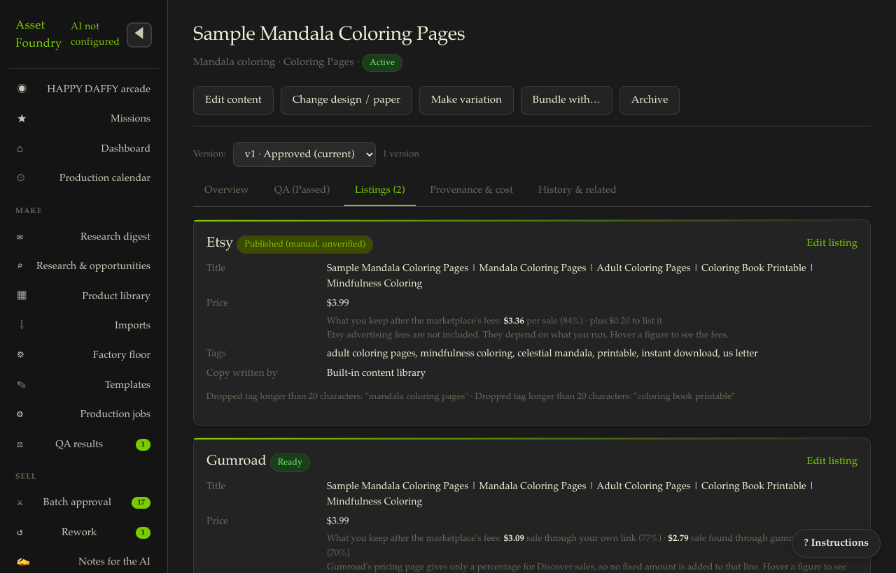

# Product page

**Route:** `/products/:id` (click any product title) · **Verification:** tabs, files, QA and steps captured and read live (VERIFIED). **Edit content** and **Change design / paper** were NOT exercised (Walkthrough and code only).

## 1. What this screen is
Everything about one product: its versions, files, checks, listings, history and the buttons to change it.

## 2. Why it exists
Production happens in the background. This is where you look inside the result and fix or branch it.

## 3. When to use it
To inspect files, read QA, edit content, change the look, make a variation, or archive. To approve, use Batch approval.

## 4. Before you begin
Have the product made (status Ready, or Failed if you are investigating).

## 5. Understand the interface

**Under the title:** type, category, audience, theme, status, license, brief answers. A dated product shows a **new edition** banner with the dates it covers.

**Buttons**

| Button | What it does | Consequence |
| --- | --- | --- |
| **Edit content** | Opens the product's content as raw JSON text. **Save as new version** makes a new version, redraws, re-runs QA. Optional change note. | **Withdraws any approval** of the current version |
| **Change design / paper** | Pick another design system, paper, orientation or grayscale with a preview. **Re-render as new version** keeps content, changes only the look. | New version; approval withdrawn |
| **Make variation** | A separate product linked to this one. It must differ in design, audience, theme, paper or settings; a new title alone is not a variation. | A variation always draws **new random art**; it keeps the brief |
| **Bundle with…** | Opens Build a pack with this product ticked | Hidden on packs |
| **Archive** | Hides it under Archived (asks first). On an archived product it says **Restore**. | Reversible |

**Version dropdown.** Lists every version and its status (for example *v1 · Approved (current)*). Picking an older one shows a blue banner.

**Banners.** Blue **In production** (updates itself). Red **Production failed** with **Retry failed step**. Red **QA failed**, reading "Fix it with Edit content or Change design, or regenerate from batch review." That advice does not cover a failure caused by a *setting* (see the dated daily planner in [Lesson 7](../D-lessons/07-run-qa-and-fix-a-problem.md)); there, make a **variation** with the setting corrected.

**Tabs**
- **Overview:** **Show N page previews** (click one for full size); **Files** (each file with **Download**, plus Design, Paper, Seed, License); **Production steps** (six jobs with attempts); **Tags**; **Listing images**; **Marketing kit**.
- **QA:** every check from every run, failures and warnings marked.

  
- **Listings:** one card per marketplace: title, price, tags, who wrote the copy, and a **What you keep after the marketplace's fees** line. **Edit listing** opens the editor ([Marketplace listings](15-marketplace-listings.md)).

  
- **Provenance & cost:** who or what wrote the content, every AI call with tokens and estimated cost, where each file came from. Cost is estimated from your price table, not an invoice.
- **History & related:** versions with notes, related products, near-duplicates ("consider merging"), products in the same category and the batches it has been in.

**Tags card.** Tags decide which packs a product can join. Tags from the product itself are fixed; ones you add have an **x**. **Suggest with AI** needs a key.

**Marketing kit.** Three Pinterest pins (1000 x 1500 PNG) plus `pinterest-copy.txt`, `launch-email.txt` and `social-and-video.txt` (a 20-second video script). Built from real pages with **no AI** and no claims about sales or reviews. **Never** in the customer's download.

## 6. Step-by-step: inspect a finished product
1. Open the product. Check the version pill says Ready and QA Passed.
2. Press **Show N page previews**; click through.
3. Open **QA** and scan for yellow lines.
4. Open **Listings**; read the title and fee line.
5. Open **Files**; download the PDF and read it at full size.

## 7. Expected results
Six steps Succeeded; files as listed in [Files and formats](../E-reference/05-files-and-formats.md).

## 8. Practical example (sample)
The sample mandala pack: 7-page PDF, six SVGs, ZIP, 3 listing images (2000 x 2000), 3 pins, 2 listings.

## 9. Common mistakes
- Editing an approved product and forgetting it cancels the approval.
- Judging a product from previews only.
- Making a "variation" and expecting the same pictures.

## 10. Troubleshooting
| Symptom | Fix |
| --- | --- |
| Red Production failed | **Retry failed step**; if it fails again read the error under Production steps |
| QA failed on a setting | Make a variation with the fixed setting |
| Missing previews | Press the preview button (they load on request) |

## 11. What happens next
Decide in [Batch approval](12-batch-approval.md).

## 12. Completion checklist
- [ ] I read QA and listings.
- [ ] I opened the PDF itself.
- [ ] I know which buttons cancel an approval.

---
**Previous:** [Product library](05-product-library.md) · **Next:** [Imports](07-imports.md)
