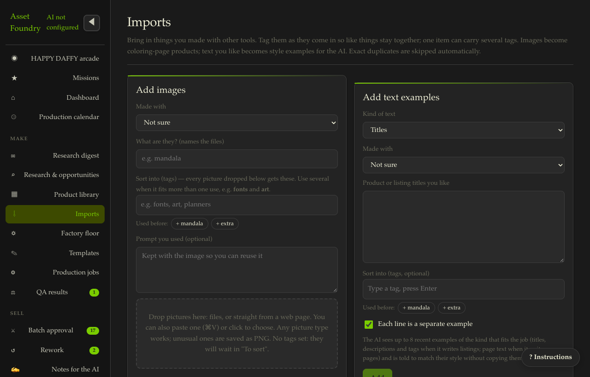

# Imports

**Route:** `/imports` · **Sidebar:** Make · **Verification:** screen captured live (VERIFIED). Importing three pictures, a duplicate, and making a product from them was exercised through the app's API (VERIFIED). Dragging files in with the mouse was NOT exercised.

## 1. What this screen is
Where you bring in pictures and text you made with other tools. Pictures become coloring-page products. Text becomes style examples shown to the AI.

## 2. Why it exists
So art from Grok, ChatGPT, Gemini, Midjourney, Canva and others can go through the same QA, listing and approval path as everything else.

## 3. When to use it
When you have outside artwork. For art Foundry draws itself, use New product.

## 4. Before you begin
Check each tool's terms before selling what it made. Foundry never trains a model on your imports: examples ride along in the prompt, as your review notes do.

## 5. Understand the interface

**Add images**
- **Made with:** Not sure, Grok Imagine, ChatGPT images, Gemini (Nano Banana), arena.ai, Flux, Venice AI, Midjourney, Canva, Something else.
- **What are they?** A word like "mandala". It names the files.
- **Sort into (tags):** type one and press Enter, or click one under **Used before**. Every picture you drop gets these tags (up to 12 each). Untagged pictures wait under **To sort**.
- **Prompt you used** (optional): kept with the image.
- **Drop pictures here:** files, pictures dragged from a web page, a paste (Cmd+V), or click to choose. Unusual picture types are saved as PNG. Exact duplicates are skipped.

**Add text examples:** kind (Titles, Descriptions, Tags, Page text, Other), made with, the text (one example per line by default), optional tags, **Add**. The AI sees up to 8 recent examples that fit the job.

**Image library:** a groups row (**All**, **To sort**, one per tag with its count), **Tick all N shown**, and per-picture **Preview**, **Edit**, **Delete** (greyed out while a product uses it). Tick pictures *in the order you want the pages*; each gets a number. A **Tags for the N ticked** box adds or removes tags on all at once. Once something is ticked a **Product title** box and **Make coloring product from N selected** appear.

**Text examples card:** every example, with **Edit**, a **Use as example** box and **Delete**.

## 6. Step-by-step: pictures to a product
1. Choose **Made with**, type what they are, add a tag.
2. Drop the pictures. A message lists each as imported, duplicate (with which file it matches) or not imported (with why).
3. Tick the pictures in page order.
4. Type a **Product title**, press **Make coloring product from N selected**.
5. The product page opens. When ready it is in Batch approval.

## 7. Expected results (live)
Three 2000 x 2000 pictures imported as `sample-art_...png` files under `references/images/`. A duplicate drop returned **duplicate**, pointed at the existing file, and **added the new tag to it**. Three pictures gave a **4-page PDF** (cover plus three), a ZIP containing the PNGs, and QA **Passed with warnings** (one listing-spelling warning).

## 8. Practical example (sample)
Tag `mandala`, made with "Sample tool". After importing, the groups row read **All (3)**, **To sort (0)**, **mandala (3)**.

## 9. Common mistakes
- Ticking pictures in the wrong order (page order = tick order).
- Importing a file with a key-like name (for example `client_secret_...json`): refused by design. A Google OAuth secret is never imported.
- Expecting AI to sort pictures. Sorting is by hand; AI tag suggestions are PLANNED, waiting for a picture-reading model.

## 10. Troubleshooting
| Symptom | Fix |
| --- | --- |
| "not imported" | The message says why: not a picture, or too large |
| Delete greyed out | A product uses that picture |
| Warning on the product | See the warning gate in [Batch approval](12-batch-approval.md) |

## 11. What happens next
[Batch approval](12-batch-approval.md). Lesson: [Import outside artwork](../D-lessons/03-import-outside-artwork.md).

## 12. Completion checklist
- [ ] Pictures imported and tagged.
- [ ] Ticked in page order.
- [ ] Product made and opened.

---
**Previous:** [Product page](06-product-page.md) · **Next:** [Factory floor](08-factory-floor.md)
