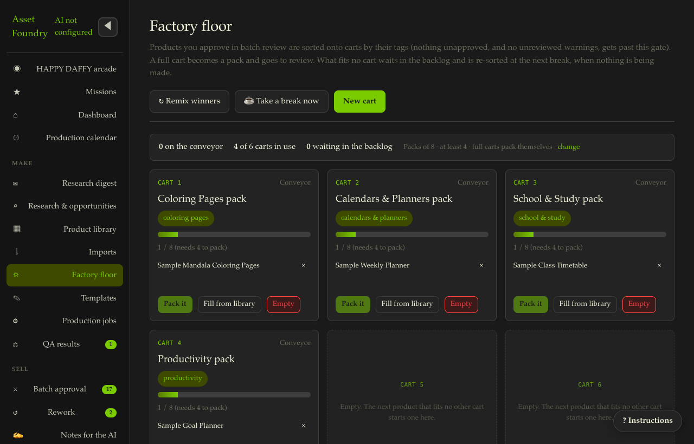

# Factory floor

**Route:** `/packing` · **Sidebar:** Make · **Verification:** screen captured live after approving four products (VERIFIED). Building a full pack from a cart was NOT exercised; a pack was built through **Build a pack** instead (VERIFIED).

## 1. What this screen is
An automatic sorter. Approved products roll onto **carts** with others that share their tags. A full cart becomes a **pack** (a bundle product) that goes to review like anything else.

## 2. Why it exists
Packs sell for more than single items, and sorting by hand is dull work.

## 3. When to use it
Glance at it after you approve products. Use **Build a pack** on the Product library when you want to choose the contents yourself.

## 4. Before you begin
Only **approved** products get in, and only once any QA warnings are accepted. Nothing unapproved passes the gate. Defaults (Settings → Packing): 6 carts open at once, pack size 8, at least 4, full carts pack themselves.

## 5. Understand the interface
- **Status strip:** "N on the conveyor" (still being made), "N of 6 carts in use", "N waiting in the backlog", and the pack settings with a **change** link.
- **Top buttons:** **Remix winners** (opens a cart around a tag your best sellers share but have never been packed under), **Take a break now** (re-sorts the backlog now; normally only when nothing is being made), **New cart** (name optional, up to 6 tag chips).
- **Each cart:** slot number, origin (Conveyor, Backlog, Variety, Remix, Manual), name, tags, a fill bar "1 / 8 (needs 4 to pack)". Each product links to its page; **x** takes it out.
  - **Pack it:** turns the cart into a pack now (needs at least 2 products and at least the cart minimum).
  - **Fill from library:** pulls matching approved products from the whole library.
  - **Empty:** sends its products back to the backlog (asks first).
- **Backlog:** products waiting for a cart, with **Put in cart…**.
- **Recently packed:** carts that became packs, and emptied carts.

**Rules in numbers:** a product joins up to 3 matching carts, goes into at most 4 packs, and waits 30 days before joining another pack with mostly the same tags. At a break, carts that sat too long are packed if they hold at least 4, else emptied; leftovers become a **Variety pack**.

## 6. Step-by-step
1. Approve products in Batch approval.
2. Open Factory floor. Each product has joined a cart (live: four products with different category tags made four carts, each "1 / 8").
3. When a cart is full, it packs itself. Or press **Pack it**.
4. Review the new pack in Batch approval.

> **Consequence:** **Pack it** starts producing the pack immediately. **Empty** is reversible only by re-sorting.

## 7. Expected results
A pack appears under **Recently packed** and as a new product with a Bundle batch.

## 8. Practical example (sample)
Four sample products: Coloring Pages pack, Calendars & Planners pack, School & Study pack, Productivity pack, each waiting for more.

## 9. Common mistakes
- Waiting for an unapproved product to appear (it will not).
- Using **Empty** by reflex; it dissolves the cart.

## 10. Troubleshooting
| Symptom | Fix |
| --- | --- |
| Approved product not on a cart | It may have unaccepted warnings; Batch approval lists such items at the top |
| Everything in backlog | All carts used; press **Take a break now** |

## 11. What happens next
[Batch approval](12-batch-approval.md) for the pack. Lesson: [Build a bundle](../D-lessons/09-build-a-bundle.md).

## 12. Completion checklist
- [ ] I know the gate (approved plus warnings accepted).
- [ ] I can find a product's cart.
- [ ] I know the difference between Pack it and Build a pack.

---
**Previous:** [Imports](07-imports.md) · **Next:** [Templates](09-templates.md)
