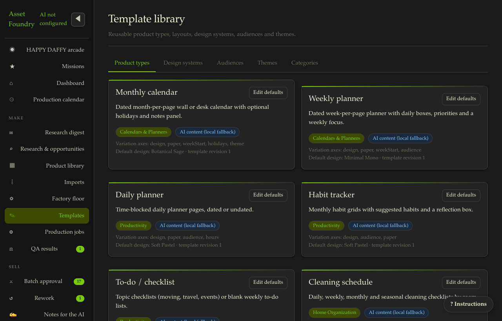
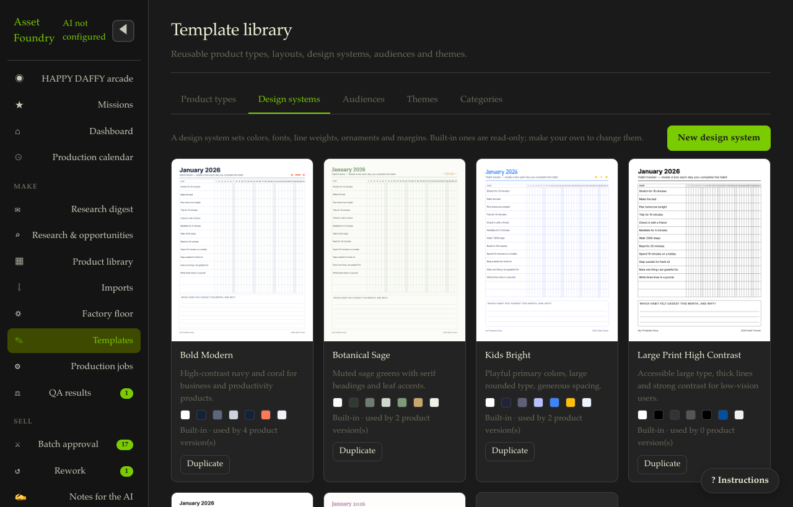

# Templates

**Route:** `/templates` (five tabs) · **Sidebar:** Make · **Verification:** screen and tabs captured live (VERIFIED). Creating a design system and editing defaults were NOT exercised (code and Walkthrough only). The page's own title reads "Template library".

## 1. What this screen is
The reusable parts every product is built from: **product types**, **design systems**, **audiences**, **themes** and **categories**.

## 2. Why it exists
So you can change how all future products of a kind look or read without editing each one.

## 3. When to use it
To set a type's default design or settings, make your own design system, or add an audience or theme. Changing a template does **not** alter products already made.

## 4. Before you begin
Nothing. Built-in items are seeded: 21 product types, 7 design systems, 8 audiences, 12 themes, 10 categories.

## 5. Understand the interface

**Product types tab.** One card per type: description, category, *AI content (local fallback)* (text is AI-written when a key works, else from the built-in library), how pictures are made, **variation axes** (what you may vary), default design and template revision. **Edit defaults** sets the default design system and default settings for new products of that type.

**Design systems tab.** A design system is a bundle of colours, fonts and layout rules. Seeded: Bold Modern, Botanical Sage, Kids Bright, Large Print High Contrast, Minimal Mono, Soft Pastel, Warm Neutral.

- **New design system** starts from a copy of one; choose **Start from**.
- **Duplicate** asks for a name. **Edit** only exists on custom ones (built-ins cannot be changed). **Delete** only on custom ones no product uses.
- The editor: Name, Description, **Colors** (pickers), **Type** (heading, body and accent fonts, base size, heading scale), **Layout** (line weight, corner radius, ornament: none, dots, leaf, stars, waves, geometric; density: airy, balanced, compact; four margins in mm).

**Audiences tab.** Seeded: ADHD-friendly, Busy parents, General adults, Kids 4-8, Seniors (large print), Small business owners, Students, Teachers. Add one with name, description, tone, reading level, text-size multiplier, density and notes for content. Audiences steer AI wording and offline word lists.

**Themes tab.** Seeded: Autumn Harvest, Back to School, Botanical, Celestial, Dinosaurs, Farmhouse, Minimalist, New Year Reset, Ocean, Space Adventure, Winter Holidays, Woodland Animals. Add one with name, description, keywords and season months (for example `11,12`).

**Categories tab.** Read-only, with product counts.

> **What a theme really does:** it names default titles, cover subtitles and listing keywords, and picks built-in word lists (for example the Ocean theme picks the ocean word search list). It does **not** change procedural artwork such as mandalas or mazes.

## 6. Step-by-step: set a type's default design
1. Product types tab, find the type, press **Edit defaults**.
2. Choose the default design system and any default settings. **Save**.
3. New products of that type start from these.

## 7. Expected results
Next time you open New product for that type, the new default is preselected.

## 8. Practical example (sample)
Duplicate **Minimal Mono**, name it "Studio Mono", set heading font and ornament, save, then pick it in New product.

## 9. Common mistakes
- Expecting an edit to restyle old products. Use the product page's **Change design / paper** for that.
- Trying to edit a built-in design system.

## 10. Troubleshooting
| Symptom | Fix |
| --- | --- |
| No Edit button | The design system is built-in; Duplicate it |
| Can't delete | A product uses it |

## 11. What happens next
Back to [Product library](05-product-library.md).

## 12. Completion checklist
- [ ] I know what a design system controls.
- [ ] I know a theme does not redraw mandalas or mazes.

---
**Previous:** [Factory floor](08-factory-floor.md) · **Next:** [Production jobs](10-production-jobs.md)
