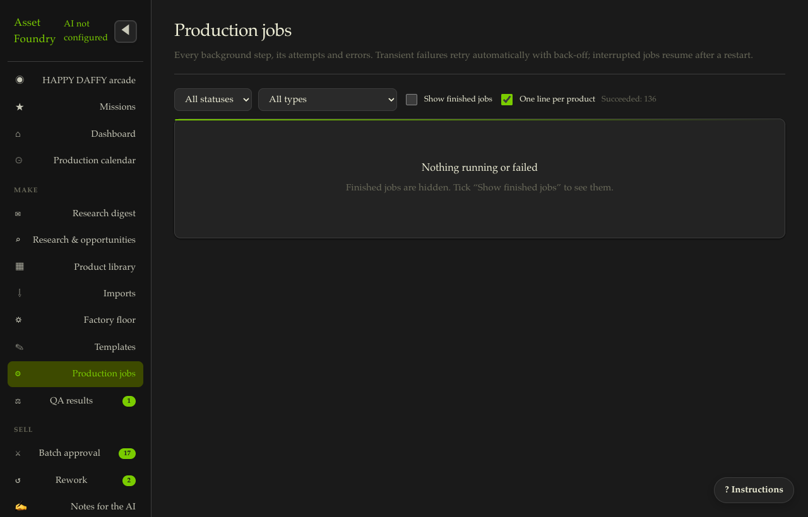

# Production jobs

**Route:** `/jobs` · **Sidebar:** Make · **Verification:** screen captured live (VERIFIED). Job names, statuses and retry rules read from the code (VERIFIED, code). Retry and Cancel buttons were NOT exercised.

## 1. What this screen is
Every background step the factory runs, with its attempts and errors.

## 2. Why it exists
Making a product is several steps in a row. This is where you look when something seems stuck or has failed.

## 3. When to use it
Only when something looks wrong. Most days you never open it.

## 4. Before you begin
Know the six steps of one product, in order: **Generate content, Generate artwork, Render, QA, Package, Prepare listings**. Other job types: Run production plan, Refresh recommendations (and the research digest).

## 5. Understand the interface
- By default only **queued, running or failed** jobs show. Live, with 136 jobs finished, the page said "Nothing running or failed" and "Succeeded: 136". Tick **Show finished jobs** to see all.
- Filters: **status** (Queued, Running, Succeeded, Failed, Cancelled) and **type**. **One line per product** folds a product's steps into one row. **Clear view** hides rows without deleting them.
- Each row: job, product link, status, attempts, when, last error. A queued job waiting to retry says when.
- **Retry** (failed or cancelled jobs). **Cancel** (queued jobs only). Click a row for **Job details**: type, status, error class, every attempt with duration and error, and the result.

**How retries work:** a *transient* problem (rate limit, timeout, server error, dropped connection, bad AI output, a rendering glitch) retries by itself, up to **3 attempts**, waiting longer each time (15 seconds, then 60, then 240). A *permanent* problem (rejected key, bad request) stops. A job interrupted by closing the app is re-queued at the next start.

**Where jobs run:** AI jobs (content, artwork, listings, digest) two at a time; render jobs (render, QA, package) two at a time; others four.

## 6. Step-by-step: investigate a stuck product
1. Open the product page; look at **Production steps**.
2. Note which step shows Failed.
3. Open Production jobs. Tick **Show finished jobs** if needed, find the row, click it, read the error.
4. If the error says a key was rejected, fix it in Settings → AI providers. If it was transient, press **Retry**.

## 7. Expected results
A retried job moves to Queued, then Running, then Succeeded. The product advances.

## 8. Practical example (sample)
A render job fails "Rendering failed: Target closed". That is a transient Chrome glitch; it retries on its own.

## 9. Common mistakes
- Pressing Retry on a job that fails for a permanent reason (it will fail again).
- Cancelling a queued step and leaving a product half-made.

## 10. Troubleshooting
| Error text | Meaning |
| --- | --- |
| "Chrome was not found" | Install Chrome or set its path in Settings → Rendering |
| "AI: None of the N providers could answer" | Every provider failed; read the per-provider reasons |
| "Key rejected" | Re-enter the key |

## 11. What happens next
Back to the [product page](06-product-page.md) or [QA results](11-qa-results.md).

## 12. Completion checklist
- [ ] I can name the six steps.
- [ ] I know which errors retry by themselves.

---
**Previous:** [Templates](09-templates.md) · **Next:** [QA results](11-qa-results.md) · **Related:** [Errors and recovery](../E-reference/07-errors-and-recovery.md)
