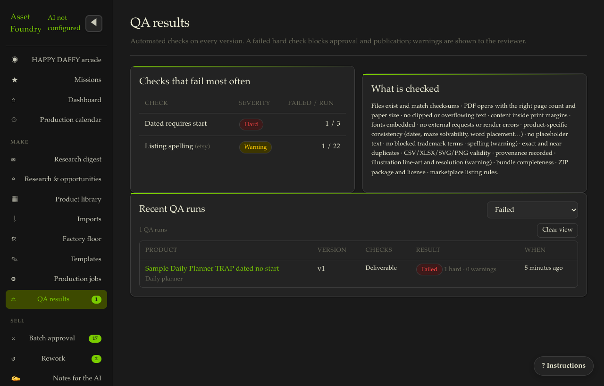

# QA results

**Route:** `/qa` · **Sidebar:** Make · **Verification:** screen captured live with a real failing check (VERIFIED). Check meanings read from the code (VERIFIED, code). The full list of checks is in [QA checks](../E-reference/03-qa-checks.md).

## 1. What this screen is
The automatic checks run on every version, with a summary of which fail most often.

## 2. Why it exists
So a broken file never reaches a buyer. QA (quality assurance) means "automatic checks on the files".

## 3. When to use it
To see why something failed, or which problem keeps recurring. To judge whether a product is *good*, you must look at it yourself (see below).

## 4. Before you begin
Know the two kinds of result:

- **Hard** check: a failure **blocks approval and publishing**. Shown red.
- **Warning**: shown to you at review; you must fix it or tick **I accept these warnings** before approving. Shown yellow.

A run is **Deliverable** (checks the files) or **Release** (checks the package and listings).

## 5. Understand the interface
- **Checks that fail most often:** check name, severity, **failed / run**. Live: "Dated requires start, Hard, 1 / 3" and "Listing spelling (etsy), Warning, 1 / 22".
- **What is checked:** the plain-English list (files and checksums; PDF page count and paper size; clipped or overflowing text; print margins; embedded fonts; no outside requests; product-specific checks such as dates, solvable mazes, word placement; placeholder text; blocked trademark terms; spelling; duplicates; file validity; provenance; line art and resolution; bundle completeness; the ZIP and license; marketplace listing rules).
- **Recent QA runs:** failed by default. The dropdown switches to Passed with warnings, Passed or All. Each row: product, version, kind, result and counts. **Click a row** to open every check with its message.

## 6. Step-by-step: read a failure
1. Open the row. Find the line marked failed.
2. Read its message. Live example: `dated_requires_start: Dated planner has no start date`.
3. Decide: fix the cause, or regenerate. See [Lesson 7](../D-lessons/07-run-qa-and-fix-a-problem.md).

## 7. Expected results
After a fix, the new version shows Passed and the old failed run stays in history.

## 8. Practical example (sample)
A passing mandala run shows lines like "6 designs for 6 pages", "PDF opens; 7 pages (expected 7)", "Thinnest line about 0.46 mm when printed 192 mm wide (minimum 0.2 mm)".

## 9. Common mistakes
- **Treating green QA as "good".** QA proves files are sound. It never reads the meaning of a page. [What to check before you approve](../../guide/CHECKING_PRODUCTS.md) lists what only your eyes catch for each kind.
- Ignoring warnings. Some matter (for example `mandala_density`: too packed to color).
- Believing QA checks spreadsheet formulas. It only confirms the XLSX opens and has sheets. Test budget and inventory workbooks by typing numbers in.

## 10. Troubleshooting
| Symptom | Fix |
| --- | --- |
| A hard failure you cannot explain | Read the message; look at the product page QA tab |
| Spelling warning on a real word | Add the word to Settings → QA → spelling allowlist |
| "Spelling not checked: no system dictionary" | The Mac has no dictionary file; spelling is skipped |

## 11. What happens next
Fix, then [Batch approval](12-batch-approval.md); failures also appear in [Rework](13-rework.md).

## 12. Completion checklist
- [ ] I can tell hard from warning.
- [ ] I know QA does not judge quality.

---
**Previous:** [Production jobs](10-production-jobs.md) · **Next:** [Batch approval](12-batch-approval.md)
