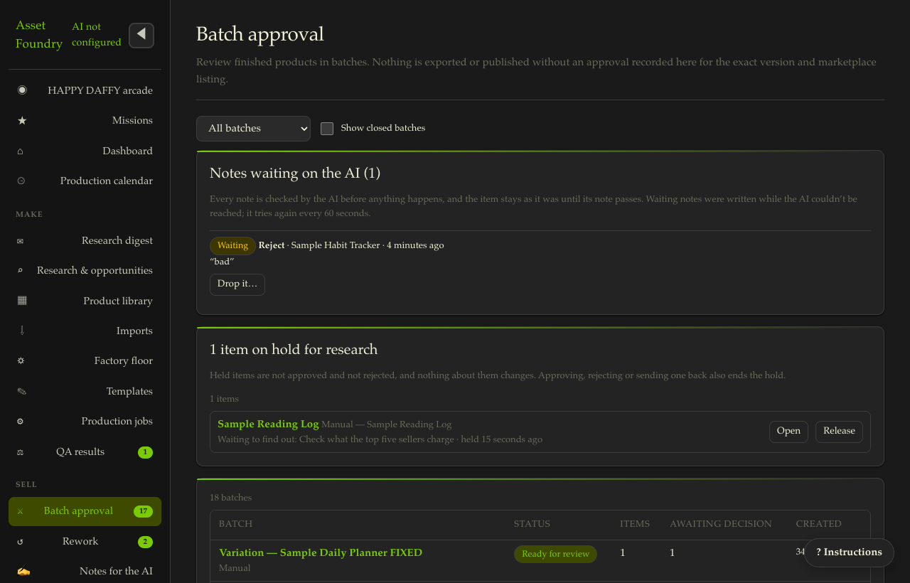
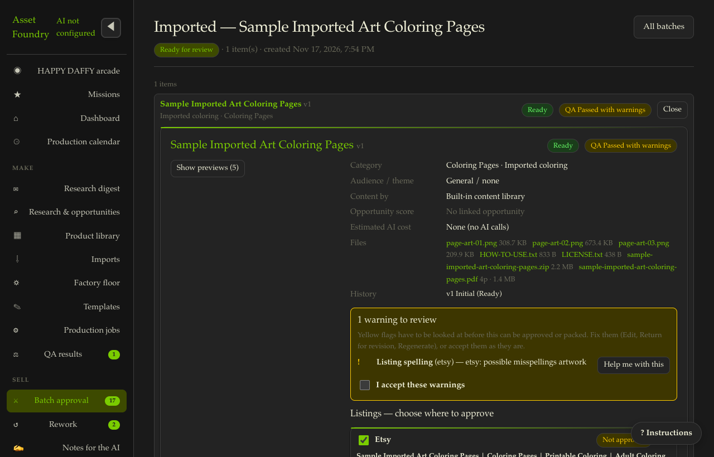
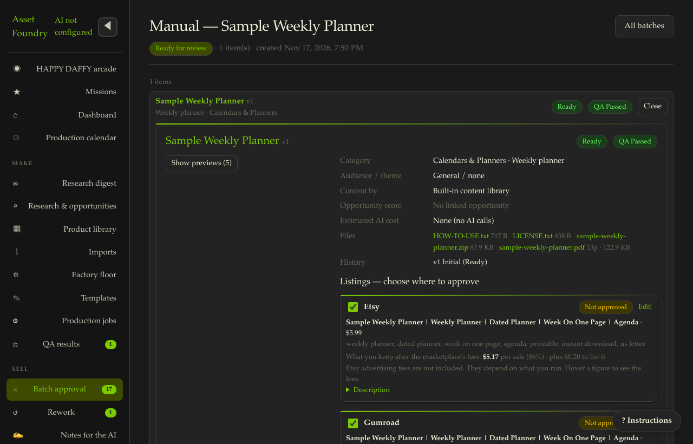

# Batch approval (and the batch review page)

**Route:** `/batches` and `/batches/:id` · **Sidebar:** Sell · **Verification:** both pages captured live (VERIFIED). Approve, the QA-failed block, regenerate with no notes, hold, and a rejection with no AI key were exercised live through the app's API (VERIFIED). Drawing boxes and the AI reason check need an AI key (NOT VERIFIED).

## 1. What this screen is
Where you review finished products and decide. **Nothing is exported or published without an approval recorded here**, for that exact version and that marketplace listing.

## 2. Why it exists
The Constitution's first standing rule: a person approves before anything is published.

## 3. When to use it
Daily, as the review step. Each production-plan run makes one batch. Each product you make by hand gets its own batch called **Manual — (title)** (or **Variation —**, **Imported —**, **Bundle —**).

## 4. Before you begin
Have finished products. Read [What to check before you approve](../../guide/CHECKING_PRODUCTS.md).

## 5. Understand the interface

**The list.** Needs-you batches by default. Tick **Show closed batches** or pick a status (Ready for review, Still producing, Closed). Columns: Batch, Status, Items, **Awaiting decision**, Created.

**Three panels that appear only when they apply**
- **Notes waiting on the AI (N).** Every note you write when rejecting or returning something is checked by the AI first, and *the item stays as it was until its note passes*. If the AI cannot be reached the note waits and retries every 60 seconds. **Drop it…** discards a waiting note. See the warning below.
- **N items on hold for research.** Items parked with a note. **Open** and **Release**. The "Awaiting decision" column leaves held items out ("0 · 1 on hold").
- **Approved items with warnings you haven't accepted.** Items approved before the warning gate existed. They stay approved but cannot be packed or published until you accept the warnings.

### The batch review page

Each item is one slim line. **Review** opens it; **Close** folds it. An open item shows:
- **Show previews (N).**
- Category, audience/theme, **Content by** (a provider, or *Built-in content library*), opportunity score, estimated AI cost, **Files** (click to download), what is inside (for packs), version history.
- **QA failures** (opened up) and **Warnings to review**.
- **Listings — choose where to approve.** One card per marketplace: title, price, tags, a **What you keep after the marketplace's fees** line, a **Description** you can open, and **Edit**. Tick the marketplaces to approve. A listing with problems is red and cannot be ticked until fixed.

**The buttons**

| Button | What it does | Consequence |
| --- | --- | --- |
| **Approve for (marketplaces)** | Records your approval for this version and the ticked listings | Item moves to the Factory floor; Gumroad listings post only if you enabled auto-posting. Greyed out if QA failed, nothing is ticked, or warnings are not accepted; hover for the reason |
| **Return for revision** | "What should change?" Your notes go to the generator for the next version | New version; note is AI-checked |
| **Regenerate** | A fresh version with new random artwork; notes optional | New version. **Works with a blank note even with no AI key** (verified live) |
| **Reject** | Marks the version rejected; it can never be published. Needs a reason saying *which part* is wrong and *what* is wrong | Irreversible for that version; note is AI-checked |
| **Hold for research** | Parks the item with a note ("check what the top 5 sellers charge") | Not a decision; nothing changes; no learning. Any real decision or **Release** ends it |
| **Edit…** | Opens the product page | Editing cancels an existing approval |

**Draw a box on a page** (in Reject, Return and Regenerate): drag up to 6 boxes on page previews. A box says *which part* is wrong, so the words need only say *what* ("too blurry" plus a box passes; "bad" plus a box does not). A picture-reading AI (Settings → Generation → Vision) describes each box; it has not run live yet.

**Warnings (yellow flags).** A box lists each. **Help me with this** asks the AI what it means and how to fix it (a suggestion only; needs a key). Either fix it, or tick **I accept these warnings** (optional note, kept in the audit log). **Approve unlocks once the box is ticked.**

## 6. Step-by-step: review one item
1. Open the batch, press **Review** on the item.
2. Press **Show previews**, page through, and download the PDF to read it.
3. Read QA failures and warnings.
4. Tick the marketplaces you intend to use.
5. Choose: **Approve**, or **Return for revision / Regenerate / Reject** with a *specific* note, or **Hold for research**.

> **Consequences.** Approve withdraws nothing but is cancelled by any later edit. Reject is permanent for that version. Notes you write are kept in [Notes for the AI](14-notes-for-the-ai.md) and shape future AI prompts, so be specific.

## 7. Expected results (live)
- Approving the sample mandala returned a decision for each listing and the library showed **Approved**.
- Trying to approve the failed daily planner returned: *"This version cannot be approved: QA status is "failed". Fix or regenerate it first."*
- Regenerating the habit tracker (no note) created **v2**; v1 became *superseded* and appears on Rework under "Rejected by you" as an older version.
- Rejecting with the one-word note "bad" and **no AI key** returned: *"The AI can't be reached right now, so your note is waiting in line. Nothing has changed yet."* The item stayed as it was.

> **Important:** with no working AI key, a **Reject** or **Return for revision** note cannot be checked, so it waits in line and the rejection is not recorded. Regenerate with a blank note and Approve still work. Set up an AI key before you rely on rejecting.

## 8. Practical example (sample)
Reject note that passes: "The page 3 mandala is too fine to color: the outer ring lines are under a millimetre apart." One that fails: "bad".

## 9. Common mistakes
- Approving without opening the PDF.
- Writing "bad" or "ugly" as a reason.
- Approving for a marketplace you will not use.
- Editing after approving.

## 10. Troubleshooting
| Symptom | Fix |
| --- | --- |
| Approve greyed out | Hover; QA failed, no marketplace ticked, or warnings not accepted |
| "A newer version of this product exists" | Review the newest version instead |
| "This version is still being produced" | Wait for it to finish |
| Note stuck in "Notes waiting on the AI" | Add an AI key, or **Drop it…** |

## 11. What happens next
Approved items go to [Factory floor](08-factory-floor.md) and [Publishing status](16-publishing-status.md); rejected and failed ones to [Rework](13-rework.md).

## 12. Completion checklist
- [ ] I opened the PDF before approving.
- [ ] I know hold is not a decision.
- [ ] I know rejecting needs a working AI key.

---
**Previous:** [QA results](11-qa-results.md) · **Next:** [Rework](13-rework.md) · **Lesson:** [Review and approve a batch](../D-lessons/11-review-and-approve-a-batch.md)
