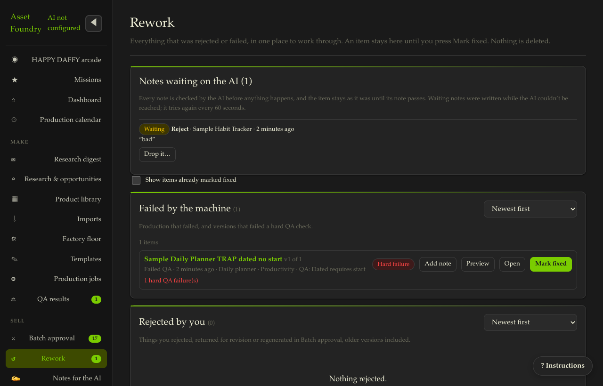

# Rework

**Route:** `/rework` · **Sidebar:** Sell · **Verification:** screen captured and read live with a QA-failed item and a regenerated item (VERIFIED). **Add note**, **Mark fixed** and **Put back** were NOT clicked.

## 1. What this screen is
Everything that failed or was sent back, in one place. An item stays here until you press **Mark fixed**. Nothing is deleted.

## 2. Why it exists
So failed work cannot quietly disappear.

## 3. When to use it
After review, to clear what you can. Use [Batch approval](12-batch-approval.md) to decide new work.

## 4. Before you begin
Nothing.

## 5. Understand the interface
- **Notes waiting on the AI (N):** same panel as Batch approval.
- **Show items already marked fixed.** Marked-fixed items return with a **Put back** button.
- **Failed by the machine:** production that failed and versions that failed a hard QA check. Live: the sample daily planner, "Failed QA · Daily planner · Productivity · QA: Dated requires start · Hard failure".
- **Rejected by you:** anything rejected, returned for revision or regenerated, older versions included. Live: "Sample Habit Tracker v1 of 2 (older version), Regenerated".
- Each section has a **sort** dropdown: Newest first, Product type, Category, Marketplace, QA check flagged, Failure before warning, Most versions, Has your notes.
- Each row: title, version "v1 of 2", why, when, type, category, marketplaces, QA checks involved, your notes or the error, and **Show the box you drew** if you drew boxes.
- Row buttons: **Add note** (a note to the AI about this item, saved to [Notes for the AI](14-notes-for-the-ai.md); **Cancel note** closes without saving), **Preview**, **Open**, **Mark fixed**.

## 6. Step-by-step: clear a failed item
1. Click **Open** to see the product.
2. Fix it: make a corrected variation, regenerate, or edit ([Lesson 7](../D-lessons/07-run-qa-and-fix-a-problem.md), [Lesson 8](../D-lessons/08-rework-an-existing-product.md)).
3. Optionally press **Add note** to record what you learned.
4. Press **Mark fixed**.

## 7. Expected results
The row leaves the list. Tick **Show items already marked fixed** to see it again.

## 8. Practical example (sample)
The failed dated planner: open it, make a variation with **Dated** off (passes QA), then **Mark fixed** on the original.

## 9. Common mistakes
- Pressing **Mark fixed** before actually fixing.
- Forgetting that a regenerated older version still sits here until marked.

## 10. Troubleshooting
| Symptom | Fix |
| --- | --- |
| Item you fixed still listed | Mark it fixed; fixing does not remove it automatically |
| Sidebar count is higher than you expect | Both machine failures and rejections count |

## 11. What happens next
[Notes for the AI](14-notes-for-the-ai.md) learns from the notes.

## 12. Completion checklist
- [ ] I know nothing is deleted here.
- [ ] I cleared items with Mark fixed only after fixing.

---
**Previous:** [Batch approval](12-batch-approval.md) · **Next:** [Notes for the AI](14-notes-for-the-ai.md)
