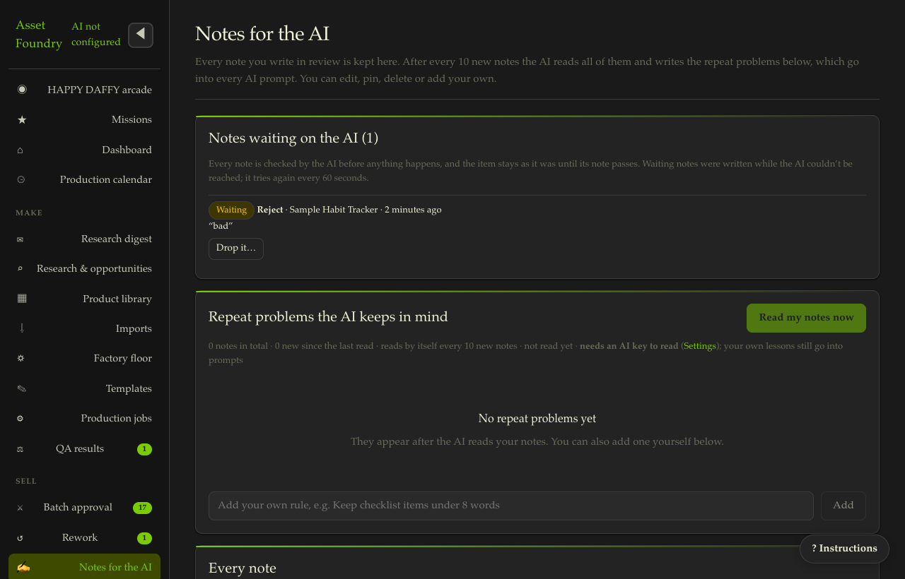

# Notes for the AI

**Route:** `/ai-notes` · **Sidebar:** Sell · **Verification:** screen captured and read live with no notes (VERIFIED). Reading notes needs an AI key and was NOT run (NOT VERIFIED).

## 1. What this screen is
Every note you have written in review, plus a short list of **repeat problems** the AI works out from them. That list goes into every AI prompt, ahead of the 12 most recent notes.

## 2. Why it exists
So the AI stops repeating mistakes you already corrected. Nothing is trained: notes ride along inside the prompt, as text.

## 3. When to use it
Every so often, to tidy the lessons. Write the notes themselves during review.

## 4. Before you begin
Reading notes needs an AI key. Your own typed rules go into prompts even without a key.

## 5. Understand the interface
- **Notes waiting on the AI (N):** notes written while the AI could not be reached. See [Batch approval](12-batch-approval.md).
- **Repeat problems the AI keeps in mind.** Status line: how many notes, how many new since the last read, "reads by itself every 10 new notes", when last read, or "needs an AI key to read".
  - **Read my notes now:** greyed out with no AI key, while reading, or with no notes.
  - Each lesson shows whether the AI or you wrote it. **Edit** (then Save or Cancel), **Pin** (keeps an AI lesson when the AI re-reads), **Unpin**, **Delete** (asks first; the AI may write it again if your notes keep saying it). Lessons you write are never replaced.
  - **Add your own rule** (for example "Keep checklist items under 8 words") and **Add**.
- **Every note.** Filter chips: All notes, Rejected, Sent back, Regenerated, Approved, Warnings accepted, Rework notes. Each note shows the product, version, type, when and any warnings.

Where notes come from: reject, send back, regenerate, approve and accepted-warning notes in Batch approval; **Add note** on Rework; and mission reports (each report is filed as a note on that product).

## 6. Step-by-step
1. Write specific notes during review.
2. Open this page; press **Read my notes now** (or wait for 10 new notes).
3. Read each lesson. Pin good ones, delete wrong ones, edit wording.
4. Add any rule you always want followed.

## 7. Expected results
A list of short lessons ("Mandala pages are too fine to color near the edge") appears, marked AI-written with a count.

## 8. Practical example (sample)
Your own rule: "Never write medical or weight-loss claims." Put in with **Add**; it applies to every future prompt.

## 9. Common mistakes
- Writing vague notes ("bad"), which teach nothing.
- Expecting the AI to learn without a key.
- Forgetting to pin a lesson you want kept.

## 10. Troubleshooting
| Status | Meaning |
| --- | --- |
| "needs an AI key to read" | Add a key; your own rules still work |
| "last try failed" | Press Read again; check Logs |

## 11. What happens next
Lessons appear in every future AI prompt.

## 12. Completion checklist
- [ ] I know notes shape prompts only.
- [ ] I added at least one rule of my own.

---
**Previous:** [Rework](13-rework.md) · **Next:** [Marketplace listings](15-marketplace-listings.md)
