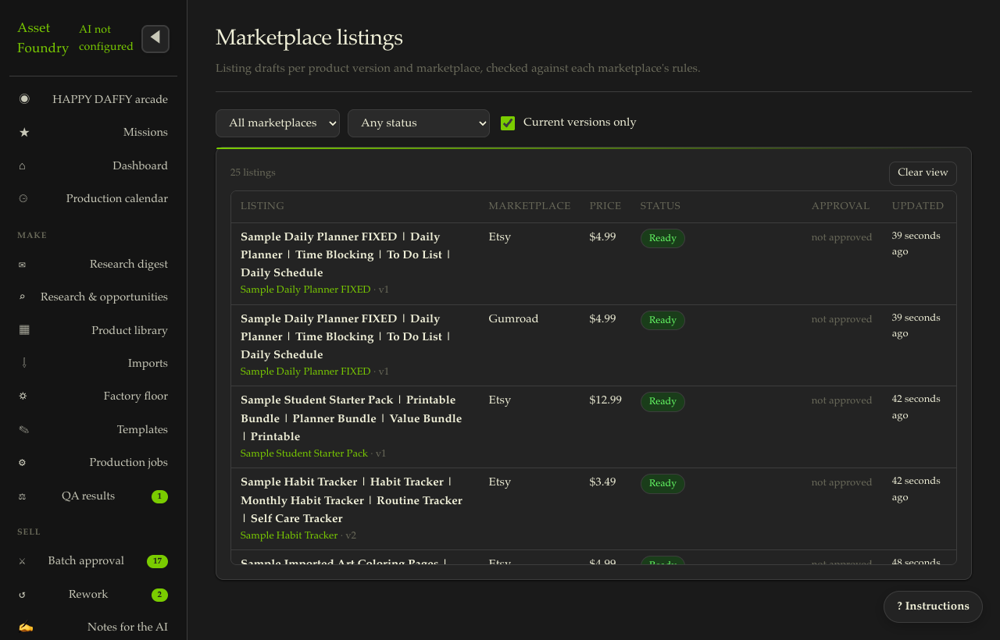
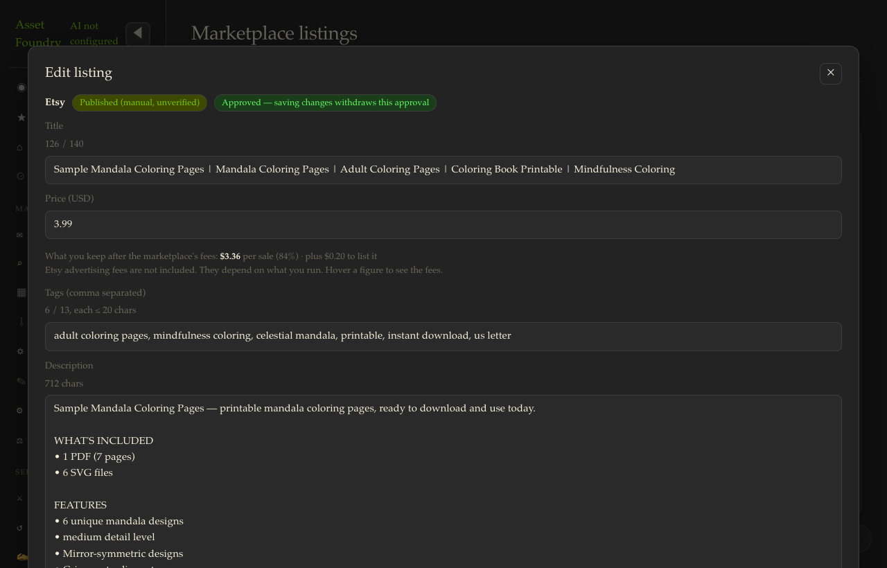

# Marketplace listings

**Route:** `/listings` · **Sidebar:** Sell · **Verification:** list and editor captured live (VERIFIED). Rules and fee numbers read from the code (VERIFIED, code); fee numbers were read from the marketplaces' pages on 2026-11-17 and only you can confirm they still match.

## 1. What this screen is
The listing drafts (title, description, tags, price) for each product version and marketplace, checked against each marketplace's rules.

## 2. Why it exists
Listings are drafted automatically after a product is packaged. This is where you improve them before approving.

## 3. When to use it
To fix a listing marked Invalid, tidy wording, or check prices.

## 4. Before you begin
A packaged product with listings. Marketplaces: **Etsy**, **Gumroad**, **Generic**.

## 5. Understand the interface
- Filters: marketplace, **status**, and **Current versions only** (ticked). **Clear view**.
- Listing statuses: **Ready**, **Invalid**, **Export prepared**, **Published (manual, unverified)**, **Published verified**, **Needs reconciliation**, **Retired** (and Draft, Failed). See [States](../E-reference/02-states.md).
- Columns: Listing (title and product version), Marketplace, Price, Status (with an issue count if invalid), Approval, Updated. **Click a row** to open the editor.

**The listing editor**
- The marketplace, status, and whether it is approved. **If approved, saving changes withdraws the approval.**
- **Title,** with a counter against the marketplace's limit (red when over).
- **Price.** Under it, **What you keep after the marketplace's fees**: the money left per sale after the marketplace's own fees. Live: a $5.99 Etsy listing showed $5.17 per sale (86 percent) plus $0.20 to list it. Gumroad shows two figures (your own link, and Gumroad Discover). Advertising, tax, refunds, currency conversion and the cost of making the product are **not** included, and a price in a currency other than US dollars shows "not available".
- **Tags,** comma separated, with a counter. Any too-long tag is named in red.
- **Description,** with a character count.
- Rule problems in red, and who wrote the copy.
- **Save changes** (greyed until you change something), **Close**.

**Etsy's default rules (Settings → Marketplaces):** title 10 to 140 characters, description at least 150, up to 13 tags of at most 20 characters, 1 to 10 images, up to 5 files of at most 20 MB, minimum price 20 cents. Some limits could not be confirmed from Etsy's own pages; you can change them in Settings. **A tag longer than 20 characters is dropped automatically** and noted in QA ("Dropped tag longer than 20 characters"), which is why a listing can end with fewer tags than you expect.

## 6. Step-by-step: fix an invalid listing
1. Filter **Status: Invalid**. Click the row.
2. Read the red messages. Fix the title, tags or description.
3. **Save changes**. Status becomes Ready.
4. Return to Batch approval to approve.

## 7. Expected results
Status Ready; counters not red.

## 8. Practical example (sample)
A sample mandala Etsy title was 126 characters, inside the 140 limit.

## 9. Common mistakes
- Editing an approved listing and forgetting the approval is withdrawn.
- Believing the "what you keep" line is profit. It is only after marketplace fees.

## 10. Troubleshooting
| Symptom | Fix |
| --- | --- |
| Can't tick a marketplace in review | Its listing is invalid; fix it here |
| Fee line says "not available" | Price is not in USD, or no fee numbers are set for that marketplace |

## 11. What happens next
[Publishing status](16-publishing-status.md). Lesson: [Prepare a marketplace listing](../D-lessons/10-prepare-a-marketplace-listing.md).

## 12. Completion checklist
- [ ] Title, tags and description inside limits.
- [ ] I read the fee line and know what it leaves out.

---
**Previous:** [Notes for the AI](14-notes-for-the-ai.md) · **Next:** [Publishing status](16-publishing-status.md)
