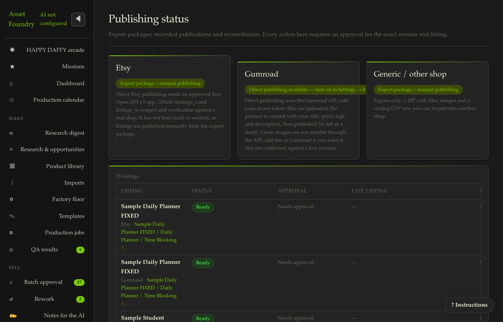

# Publishing status

**Route:** `/publishing` · **Sidebar:** Sell · **Verification:** screen captured live. Export, the two direct-publish refusals, a bad link, and recording a publication were exercised through the app's API (VERIFIED). Direct Gumroad posting was NOT run (it is switched off by default and has never been proven against a live account: NOT VERIFIED).

## 1. What this screen is
Export packages, recorded publications, and sorting out publish attempts with an unknown result. Every action here needs a valid approval for that exact version and listing.

## 2. Why it exists
So "published" in Foundry always means you decided it, and so a crash during posting can never create a duplicate listing.

## 3. When to use it
After approving. Daily or whenever you post something.

## 4. Before you begin
An **approved** listing. Without one the row says **Needs approval**.

## 5. Understand the interface

**Marketplace cards** at the top say how each marketplace works:
- **Etsy:** *Export package + manual publishing.* Direct Etsy publishing is not built (it needs an approved Etsy Open API app, OAuth and a real-shop check). The two Etsy keys in Settings are marked "not used yet".
- **Gumroad:** *Direct publishing available. Turn on in Settings → Integrations.* Posts through Gumroad's API with your token. Cover images cannot be set through the API; add one in Gumroad. **Not yet confirmed against a live account.**
- **Generic / other shop:** *Export-only*: a ZIP with files, images and a `catalog.csv` row.

**The list.** Product, marketplace and listing title (click to open the editor), status, approval, live link ("Verified by API" or "Recorded manually — not verified by the app"), last action.

**Buttons**

| Button | What it does |
| --- | --- |
| **Export package** | Builds the upload ZIP for this approval and downloads it. If one exists for this approval it is reused. |
| **Download** | Downloads the package again |
| **Record publication** | After you posted it yourself, paste the live address and press **Record**. The app marks it *published manually* and does **not** check it is live. The address must be on that marketplace's own site. |
| **Publish directly** | Posts through the marketplace's API. Only Gumroad, and only when switched on |
| **Reconcile** | Appears when a publish request was sent but the result could not be confirmed. Check the marketplace, then **It IS live** (paste the address) or **It was NOT published** |

**What is in an export package** (live, Etsy): `files/` (the customer ZIP), `images/01.png`, `02.png`, `03.png`, `listing.json`, `listing.txt`, and `PUBLISHING_STEPS.md`, a numbered checklist for that marketplace (open Shop Manager, upload the photos in order, paste the title block, choose "Digital files", set the price, upload the files, preview and publish, then come back and Record publication).

> **Consequence:** the app never retries blindly. A publish with an unknown outcome is held in **Needs reconciliation** until you answer, so duplicates are impossible.

## 6. Step-by-step: publish by export
1. Approve the listing ([Batch approval](12-batch-approval.md)).
2. On this page press **Export package** for that row. A ZIP downloads.
3. Unzip it and follow `PUBLISHING_STEPS.md` on the marketplace.
4. Copy the live listing's address.
5. Press **Record publication**, paste the address, press **Record**.

## 7. Expected results (live)
- Export built a ZIP and returned its id.
- Recording `https://example.com/not-etsy` returned **"That URL is not an address on Etsy"**.
- Recording an `etsy.com` address changed the listing to **Published (manual, unverified)**; the Dashboard and Analytics now count it.
- Pressing **Publish directly** on Etsy returned: *"Etsy direct publishing is not available... Use the export package and then record the publication."* On Gumroad (off) it returned: *"Gumroad direct publishing is off. Turn it on in Settings → Marketplaces → Gumroad → 'Auto publish enabled'..."*

## 8. Practical example (sample)
The sample mandala: exported for Etsy, then recorded with a made-up `etsy.com/listing/...` address. **Sample data: no real listing was created.**

## 9. Common mistakes
- Forgetting to **Record** after posting, so Foundry never knows.
- Editing a listing after approval (the approval is withdrawn and Export is blocked).
- Believing "Published (manual)" means verified.

## 10. Troubleshooting
| Message | Meaning and fix |
| --- | --- |
| "has no valid approval for its current files and listing text" | Something changed after approval. Re-approve |
| "has QA warnings you haven't accepted yet" | Accept them in batch review |
| "A previous attempt has an unknown outcome" | Reconcile it |
| "Gumroad ... access token was rejected" | Create a new token in Gumroad and save it in Settings → Integrations |

## 11. What happens next
[Analytics](17-analytics.md). Lesson: [Export or publish a finished product](../D-lessons/12-export-or-publish.md).

## 12. Completion checklist
- [ ] Export downloaded and followed.
- [ ] Publication recorded with the real address.
- [ ] I know Gumroad direct posting is unproven.

---
**Previous:** [Marketplace listings](15-marketplace-listings.md) · **Next:** [Analytics](17-analytics.md) · **Related:** [Publishing and marketplaces](../E-reference/06-publishing-and-marketplaces.md)
