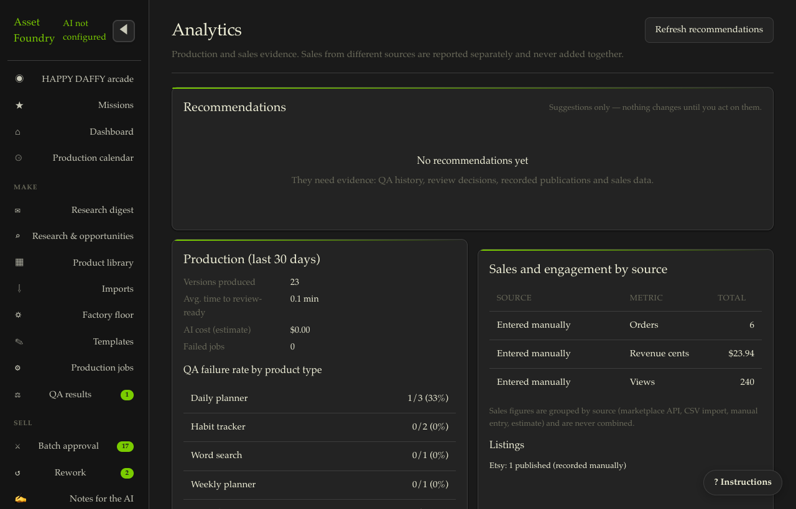

# Analytics

**Route:** `/analytics` · **Sidebar:** Sell · **Verification:** screen captured live after entering sample numbers (VERIFIED). CSV import and Gumroad sync were NOT run.

## 1. What this screen is
Evidence about production and sales. Sales from different sources are reported separately and **never added together**.

## 2. Why it exists
To show which products earn and which fail, so you decide what to make more of. Nothing here is estimated unless labelled.

## 3. When to use it
Weekly. Sales do not arrive by themselves except Gumroad (pulled every 6 hours when connected).

## 4. Before you begin
A published listing (recorded in Publishing status) to attach numbers to.

## 5. Understand the interface
- **Refresh recommendations:** looks for suggestions in your QA history, review decisions, recorded publications and sales. Each has kind, title, reasoning, evidence and confidence; **Accept** or **Dismiss** records your choice. They are suggestions only. Live, with no sales: "No recommendations yet. They need evidence."
- **Production (last 30 days):** versions produced, average time to review-ready, estimated AI cost, failed jobs, **QA failure rate by product type** (live: Daily planner 1/3 (33%)), and **review decisions** by type.
- **Sales and engagement by source:** totals per source (marketplace API, CSV import, **Entered manually**, estimate) and metric. Below: published listings per marketplace.
- **By product** (once there are sales): orders, revenue and views per product and source.
- **Import sales CSV:** pick the marketplace and choose the file. It needs a date column and a column identifying the listing (listing ID, address or title). Quantity, revenue, views and favourites are read when present. Rows are matched to listings you recorded as published; problem rows are listed by row number.
- **Enter numbers manually:** pick the listing, the **metric** (views, favourites, orders, units, revenue in cents, refunds), the value, the dates, and whether the number is **real** (copied from your shop stats) or **an estimate**.

## 6. Step-by-step: enter numbers
1. Open **Enter numbers manually**. Choose the listing (it must be recorded as published).
2. Pick a metric, type the value, set period start and end.
3. Choose "Real (copied from my shop stats)".
4. **Save**. Repeat per metric.
5. Press **Refresh recommendations**.

## 7. Expected results (live)
After entering views 240, orders 6 and revenue 2394 (cents), the table showed *Entered manually: Orders 6, Revenue $23.94, Views 240* and a *By product* row for the sample mandala.

## 8. Practical example (sample)
**Sample numbers only:** 240 views, 6 orders, $23.94 revenue over 1 to 15 November.

## 9. Common mistakes
- Typing revenue in dollars where cents are expected (the metric is *revenue in cents*).
- Marking an estimate as real.
- Adding sources together in your head.

## 10. Troubleshooting
| Symptom | Fix |
| --- | --- |
| Listing missing from the picker | Record its publication first |
| CSV rows rejected | Fix the date or listing column; rows are listed by number |
| No recommendations | The thresholds in Settings → Analytics need more evidence |

## 11. What happens next
Use what you learn in [Research & opportunities](04-research-and-opportunities.md). Lesson: [Review analytics](../D-lessons/13-review-analytics.md).

## 12. Completion checklist
- [ ] Numbers entered with the right source label.
- [ ] I know sources are never combined.

---
**Previous:** [Publishing status](16-publishing-status.md) · **Next:** [Settings and integrations](18-settings-and-integrations.md)
