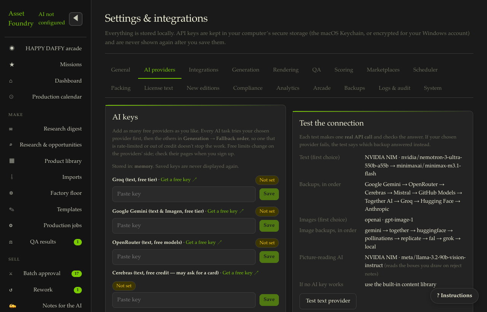
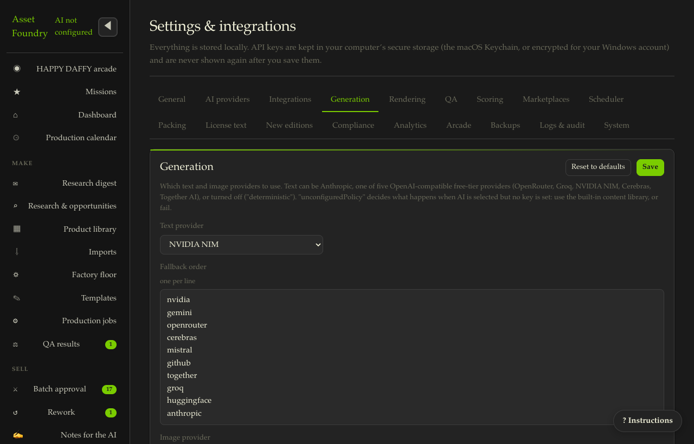
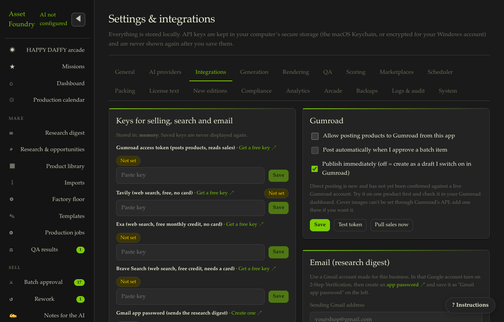
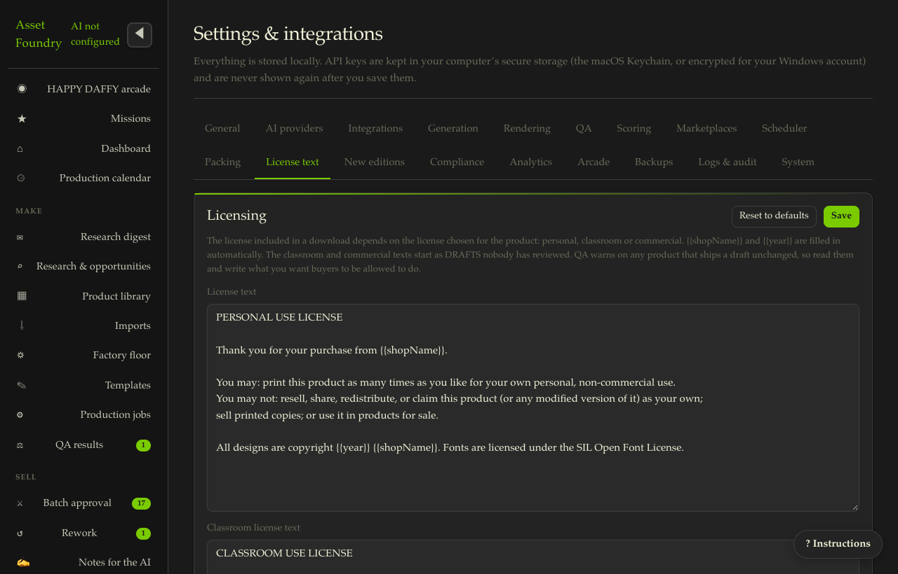
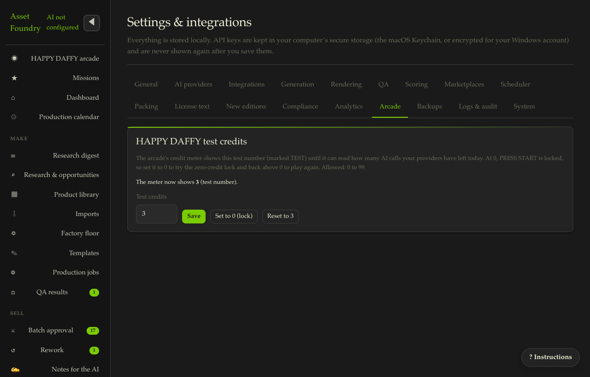
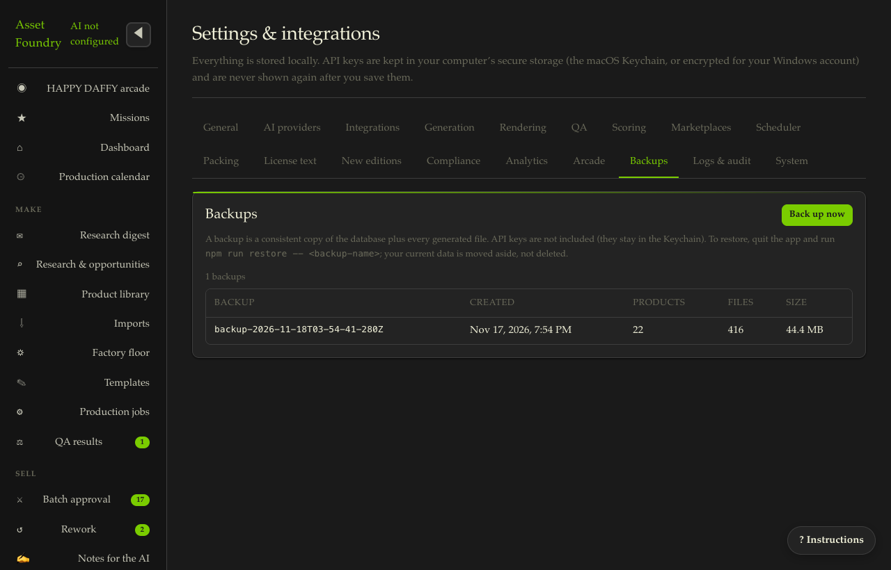
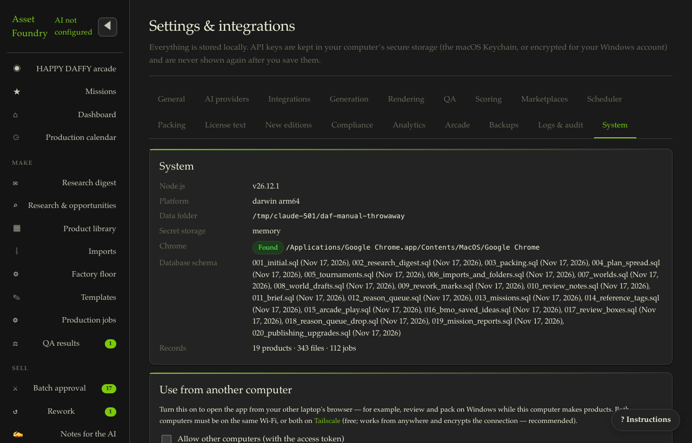

# Settings & integrations

**Route:** `/settings` (18 tabs; `?tab=` links) · **Sidebar:** System · **Verification:** tab list read from the live page; several tabs captured (VERIFIED). Saving settings, keys and live provider tests were NOT run. Provider detail is in [Providers and keys](../E-reference/04-providers-and-keys.md).

## 1. What this screen is
Keys, connections and every option. Everything is stored on this computer. **API keys go into the macOS Keychain** and are never shown again once saved.

## 2. Why it exists
So behaviour (which AI answers, how packs form, how listings are checked) can change without editing code.

## 3. When to use it
At setup, and when a provider, price or rule changes.

## 4. Before you begin
Know which keys you have. A key is a password for one service. Never paste one into a note, chat or file in the project.

## 5. Understand the interface

**The 18 tabs:** General, AI providers, Integrations, Generation, Rendering, QA, Scoring, Marketplaces, Scheduler, Packing, License text, New editions, Compliance, Analytics, Arcade, Backups, Logs & audit, System.

**Plain form tabs** (General, Generation, Rendering, QA, Scoring, Marketplaces, Scheduler, Packing, License text, New editions, Compliance, Analytics) are built from the settings themselves: a one-line explanation, **Save**, and **Reset to defaults** (asks first). Boxes marked "one per line" take a list; boxes marked "(JSON)" say "not valid JSON yet" until complete.

| Tab | What is in it |
| --- | --- |
| **General** | Shop name (printed on every footer and in the license), timezone (when plans run), currency, this computer's name |
| **AI providers** | A write-only key box per provider (free or paid marked, with a "get a key" link, Saved or Not set). **Test text provider**, **Test image provider**, **Test picture-reading AI**: each makes **one real API call** and reports whether it worked, which model answered and how long it took. If your first choice fails and a backup answers, it says so |
| **Integrations** | Keys for Gumroad, Tavily, Exa, Brave Search, the Gmail app password, and two Etsy keys (not used yet). A **Gumroad** card (allow posting, post automatically on approval, publish immediately or as drafts, **Test token**, **Pull sales now**). An **Email** card (sending Gmail address, From name, **Send a test email**) |
| **Generation** | First-choice text and image provider, fallback order for each, **allowPaidFallback**, pacing limits, what to do with no key (*deterministic*: use the built-in library; *fail*: stop the job), each provider's model and backup models, the picture-reading AI (Vision), and an Advanced AI price table used only to estimate cost |
| **Rendering** | Chrome's path, how many pages render at once, preview resolution and pages, page timeout |
| **QA** | Near-duplicate thresholds, spelling on or off and the allowlist (one word per line), minimum image DPI, line-art limit, margin tolerance |
| **Scoring** | Weights per score factor, minimum score (60) and confidence (0.35) |
| **Marketplaces** | Each marketplace on or off, its listing rules, Gumroad posting options, **default price per product type (cents)**, and **fees** (the numbers behind "what you keep") |
| **Scheduler** | How often plans are checked, catch-up window, retries, jobs at once, weekly clean-up of old test copies |
| **Packing** | Automatic feeding, carts, pack sizes, how closely tags must match, cooldowns |
| **License text** | The license in a download, one each for personal, classroom and commercial use. `{{shopName}}` and `{{year}}` are filled in. **Classroom and commercial texts are unreviewed drafts**, and QA warns until you edit them. What "commercial" allows is **your** decision |
| **New editions** | Days before a dated product's last date that it appears under "Due for a new edition" (90) |
| **Compliance** | Blocked terms, one per line (trademarks, licensed characters, brands) |
| **Analytics** | Evidence needed before a recommendation |
| **Arcade** | The arcade's **test credits** (0 to 99), **Set to 0 (lock)** and **Reset to 3**. The XP, bonus and failsafe values are blank on purpose and have **no screen yet** |
| **Backups** | **Back up now** and a list (name, date, products, files, size). See [Backups](../E-reference/08-backups-and-data-safety.md) |
| **Logs & audit** | Application log (Debug, Info, Warnings, Errors; secrets removed) and the audit trail of every recorded action |
| **System** | Node version, platform, data folder, where secrets are kept, Chrome found, schema, record counts; **Use from another computer** (access token, public web address) |

**Tab pictures (sample copy, no keys saved):**

## 6. Step-by-step: add a first AI key (NVIDIA first)
1. Open **AI providers**. Find the **NVIDIA** row and press its **Get a key** link.
2. Paste the key and press **Save**. The pill becomes **Saved**.
3. Open **Generation** and check **Text provider** is **nvidia** (the default). Its default model is Nemotron 3 Ultra, with MiniMax as a backup model on the same key (the app tries it before moving to the next provider).
4. Back on AI providers, press **Test text provider**. "Working" means ready.

> **Consequences.** A test makes one real call that may use free-tier credit. Never turn on **allowPaidFallback** unless you accept charges: Anthropic is paid and is never used as a backup otherwise.

## 7. Expected results
The Dashboard's AI banner disappears and the sidebar line shows a model name instead of "AI not configured".

## 8. Practical example (sample)
NVIDIA first, Gemini and OpenRouter as extra backups so a daily limit at one never stops production.

## 9. Common mistakes
- Putting Groq first (your standing choice is NVIDIA first; Groq is a late backup).
- Saving a key that has spaces or quotes. (The Gmail app password's spaces are stripped for you; other keys should be pasted exactly.)
- Expecting **Test** to be free.

## 10. Troubleshooting
| Symptom | Fix |
| --- | --- |
| Test fails but a backup answered | First provider's key or model is wrong; read the message |
| Can't save a key | Keys must be 8 to 4096 characters of letters, digits and `. _ ~ + / = : -` |
| "Chrome not found" | Settings → Rendering → Chrome path |

## 11. What happens next
Back to the Dashboard to confirm AI is active.

## 12. Completion checklist
- [ ] At least one text key saved and tested.
- [ ] I know which tab holds license text, fees and backups.
- [ ] I did not enable paid fallback by accident.

---
**Previous:** [Analytics](17-analytics.md) · **Next:** [Missions](19-missions.md)
