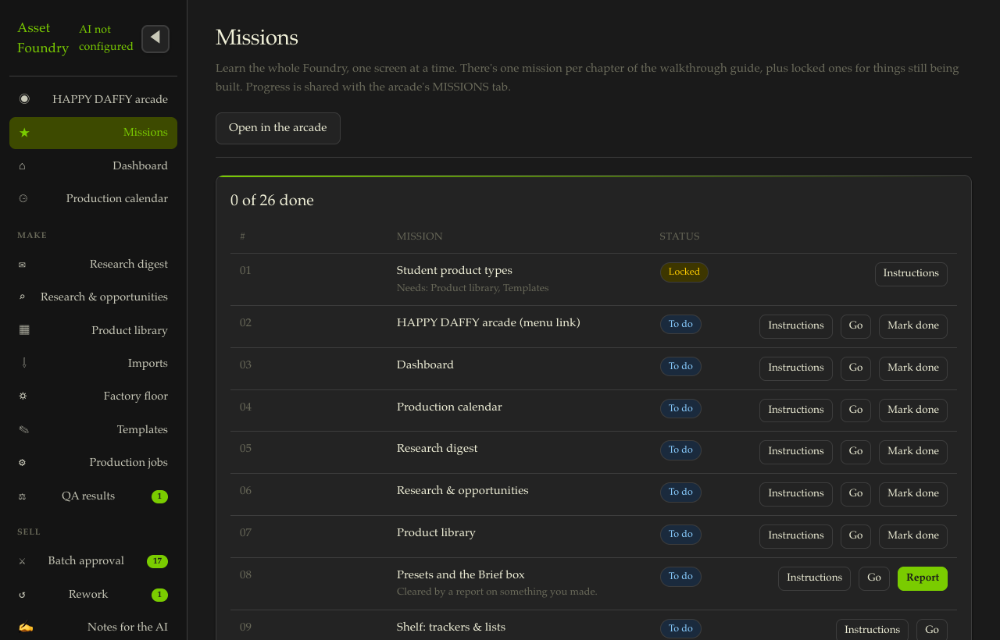
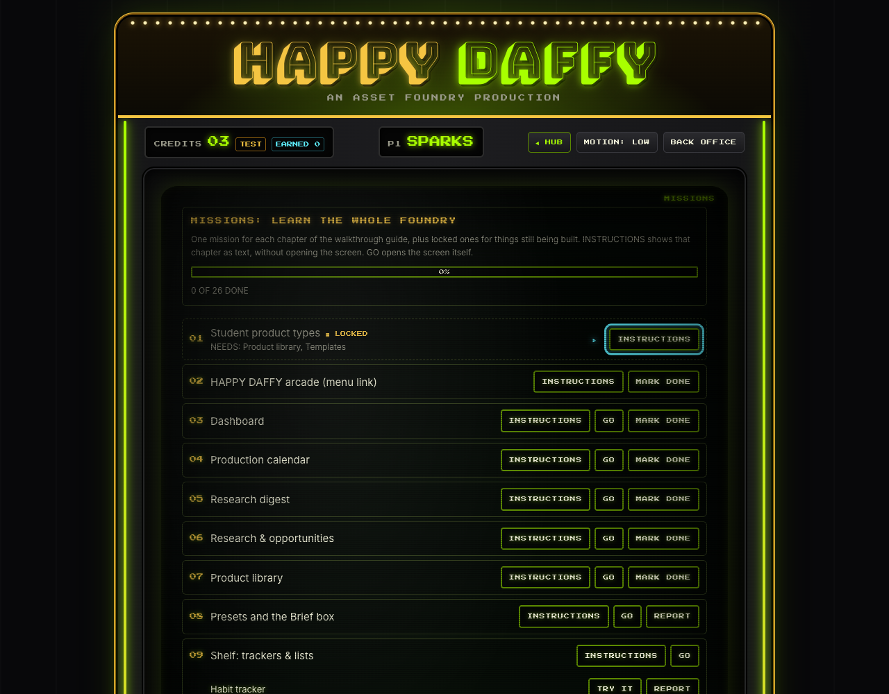

# Missions

**Route:** `/missions` (and the MISSIONS tab in the arcade) · **Sidebar:** top group · **Verification:** both versions captured live (VERIFIED). Reports were NOT submitted.

## 1. What this screen is
A checklist of 26 missions that teach you every screen. Progress is shared between the back office and the arcade.

The same list inside the arcade:

## 2. Why it exists
So learning the app is a task list with a finish line.

## 3. When to use it
When you want a guided tour. This manual replaces the need for it, but the two work together.

## 4. Before you begin
Nothing.

## 5. Understand the interface
- Header "0 of 26 done" and **Open in the arcade**.
- Columns: #, Mission, Status (**To do**, **Done**, **Locked**), actions.
- **Instructions:** opens that chapter of the older [Walkthrough](../../guide/WALKTHROUGH.md) in a pop-up (the missions read that file's headings, which is why it is not rewritten).
- **Go:** opens the screen. **Mark done** and **Undo** keep a done mark.
- **Report:** some missions are cleared by a report instead (15 to 1000 characters on how it came out, and the product you made). The report is also saved as a note for the AI on that product. **Undo** clears reports but keeps the notes.
- **Shelf missions** (five): trackers and lists, calendars and planners, goal and journal sheets, money sheets, coloring and activities. Each part has **Try it** (opens New product with a preset, or empty) and **Report**.
- **Locked:** *Student product types* needs Product library and Templates cleared first.
- Missions earn **no XP**: the XP rules are not decided.

## 6. Step-by-step
1. Press **Instructions** on a mission. Read.
2. Press **Go** and try it.
3. **Mark done**, or **Report** if it is a report mission.

## 7. Expected results
The counter rises and the row shows Done.

## 8. Practical example (sample)
Mission 07, Product library: read, go, make a product, mark done.

## 9. Common mistakes
- Marking missions done without doing them. Nothing checks, by design (the only checks on a report are that the product exists and fits).

## 10. Troubleshooting
| Symptom | Fix |
| --- | --- |
| "The walkthrough guide isn't in this copy" | The file `docs/guide/WALKTHROUGH.md` is missing |
| The "? Instructions" button shows the Student chapter on the Library | Known quirk once that mission unlocks; read the Product library chapter from the list |

## 11. What happens next
Return to the [Dashboard](01-dashboard.md).

## 12. Completion checklist
- [ ] I know which missions are reports.
- [ ] I know missions give no XP.

---
**Previous:** [Settings](18-settings-and-integrations.md) · **Next:** [Arcade chapters](arcade/01-hub-characters-and-worlds.md)
