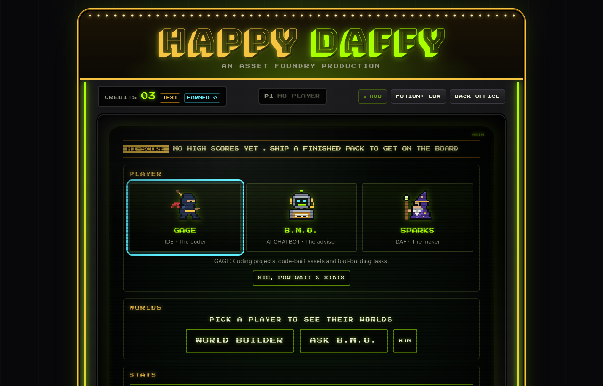
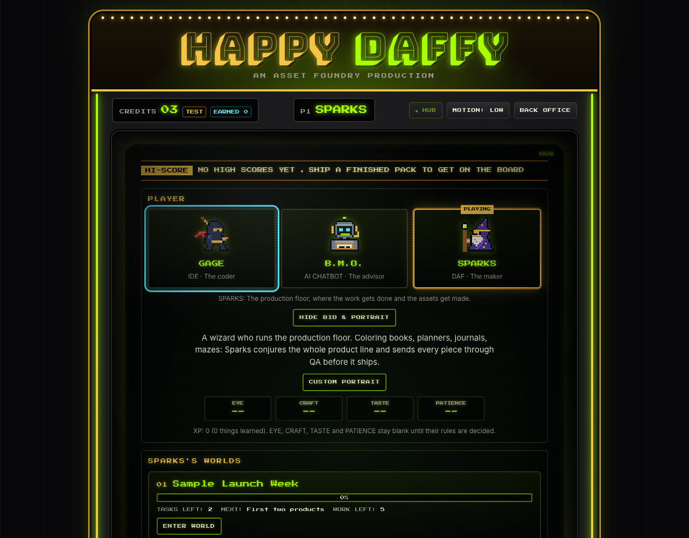
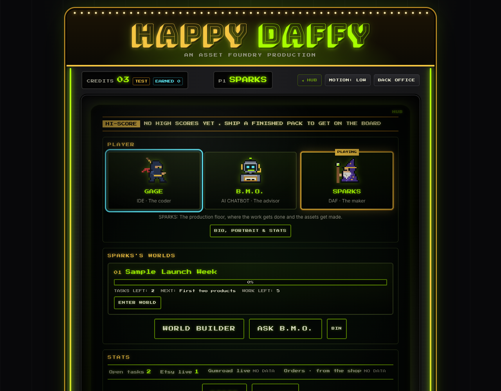
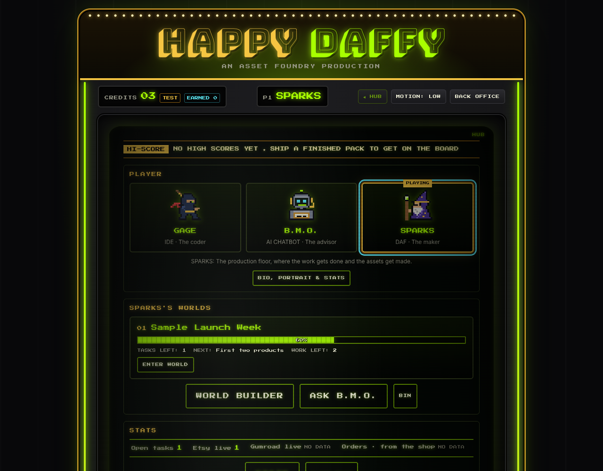
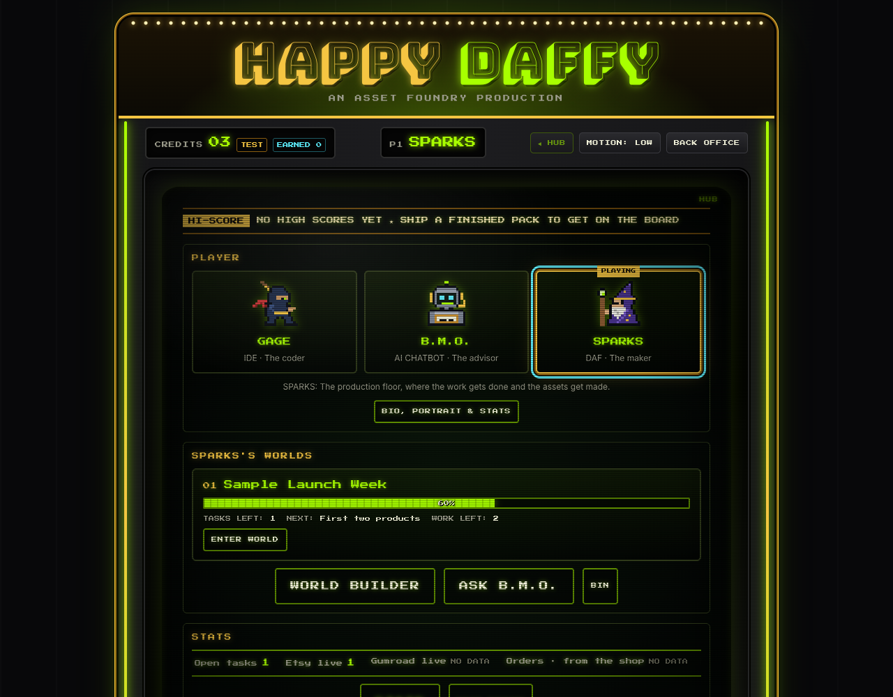

# HAPPY DAFFY: the Hub, characters and worlds

**Route:** `/arcade` · **Verification:** captured and driven live in a throwaway copy (VERIFIED). Keyboard and controller input were NOT tested. The arcade is always dark by design.

The back-office chapters use a 12-part layout. Arcade screens are small, so the same 12 parts are used in a shorter form.

## 1. What this screen is
The Hub is the arcade's home. It merges what used to be Insert Coin, Start Gate, Title, Character Select and Worlds into one screen (2026-11-05). "Character selection" and "Worlds" are zones of the Hub, not separate screens.

## 2. Why it exists
To make the factory a game: pick a character, see only that character's projects, enter a world and do the work.

## 3. When to use it
When you want game-style access to the same work as the back office. Both sides read the same products and data.

## 4. Before you begin
Nothing. A fresh copy has no worlds, so a character shows **NO OPEN WORLDS** until you build one in the World Builder.

## 5. Understand the interface

**Top of the cabinet**
- **CREDITS 03 TEST, EARNED 0.** Credits show a **TEST** number you set in Settings → Arcade until real provider limits are tracked. **Insert Coin never changes credits**: it only clinks (a locked rule). **EARNED** is separate and never adds to the main number. At 0 credits no new AI work starts and **ENTER WORLD** locks ("ENTER LOCKED: NO AVAILABLE CREDITS"); picking a character, the World Builder and STATS keep working.
- **P1** the player (NO PLAYER until you pick). **◀ HUB** returns here. **MOTION: FULL/LOW** turns down flicker and wobble. **BACK OFFICE** goes to the Dashboard.

**Controls:** arrows or WASD move; Enter or Space selects; Esc goes back; Start enters a world; controllers work. When typing in a box, keys type; press Esc to step out.

**HI-SCORE:** "NO HIGH SCORES YET" until you finalize a ready-to-sell pack.

**PLAYER: pick your fighter**

| Character | Class | Covers |
| --- | --- | --- |
| **GAGE** the ninja | IDE · The coder | Coding projects, code-built assets, tool-building tasks |
| **B.M.O.** the desk robot | AI CHATBOT · The advisor | Ideas, advice, suggestions |
| **SPARKS** the wizard | DAF · The maker | The production floor, where assets get made |

Picking one marks it **PLAYING** and the cabinet remembers it on this computer. It **filters**: you see only worlds where that character has an open task. **BIO, PORTRAIT & STATS** opens the bio, **CUSTOM PORTRAIT** (your own picture replaces the pixel art; **USE PIXEL ART** restores it) and the stats **EYE, CRAFT, TASTE, PATIENCE**, which show `--` because their rules are not decided. No AI runs behind any character yet except B.M.O.'s chat.

**(PLAYER)'s WORLDS:** each world card shows rank, progress bar, **TASKS LEFT**, **NEXT** (the milestone) and **WORK LEFT** (effort points left before the next milestone). Worlds with the fewest points left sort first. **ENTER WORLD** (or **1P · START**) goes in. Buttons beside: **WORLD BUILDER**, **ASK B.M.O.**, **BIN**.

**STATS:** a scrolling ticker of stats you choose with **EDIT TICKER**. **NO DATA** means nothing is recorded (never a made-up 0). Live: *Open tasks 2, Etsy live 1, Gumroad live NO DATA, Orders NO DATA, AI cost $0.00*. The **STATS** button opens the back-office [Analytics](../17-analytics.md), because an arcade stats page is PLANNED.

**Tabs at the bottom:** WORLDS, MISSIONS, PACKS, LEADERBOARDS, CODEX.

With SPARKS picked, the worlds zone shows the sample world:

The stats ticker editor (EDIT TICKER) lists 8 of up to 16 chosen stats and every stat the factory can report:

After one task was approved the world card read 60% with one task left:

## 6. Step-by-step: pick a character and enter a world
1. Click **SPARKS**. It lights **PLAYING**.
2. Under SPARKS'S WORLDS find a world card.
3. Press **ENTER WORLD**.

## 7. Expected results
The screen changes to World detail ([next chapter](02-world-detail-and-task-workspace.md)). The breadcrumb reads HUB / world name.

## 8. Practical example (sample)
Sample data: a world "Sample Launch Week" with two tasks for SPARKS. The card showed 0%, TASKS LEFT 2, WORK LEFT 5.

## 9. Common mistakes
- Expecting Insert Coin to give credits.
- Expecting a character to see every world. It only sees its own.
- Looking for a URL. Arcade screens have none; a refresh returns to the Hub.

## 10. Troubleshooting
| Symptom | Fix |
| --- | --- |
| CREDITS `--` and UNAVAILABLE | The cabinet lost its link to the factory; restart the app |
| NO OPEN WORLDS | Build one in the World Builder and give the character a task |
| ENTER LOCKED | Credits are 0; raise the test number in Settings → Arcade |

## 11. What happens next
[World detail and Task Workspace](02-world-detail-and-task-workspace.md), or the [World Builder](04-world-builder.md).

## 12. Completion checklist
- [ ] I picked a character and saw its worlds.
- [ ] I know what TEST credits mean.
- [ ] I know the stats show NO DATA rather than a guess.

---
**Previous:** [Missions](../19-missions.md) · **Next:** [World detail and Task Workspace](02-world-detail-and-task-workspace.md)
