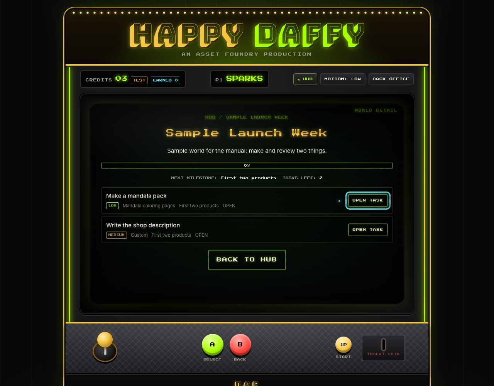
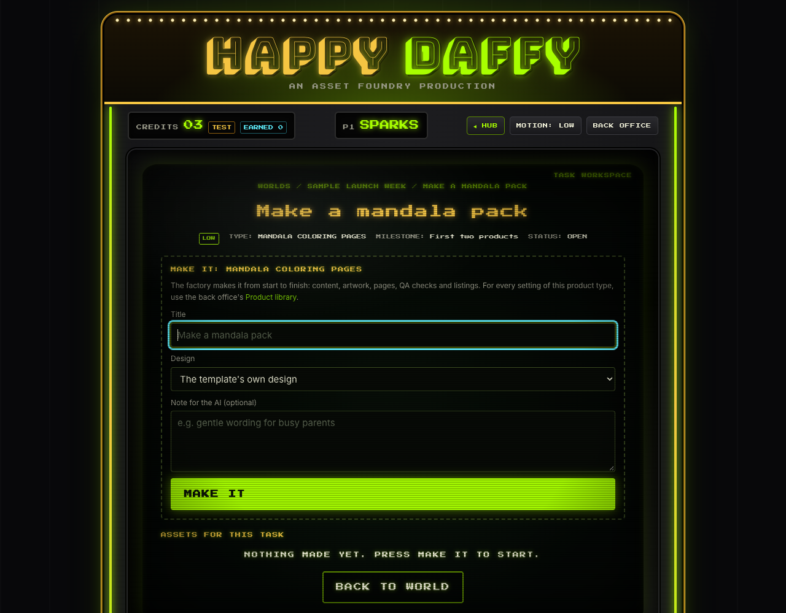
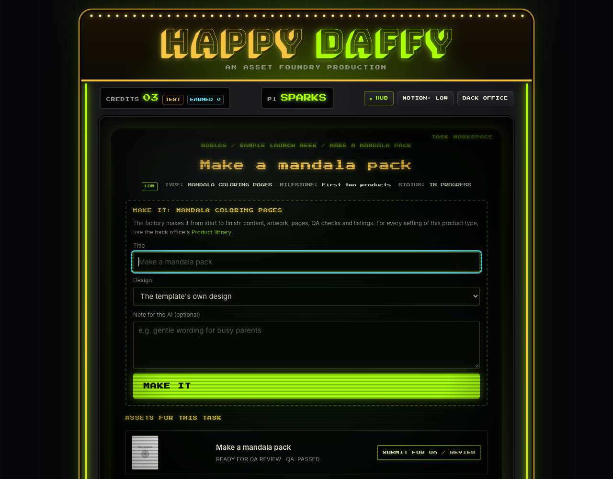

# HAPPY DAFFY: World detail and Task Workspace

**Verification:** driven live with real clicks in a throwaway copy: Hub → ENTER WORLD → OPEN TASK → MAKE IT → SUBMIT FOR QA (VERIFIED). A custom task's status buttons were NOT clicked.

## 1. What these screens are
**World detail** is the inside of one world: its goal, progress, next milestone and your character's open tasks. The **Task Workspace** is where you do one task.

## 2. Why they exist
A task of a product type makes a real asset through the factory's own pipeline, linked to the task and the world. Approving it completes the task.

## 3. When to use them
To do production work in game form. For every product setting use the back-office Product library; the workspace offers only a few.

## 4. Before you begin
A world with an open task for your character and credits above 0. Making an asset starts real production, which spends AI credit if a key works (the sample used none).

## 5. Understand the interface

**World detail:** breadcrumb **HUB / WORLD**, the world's name and purpose, progress %, **NEXT MILESTONE**, **TASKS LEFT**. Each open task shows a difficulty (LOW, MEDIUM, HIGH), task type (a product type, or Custom), milestone and status, with **OPEN TASK**. **BACK TO HUB** (or B).

**Task Workspace**

- **Product task** ("MAKE IT: MANDALA COLORING PAGES"): *The factory makes it from start to finish: content, artwork, pages, QA checks and listings.* Fields: **Title**, **Design** (the template's own, or any design system), **Note for the AI (optional)**, and **MAKE IT**. Import-only types show **OPEN IMPORTS** instead.
- **ASSETS FOR THIS TASK:** each made asset with its stage ("READY FOR QA REVIEW", "QA: PASSED") and **SUBMIT FOR QA / REVIEW**, **SEE WHY** (if it failed) or **LOOK**.
- **Custom task:** "CUSTOM TASK: MARK YOUR PROGRESS" with **IN PROGRESS**, **BLOCKED**, **DONE** and an effort-left box. Nothing is made.
- **BACK TO WORLD**.

After MAKE IT finishes:

## 6. Step-by-step
1. On the Hub press **ENTER WORLD**.
2. Press **OPEN TASK** on a product task.
3. Optionally set a title and design. Press **MAKE IT**.
4. Wait (about a minute for a mandala pack). The asset line moves to **READY FOR QA REVIEW**.
5. Press **SUBMIT FOR QA / REVIEW**. Continue in [QA Review](03-qa-review-and-bin.md).

> **Consequence:** MAKE IT runs the full pipeline and creates a product visible in the back-office library.

## 7. Expected results (live)
Task status changed OPEN → IN PROGRESS. The asset showed **READY FOR QA REVIEW, QA: PASSED**. The mandala made here had **10 pages** (the workspace uses the type's defaults), an 11-page PDF.

## 8. Practical example (sample)
Task "Make a mandala pack", type Mandala coloring pages, difficulty LOW, effort 3. Sample data.

## 9. Common mistakes
- Expecting the workspace to expose every product setting. It does not; use the Library for exact settings.
- Clicking MAKE IT twice and making two assets.

## 10. Troubleshooting
| Symptom | Fix |
| --- | --- |
| Asset shows SEE WHY | Open it to read the QA failure; fix in the back office |
| MAKE IT does nothing at 0 credits | Credits are 0; raise the TEST number (Settings → Arcade) |

## 11. What happens next
[QA Review and Bin](03-qa-review-and-bin.md).

## 12. Completion checklist
- [ ] I made an asset for a task.
- [ ] I saw it reach READY FOR QA REVIEW.

---
**Previous:** [Hub](01-hub-characters-and-worlds.md) · **Next:** [QA Review and Bin](03-qa-review-and-bin.md)
