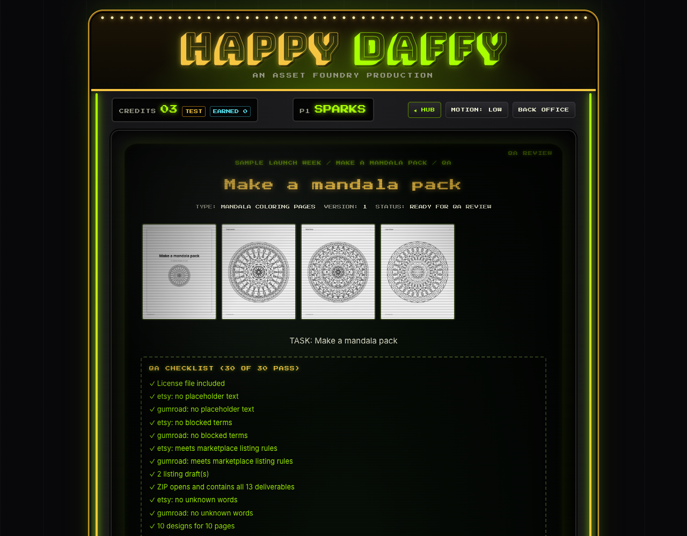
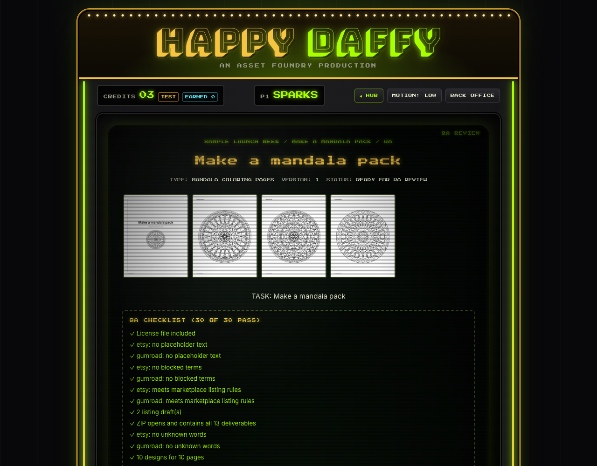
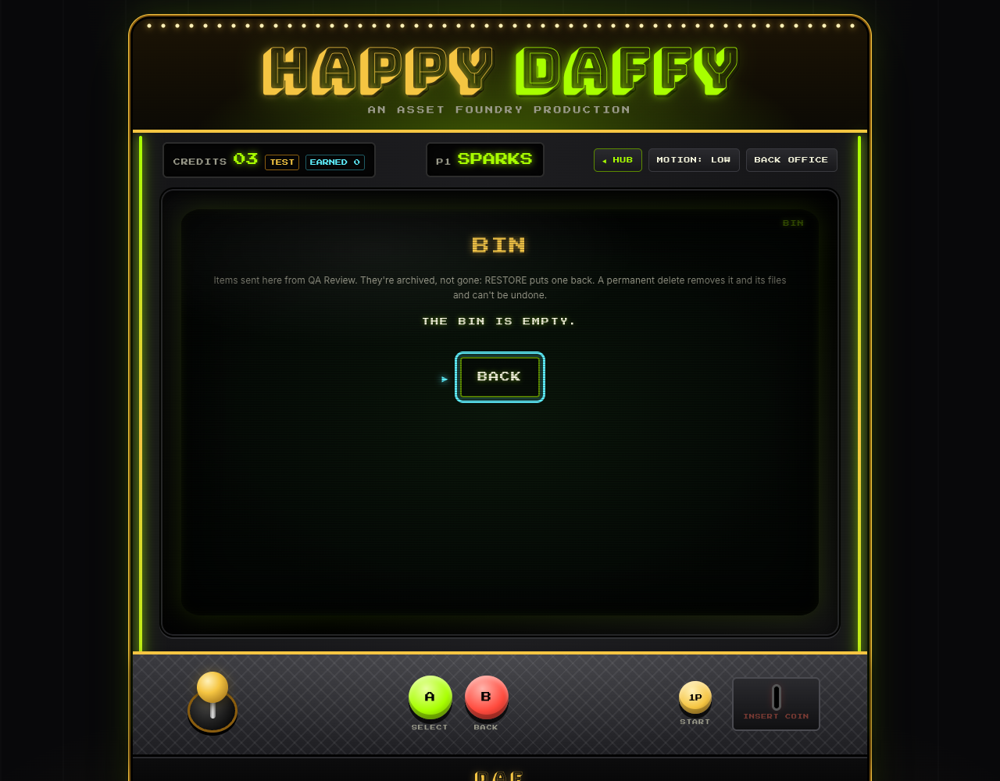
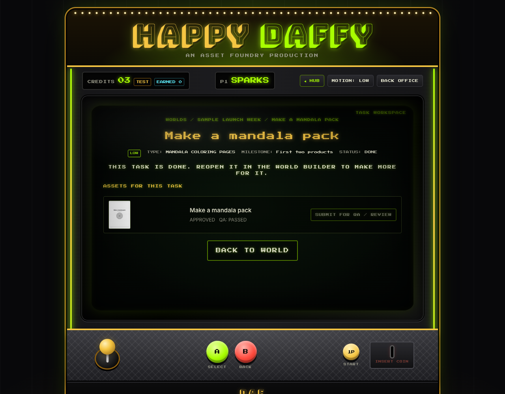
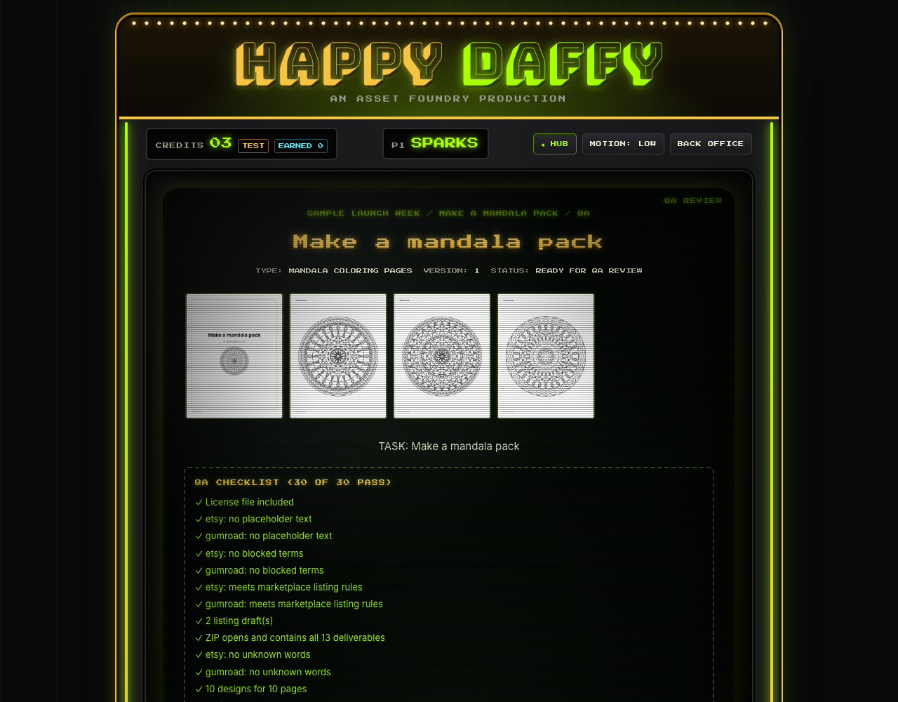

# HAPPY DAFFY: QA Review and the Bin

**Verification:** QA Review, APPROVE, DELETE and the Bin were driven live (VERIFIED). The REJECT sentence check needs an AI key and was NOT exercised (NOT VERIFIED).

## 1. What these screens are
**QA Review** shows one asset's pages, the factory's own QA checklist and its task, and lets you **APPROVE**, **REJECT** or **DELETE** it. The **Bin** holds what you deleted.

## 2. Why they exist
Approval is the one human step. QA Review uses the *same* approval as back-office Batch approval, so a decision made here is recorded there too, and the reverse.

## 3. When to use them
After MAKE IT, for game-style review. The back office also offers a full review ("FULL REVIEW IN THE BACK OFFICE").

## 4. Before you begin
An asset at READY FOR QA REVIEW.

## 5. Understand the interface
- Header: product type, version, status, task.
- **QA CHECKLIST (30 OF 30 PASS):** the factory's real checks, each with a tick. Live list included "Thinnest line about 0.46 mm when printed 192 mm wide (minimum 0.2 mm)".
- A warning-accept box appears if there are yellow flags. **WHAT I LIKED (optional)** note. A **QUICK CHECK** and an optional **HOLD 5s TO APPROVE** (a laziness-failsafe stage; its weights are blank so it is off until you set them).
- **APPROVE** finishes the task. Live: the asset showed **APPROVED**, the world moved from 0% to 60% and the Codex quest ticked.
- **REJECT** needs a reason of **at least two sentences** saying which part is wrong and what is wrong, and the AI checks it is specific. Every 5 qualifying rejections earn **+1 credit** (earned credits are separate from the main meter).
- **DELETE** asks where: **SEND TO BIN** (restorable) or **DELETE FOREVER** after typing DELETE. **Deleting never counts as a rejection and never earns credits.**
- **MAKE A NEW VERSION**, **BACK**, **FULL REVIEW IN THE BACK OFFICE**.

**Bin:** "Items sent here from QA Review. They're archived, not gone: RESTORE puts one back. A permanent delete removes it and its files and can't be undone." Empty text: "THE BIN IS EMPTY." Per item: **LOOK**, **RESTORE**, a type-DELETE box, **DELETE FOREVER**.

> **Consequences.** APPROVE records your decision for this version. DELETE FOREVER is irreversible and removes files. A rejection with no working AI key cannot be checked and waits in line.

The top of QA Review shows the page thumbnails and the checklist. The reason box, **APPROVE**, **REJECT** and **DELETE** are further down the same screen (scroll). REJECT needs a reason of two sentences:

## 6. Step-by-step: approve
1. Press **SUBMIT FOR QA / REVIEW** in the Task Workspace.
2. Read the checklist; look at the pages.
3. Optionally write what you liked. Press **APPROVE**.

**Step-by-step: reject properly.** Press **REJECT**, write two sentences: "The outer ring on page 3 is too fine to color. The lines are under a millimetre apart." Press **SEND REJECTION**.

## 7. Expected results
Approve: task becomes complete; world progress rises. Reject: a new version is requested and the task reopens. Delete to Bin: asset appears in the Bin.

## 8. Practical example (sample)
Sample asset approved: world "Sample Launch Week" 0% → 60% (a 3-point task of 5 effort points).

## 9. Common mistakes
- One-sentence or vague rejections (refused).
- Using DELETE to dodge a hard rejection (it earns nothing, by rule).
- Typing DELETE casually: it is permanent.

## 10. Troubleshooting
| Symptom | Fix |
| --- | --- |
| Reject note waits in line | No AI is reachable; add a key |
| Can't approve | QA failed or warnings not accepted |

## 11. What happens next
Approved assets feed [Packs](05-packs-leaderboards-and-codex.md).

## 12. Completion checklist
- [ ] I approved an asset and saw the task complete.
- [ ] I know delete is not a rejection.

---
**Previous:** [World detail and Task Workspace](02-world-detail-and-task-workspace.md) · **Next:** [World Builder](04-world-builder.md)
