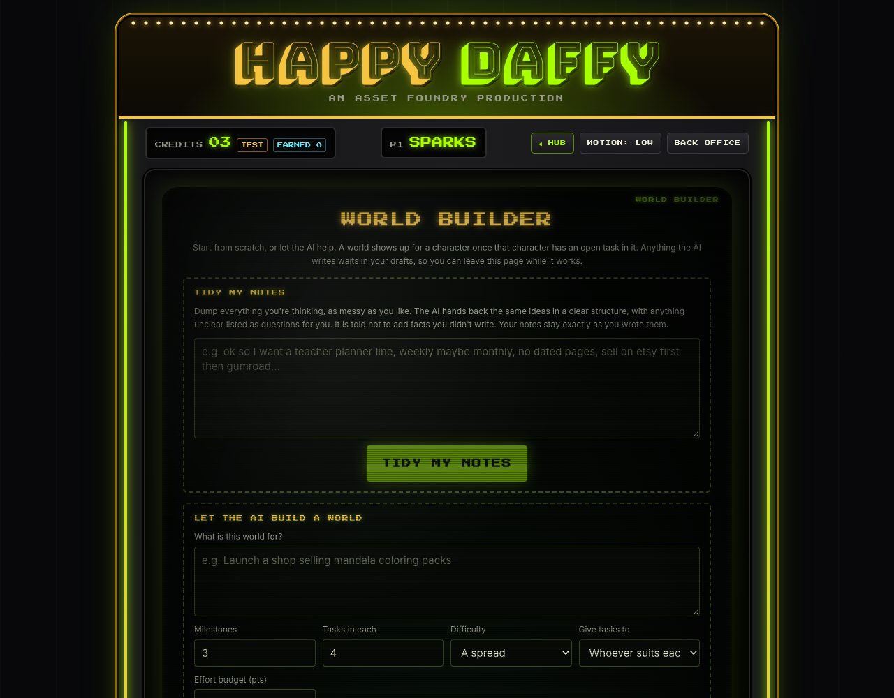

# HAPPY DAFFY: the World Builder

**Verification:** the screen was captured live and a world with a milestone and two tasks was created through the same API the builder uses (VERIFIED). The four AI panels (TIDY MY NOTES, LET THE AI BUILD A WORLD, NEED AN IDEA?, AI drafts) need a working AI key. The Constitution says only LET THE AI BUILD A WORLD has worked live (2026-11-05, with NVIDIA); the others are NOT VERIFIED.

## 1. What this screen is
Where worlds are made: from scratch, or with the AI's help. **Tasks and progress** live here: a world is a project, with **milestones** (stages) and **tasks** (jobs). There is no separate "Tasks and Progress" screen; progress shows on the Hub cards, World detail, the Codex and here.

## 2. Why it exists
To turn a goal into a list of tasks, each owned by a character and sized in effort points, so the Hub can show what to do next.

## 3. When to use it
When you start a project. Open it from the Hub's **WORLD BUILDER** button (it works at 0 credits).

## 4. Before you begin
AI panels need a text AI key; everything else works offline. **Rule: the AI parts are AI-first.** With no working provider they say so and never fall back to the built-in library.

## 5. Understand the interface

- **TIDY MY NOTES.** Dump messy ideas; the AI returns a clean structure (title and goal, scope, milestones with tasks, must and must-not, done when) and lists unclear points as **QUESTIONS FOR YOU**. It is told not to add facts. You see your original beside the tidy text, can edit the text, and send it to the world writer.
- **LET THE AI BUILD A WORLD.** Fields: *What is this world for?*, **Milestones** (1 to 8), **Tasks in each** (1 to 10), **Difficulty** (Mostly easy, A spread, Mostly hard), **Give tasks to** (whoever suits, or one character), **Effort budget (pts)**, **Base effort guesses on how I sized my finished tasks** (on by default), **Product types** (limit or any). **WRITE MY WORLD** takes up to a couple of minutes; you can leave. A review screen shows **TOTAL EFFORT** against any budget. Nothing is a real world until you press **SAVE WORLD**.
- **YOUR AI DRAFTS:** each draft marked WRITING, READY or FAILED, with REVIEW, CANCEL, DISCARD. A draft still writing when the app stops is marked failed at the next start.
- **NEED AN IDEA?** Modes: **SUGGEST WORLDS**, **BUILD ON WHAT I HAVE** (reads real worlds, products and recorded sales), **SHOW ME UNEXPLORED GROUND** (types and characters not yet used). Clicking an idea fills the form.
- **NEW WORLD** (no AI): **Name**, **What it's for**, **Milestones, one per line, in order**, **BUILD WORLD**.
- **ALL WORLDS:** every world with milestones, open and total tasks, next milestone (archived ones marked). Live: "Sample Launch Week · 1 milestones · 1 open / 2 tasks".

**Inside one world:** each milestone shows number, name (a tick when complete), work left and a progress bar. Each task shows character, difficulty, type and effort (remaining / estimated). A **status dropdown** moves a task between OPEN, IN PROGRESS, BLOCKED, DONE. A milestone completes by itself when all its tasks are done and reopens if one reopens. **ADD MILESTONE** (every task needs one). **ADD TASK:** Title, Details, Milestone, **Character**, **Task type** (any product type except imports, or Custom), **Difficulty**, **Effort points** (your estimate; the factory does not time tasks). **ARCHIVE WORLD** hides without deleting; **RESTORE WORLD** brings it back.

## 6. Step-by-step: build a world by hand
1. Hub → **WORLD BUILDER**.
2. Under **NEW WORLD** enter a name, a purpose and milestones, one per line. Press **BUILD WORLD**.
3. Add a task: title, milestone, character (for example SPARKS), task type, difficulty, effort. Press **ADD TASK**.
4. Back on the Hub pick that character; the world appears.

## 7. Expected results (live)
The new world appeared on SPARKS's Hub with 0%, TASKS LEFT 2, WORK LEFT 5.

## 8. Practical example (sample)
"Sample Launch Week", one milestone "First two products", tasks "Make a mandala pack" (mandala, LOW, 3 pts) and "Write the shop description" (Custom, MEDIUM, 2 pts). Sample data.

## 9. Common mistakes
- Adding a task before a milestone.
- Using AI buttons with no key and expecting offline output.
- Treating effort points as hours.

## 10. Troubleshooting
| Symptom | Fix |
| --- | --- |
| "No working AI provider" | Add a key in Settings → AI providers |
| World not on the Hub | The picked character has no open task in it |
| Draft FAILED | Read the reason; DISCARD and retry |

## 11. What happens next
[World detail and Task Workspace](02-world-detail-and-task-workspace.md).

## 12. Completion checklist
- [ ] A world with a milestone and a task exists.
- [ ] I can see it under a character on the Hub.

---
**Previous:** [QA Review and Bin](03-qa-review-and-bin.md) · **Next:** [Packs, Leaderboards and Codex](05-packs-leaderboards-and-codex.md)
