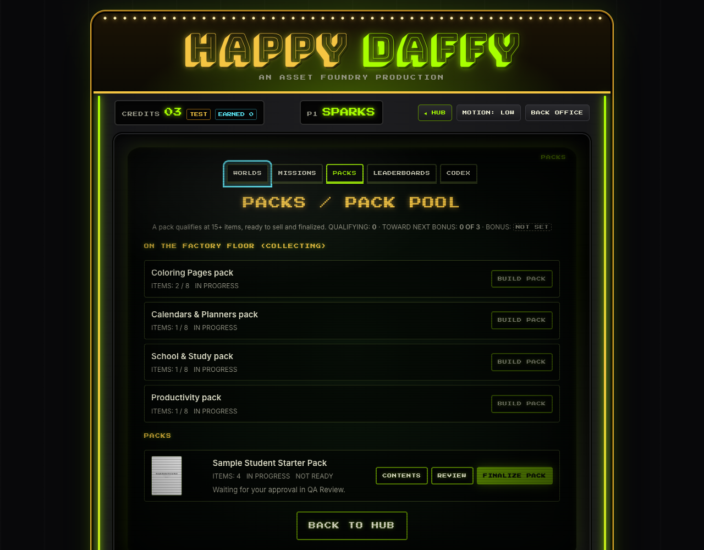
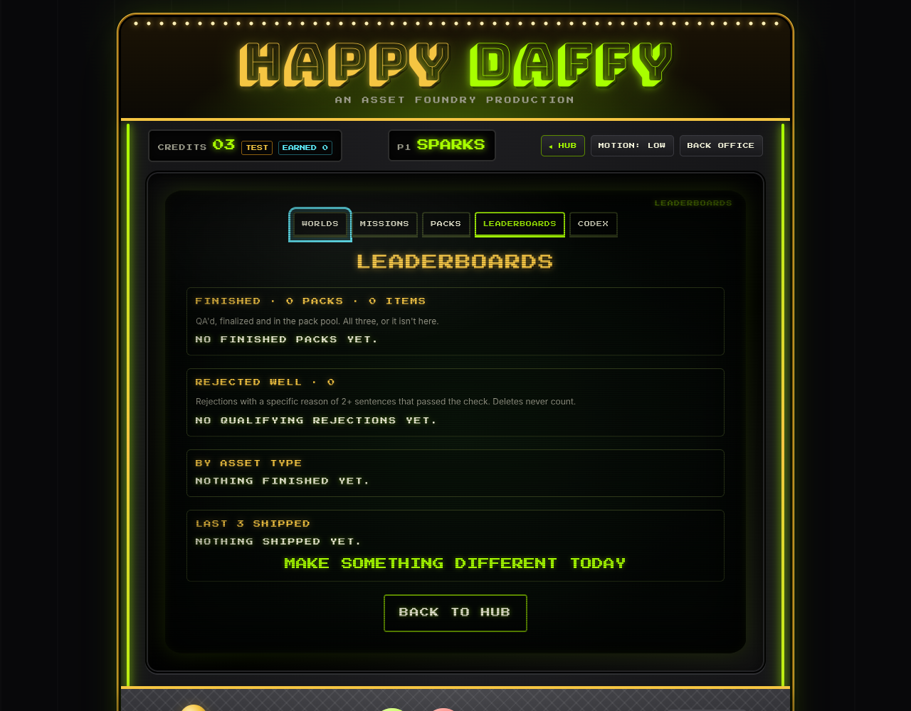
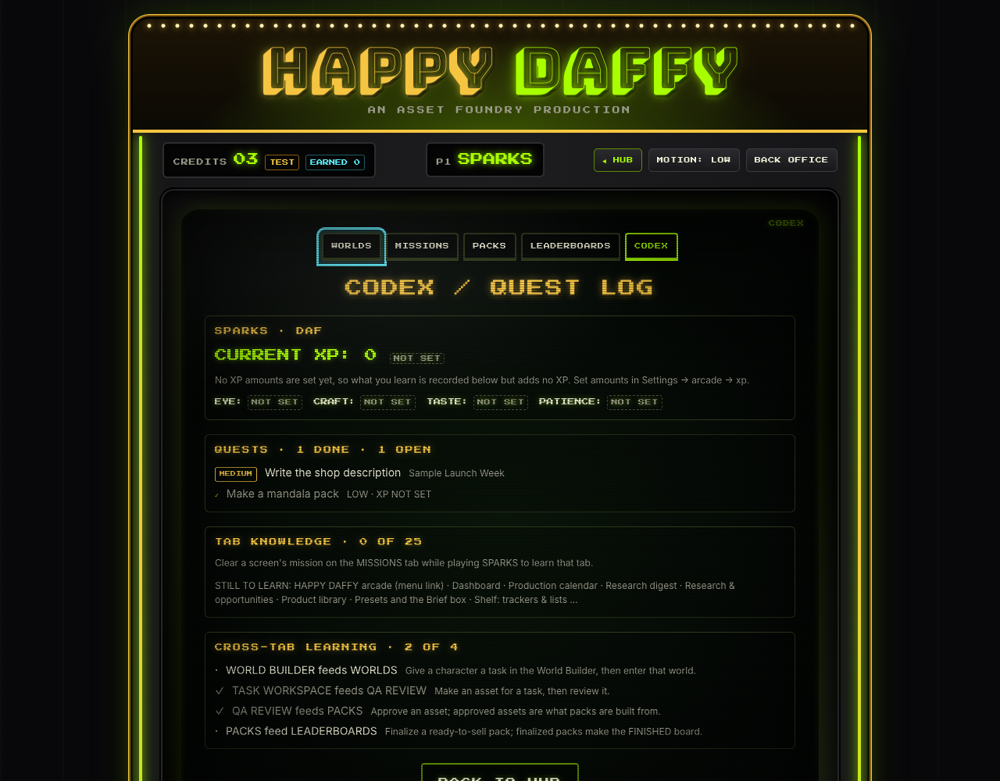

# HAPPY DAFFY: Packs, Leaderboards and Codex

**Verification:** all three screens captured and read live (VERIFIED). FINALIZE PACK was NOT pressed (it cannot be undone). XP and bonus values are blank by design, so no reward behaviour could be observed.

## 1. What these screens are
**PACKS** shows the factory floor's carts and your packs, and finalizes ready-to-sell packs into the **pack pool**. **LEADERBOARDS** shows finished packs and good rejections. The **CODEX** is a quest log of what a character has learned.

## 2. Why they exist
To turn finishing and learning into a score, without inventing numbers.

## 3. When to use them
After you have approved assets, to build and finalize packs; occasionally to see your standing.

## 4. Before you begin
Approved products. A pack **qualifies** at 15 or more items, ready to sell and finalized.

## 5. Understand the interface

**PACKS / PACK POOL.** Counters: *QUALIFYING: 0 · TOWARD NEXT BONUS: 0 OF 3 · BONUS: NOT SET*. The pack bonus amount is TBD, so **none is paid until you set it**. Two lists:
- **ON THE FACTORY FLOOR (COLLECTING):** the same carts as the back-office [Factory floor](../08-factory-floor.md), each "ITEMS: 2 / 8, IN PROGRESS" with **BUILD PACK**.
- **PACKS:** each pack with items, status and a reason when not ready (live: "NOT READY: Waiting for your approval in QA Review."), plus **CONTENTS**, **REVIEW** and **FINALIZE PACK**.

> **Consequence:** **FINALIZE PACK** (ready-to-sell packs only) **cannot be undone**; it puts the pack in the pool.

**LEADERBOARDS.** **FINISHED** (QA'd, finalized and in the pool; all three or it is not there), **REJECTED WELL** (rejections with a specific reason of 2+ sentences that passed the check, counted per character; deletes never count), **BY ASSET TYPE** (one board per type), **LAST 3 SHIPPED**, and the prompt "MAKE SOMETHING DIFFERENT TODAY". Empty lines: "NO FINISHED PACKS YET.", "NO QUALIFYING REJECTIONS YET.", "NOTHING SHIPPED YET." The Hub's hi-score shows real finished packs.

**CODEX / QUEST LOG** (needs a character picked). **CURRENT XP** reads **NOT SET** because no XP amounts exist; what you learn is recorded but adds no XP. The four stats **EYE, CRAFT, TASTE, PATIENCE** read NOT SET (the spec never defines them). **QUESTS** lists tasks (live: 1 done, 1 open). **TAB KNOWLEDGE · 0 OF 25** (clear a screen's mission while playing that character to learn the tab). **CROSS-TAB LEARNING · 2 OF 4**:
- WORLD BUILDER feeds WORLDS (give a character a task, enter the world)
- TASK WORKSPACE feeds QA REVIEW (make an asset, then review it)
- QA REVIEW feeds PACKS (approve an asset)
- PACKS feed LEADERBOARDS (finalize a ready-to-sell pack)

The Codex says "Set amounts in Settings → arcade → xp", but **Settings has no screen for the XP values yet** (see [Discrepancies](../../_status/DISCREPANCIES.md), C5).

## 6. Step-by-step
1. Approve items ([QA Review](03-qa-review-and-bin.md)).
2. Open **PACKS**; build a pack from a cart.
3. Review the pack in QA Review.
4. When ready to sell, press **FINALIZE PACK**.

## 7. Expected results
The pack moves into the pool and, once it qualifies, the FINISHED board and Hub hi-score show it.

## 8. Practical example (sample)
Live: the Student Starter Pack showed "ITEMS: 4, NOT READY: waiting for your approval".

## 9. Common mistakes
- Finalizing before the pack is reviewed and ready.
- Expecting XP or bonuses. They stay blank until you decide them.

## 10. Troubleshooting
| Symptom | Fix |
| --- | --- |
| CURRENT XP "NOT SET" | Expected until XP rules are set |
| "NO FINISHED PACKS YET" | Nothing is finalized |

## 11. What happens next
[B.M.O.](06-bmo.md).

## 12. Completion checklist
- [ ] I know finalize is permanent.
- [ ] I know XP and bonuses are blank on purpose.

---
**Previous:** [World Builder](04-world-builder.md) · **Next:** [B.M.O.](06-bmo.md)
