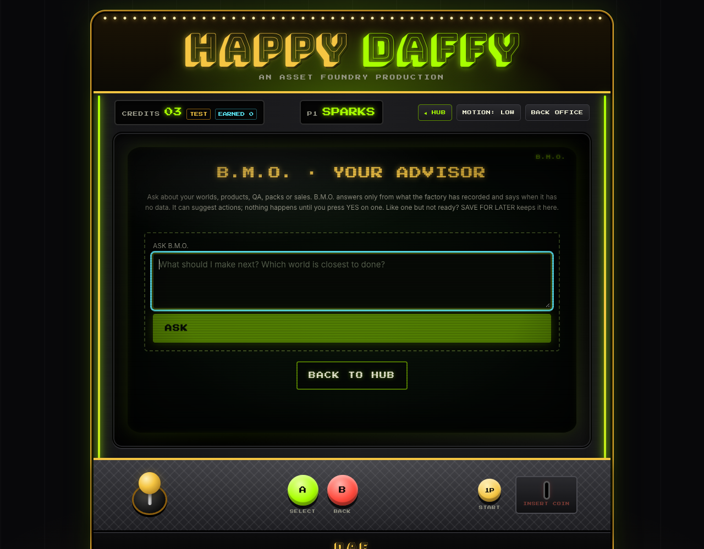

# HAPPY DAFFY: B.M.O., the advisor

**Verification:** the screen was captured and read live (VERIFIED). B.M.O.'s answers and proposals need a working AI provider and were NOT exercised (NOT VERIFIED). The Constitution says the chat has not been tried live with a real key.

## 1. What this screen is
A chat with the desk robot, the "AI CHATBOT" character.

## 2. Why it exists
To ask about your worlds, products, QA, packs or sales and get an answer drawn only from what the factory has recorded, and to get suggestions you can act on.

## 3. When to use it
When you want advice or a nudge about what to do next. Opened from the Hub's **ASK B.M.O.** button.

## 4. Before you begin
A working text AI provider. Without one B.M.O. cannot answer.

## 5. Understand the interface
- Text: "Ask about your worlds, products, QA, packs or sales. B.M.O. answers only from what the factory has recorded and says when it has no data. It can suggest actions; nothing happens until you press YES on one."
- An **ASK B.M.O.** box and **ASK**.
- **Proposals** (up to three): make a world, add a task, or start a product. Each shows **YES, DO IT**, **SAVE FOR LATER** and **NO**. **Nothing runs until you press YES.**
- **SAVED IDEAS · N** at the top: suggestions that survive restarts, with **DO IT** (runs once) and **DISCARD**. Only a suggestion B.M.O. actually made can be saved. The chat itself is not saved.
- Questions about income, money owed or tax cannot get definite answers until the factory holds that data.

## 6. Step-by-step
1. Hub → **ASK B.M.O.**
2. Type "What should I make next?" and press **ASK**.
3. If a proposal appears, read it. Press **YES, DO IT**, **NO**, or **SAVE FOR LATER**.

## 7. Expected results
A proposal that you accept creates a world, task or product; saved ones wait under SAVED IDEAS.

## 8. Practical example (sample)
"Which product types have I never tried?" would draw on real product records and say so if there is no data. (Not run live.)

## 9. Common mistakes
- Assuming B.M.O. knows things the factory never recorded.
- Pressing YES on a "start a product" proposal without reading it: it starts real production.

## 10. Troubleshooting
| Symptom | Fix |
| --- | --- |
| No answer | Add and test an AI key (Settings → AI providers) |

## 11. What happens next
Back to the [Hub](01-hub-characters-and-worlds.md).

## 12. Completion checklist
- [ ] I know B.M.O. proposes and I approve.
- [ ] I know the chat is not saved but SAVED IDEAS are.

---
**Previous:** [Packs, Leaderboards and Codex](05-packs-leaderboards-and-codex.md) · **Next:** [Part C: Product reference](../../C-product-reference/00-overview.md)
