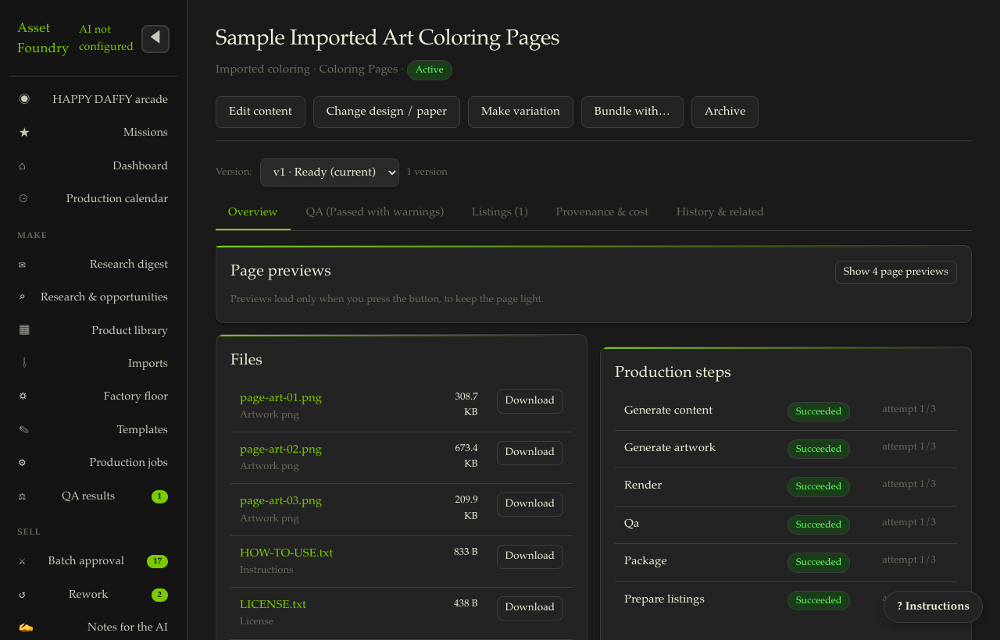

# Lesson 3: Import outside artwork

**Verification:** three pictures were imported, one duplicate dropped, and a product made, through the app's API in a throwaway copy (VERIFIED live). Dragging with the mouse was not tested.

## Learning objective
Bring pictures from other tools in, tag them, and turn them into a coloring product that goes through the same QA and approval.

## What we are creating
A three-page coloring product from three pictures. (Sample: the three pictures were pages of a sample mandala.)

## What we need
Three line-art pictures (PNG, JPEG, WebP, GIF or similar). Check each tool's terms before selling what it made.

## Steps
1. Open **Imports**.
2. **Made with:** pick the tool. **What are they?** `mandala` (names the files). **Sort into (tags):** type `mandala`, press Enter.
3. Drop the three pictures on the drop box. Read the result lines.
4. Drop the **same** picture again with a different tag, `extra`. It should say **duplicate**.
5. In **Image library**, tick the three pictures **in the order you want the pages**.
6. Type the **Product title** and press **Make coloring product from 3 selected**.

## Expected results (live)
- Three `...png` files (2000 x 2000) imported; label `sample-art`.
- The duplicate was **not copied again** and the `extra` tag was **added to the existing picture** (the groups row showed `mandala (3)` and `extra (1)`).
- The product: a **4-page PDF** (cover plus 3), a ZIP with the PNGs, QA **Passed with warnings**: `listing_spelling:etsy: possible misspellings artwork`.

## What to inspect
Each page is clean; the order is right; the warning. Open Batch approval: the item shows **1 warning to review** and Approve is locked until you tick **I accept these warnings** (or fix it, or add the word to Settings → QA → spelling allowlist).

## Common mistakes
Ticking in the wrong order; dropping a file with a key-like name (refused); expecting AI to tag pictures.

## Completion criteria
- [ ] Imported, tagged, ticked in order, product made.
- [ ] I saw the duplicate behaviour.
- [ ] I handled the warning on purpose.

## What I learned
Imports are deduplicated and tagged; art you bring in uses the same QA path; a spelling warning can come from the listing text, not the pictures.

---
**Previous:** [Lesson 2](02-create-a-planner.md) · **Next:** [Lesson 4: Illustrated coloring pages](04-illustrated-coloring-pages.md) · **Screen:** [Imports](../B-screens/07-imports.md)
