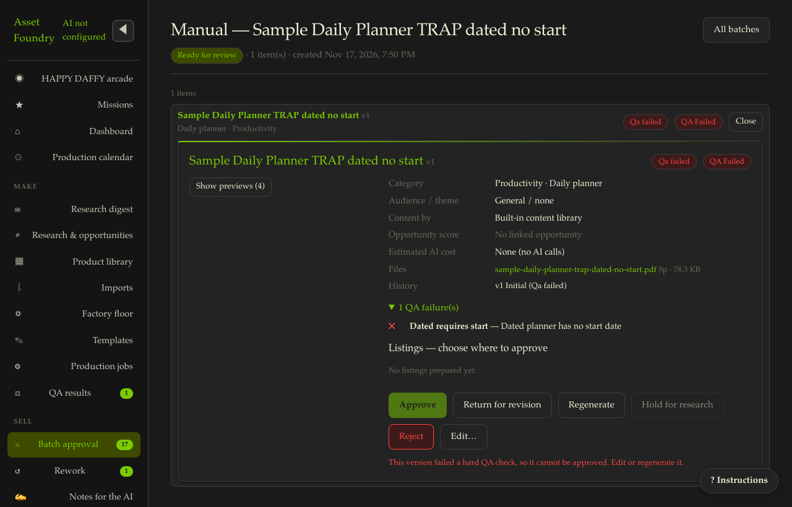

# Lesson 7: Run QA and correct a problem

**Verification:** every step and message below was reproduced in a throwaway copy (VERIFIED live).

## Learning objective
Read a hard QA failure, see how it blocks approval, and correct it.

## What we are creating
A dated daily planner that fails on purpose, then a corrected one. (Practice brief 7, *Gentle Focus Daily Planner*; see [practice briefs](00-the-twelve-practice-briefs.md).)

## What we need
The running app. No AI key.

## Steps
1. **Make the failure.** New product → **Productivity** → **Daily planner**. Tick **Dated**, Days 5. Title `Sample Daily Planner TRAP`. Create.
2. **See it.** The product page shows a red **QA failed** banner. The sidebar's QA results count goes up.
3. **Read it.** Open **QA results** (or the product's QA tab). The failed line reads:
   `dated_requires_start (hard): Dated planner has no start date`
4. **Try to approve it.** Batch approval → open the batch → Review. The Approve button is disabled. (Through the API the refusal text is: *"This version cannot be approved: QA status is "failed". Fix or regenerate it first."*)

5. **Notice the banner's advice** ("Fix it with Edit content or Change design") does **not** help. The missing value is a *setting*, not content or design, and the form cannot set a start date.
6. **Fix it.** On the product page press **Make variation**. Untick **Dated** (days 5) and press **Create variation**. Title it `Sample Daily Planner FIXED`.
7. **Clear the old one.** Open **Rework**, find the failed planner under **Failed by the machine**, optionally **Add note**, then **Mark fixed**.

## Expected results (live)
The variation finished **Ready** with **QA Passed**. The failed original stays as history with QA failed 1/3 on the QA results summary ("Dated requires start, Hard, 1 / 3").

## What to inspect
The corrected planner: five undated pages, hours 6 to 21, prompts not repeating more than expected.

## Common mistakes
Pressing **Regenerate** (a new seed does not fix a missing start date); editing content (it is not content); pressing **Mark fixed** before fixing.

## Completion criteria
- [ ] I reproduced the failure and read the exact message.
- [ ] I confirmed Approve is blocked.
- [ ] I fixed it with a variation and cleared the Rework row.

## What I learned
Hard QA failures block approval. A failure caused by a setting needs a corrected setting, not new artwork. **Recommendation (not built):** let the form set a start date.

---
**Previous:** [Lesson 6](06-word-search.md) · **Next:** [Lesson 8: Rework an existing product](08-rework-an-existing-product.md) · **Screens:** [QA results](../B-screens/11-qa-results.md), [Rework](../B-screens/13-rework.md)
