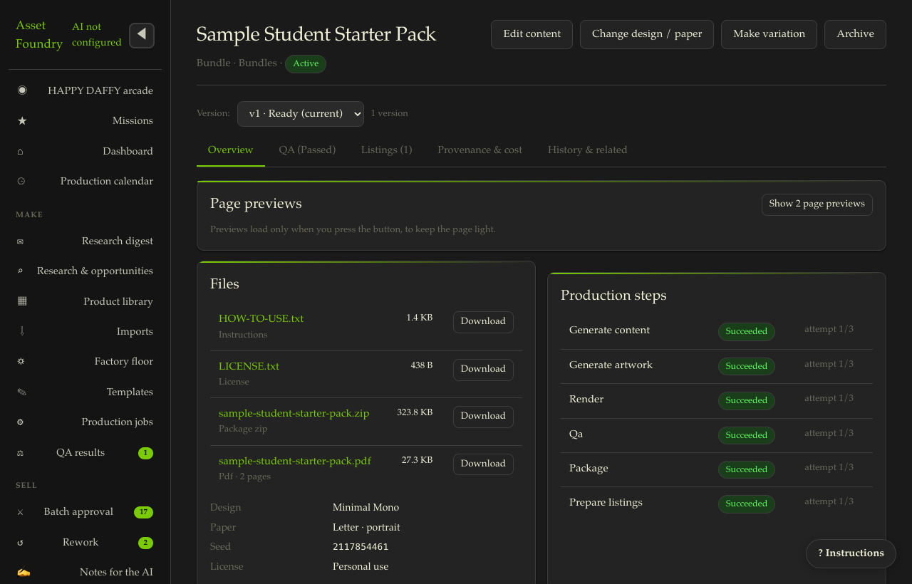

# Lesson 9: Build a product bundle

**Verification:** four products were approved and combined into a pack, which passed QA; the ZIP was read (VERIFIED live). The Factory floor's automatic cart packing was NOT run to completion (carts need 4 to 8 items).

## Learning objective
Build a pack by hand from approved products and understand the rules and files.

## What we are creating
A four-product "Student Starter Pack".

## What we need
**Two to twenty approved products** whose QA warnings are accepted. (In the sample: a weekly planner, a class timetable, a goal planner and a mandala pack.)

## Steps
1. Approve the products you want in Batch approval ([Lesson 11](11-review-and-approve-a-batch.md)).
2. Check the **Factory floor**: each approved product has joined a cart (live: four carts, each "1 / 8").
3. Product library → **Build a pack**. Search, tick the four products. **Preview** shows covers.
4. **Pack title:** `Sample Student Starter Pack`. Optional **Theme or angle** and **Description** (or **Suggest titles & description with AI** if you have a key).
5. Tick marketplaces. Press **Create pack (4)**.
6. Review the new pack in Batch approval like any product.

## Expected results (live)
- The pack is its own product ("Bundle" type), status Ready, QA Passed, price **$12.99**.
- Its ZIP holds a contents-guide PDF and each member in its own folder (weekly planner, timetable, goal planner, and the mandala pack with its six SVGs), plus license, instructions and manifest.
- The members stay for sale on their own.

## What to inspect
Open the "What's inside" guide: one blurb per member. Do the members belong together? Is $12.99 sensible next to the members' separate prices ($5.99 + $2.99 + $4.49 + $3.99)?

## Common mistakes
Fewer than two members; unapproved members; unrelated items; nesting packs (not allowed).

## Completion criteria
- [ ] Pack created, Ready, QA Passed.
- [ ] I read the contents guide and the member folders in the ZIP.
- [ ] I reviewed and decided on the pack.

## What I learned
A pack is a product made of approved products. The factory floor automates the same thing with carts.

---
**Previous:** [Lesson 8](08-rework-an-existing-product.md) · **Next:** [Lesson 10: Prepare a marketplace listing](10-prepare-a-marketplace-listing.md) · **Reference:** [Bundle](../C-product-reference/06-bundle.md), [Factory floor](../B-screens/08-factory-floor.md)
